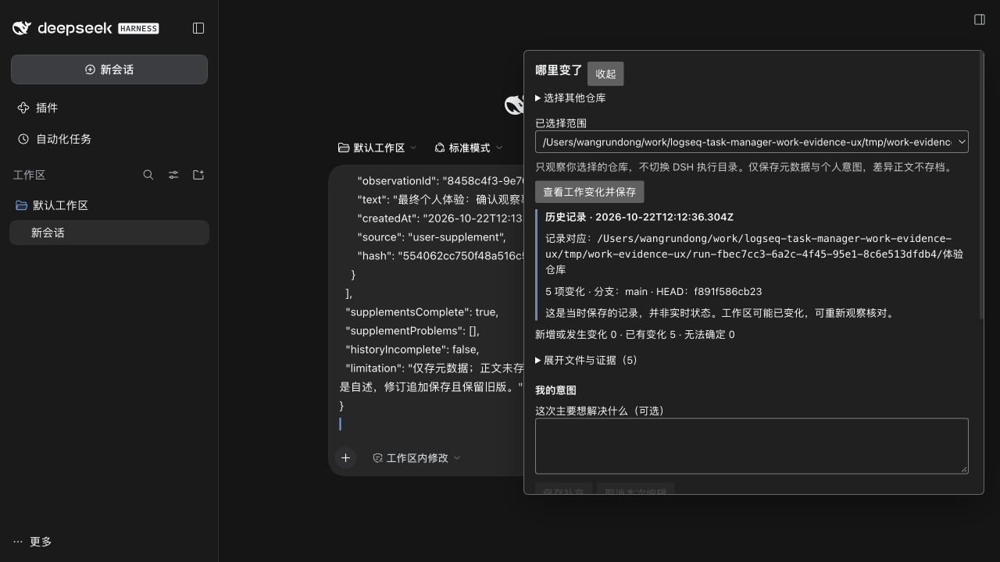
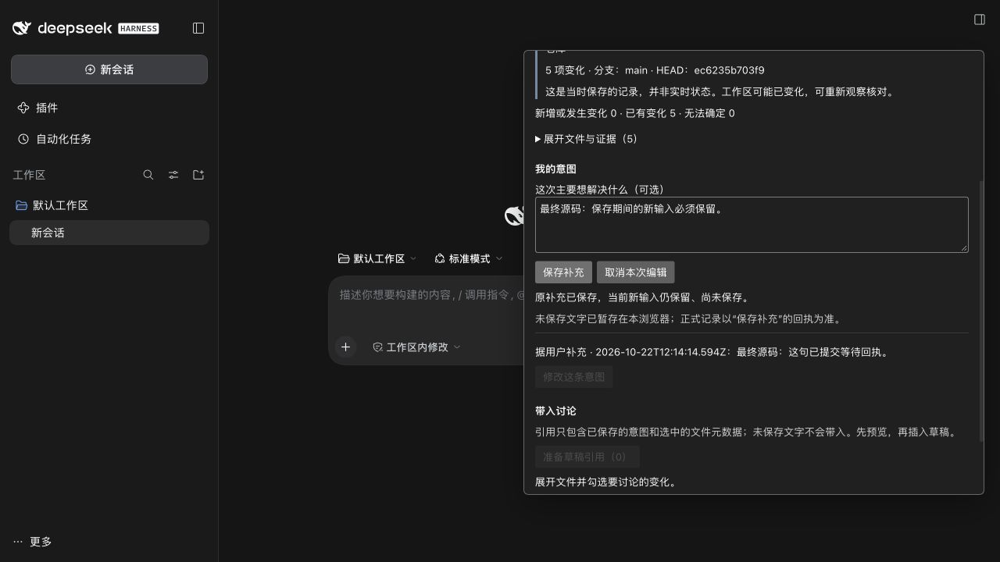

# Work Evidence v1.1 个人体验指南与验收

交付日期：2026-10-22（Asia/Shanghai）。唯一执行 Agent，全程没有子代理或外部模型委派。

## 现在可以打开什么

本机正常体验入口为 **http://127.0.0.1:56967/**，已在本聊天保留 DSH 标签页。专属运行 ID：`run-fbec7cc3-6a2c-4f45-95e1-8c6e513dfdb4`。如在另一个浏览器没有认证，请用下面的停止、启动流程，打开启动器新打印的带认证 URL；不要公开认证 URL。

体验仓库：

```text
/Users/wangrundong/work/logseq-task-manager-work-evidence-ux/tmp/work-evidence-ux/run-fbec7cc3-6a2c-4f45-95e1-8c6e513dfdb4/体验 仓库
```

这个现场已经有本次验收观察、意图和未发送引用，可直接重读历史、继续补充，或再次观察。需要从零体验时，按下一节创建新运行；旧数据不会被覆盖。本机地址会随重启改变，以终端输出或 `status` 为准。故障验收运行已停止，正常入口未启用故障门。

## 基线与范围

远端 URL 已通过 Git 协议核对为 `https://github.com/wrd233/logseq-task-manager.git`。直接 `ls-remote` 后 fetch，v1 HEAD 为 `acae168666495e269b1c533f0e232783a2fc8777`，父提交 `f4df6f576bafbef7353f555c71ed032288418845`；相对远端 main `2cb0ced7688b7af19ac5814b1f556ecae255f3c9`，落后 0、领先 2。体验分支首次检查不存在，以该 v1 创建 `codex/work-evidence-ux-v1`，Worktree 为 `/Users/wangrundong/work/logseq-task-manager-work-evidence-ux`。

[远端核查原始输出、各分支父提交、领先/落后与提交/文件差异](work-evidence/ux-v1.1/remote-baseline.json) 包括 main、v1、Capture、结构历史、one-click 和体验分支的存在性；没有合并这些其他分支。主工作区的未提交 Capture 文件保持原样。

本版本按需观察明确选择的 Git 根目录，保存不可变元数据和独立意图，主动查看允许范围内的当前 diff，然后预览并插入原生草稿。它不保存全部历史正文，不改 Git 历史，不发消息，不写 Task、Journal、Graph 或 Formal Kernel Evidence，也不改变 DSH 执行目录或工具权限。

## 重建一个干净的体验环境

以下均在本 Goal Worktree 根目录执行。已实测 Node 20.20.2 安装/检查、Node 24.19.0 运行 DSH 0.2.1-rc.2。依赖复用仓库锁文件，DSH 来自本机已安装的命令。首次克隆可运行：

```sh
cd /Users/wangrundong/work/logseq-task-manager-work-evidence-ux
PATH=/opt/homebrew/opt/node@20/bin:$PATH npm ci --no-audit --no-fund
export PATH=/opt/homebrew/opt/node@24/bin:$PATH
node apps/dsh-plugin/scripts/work-evidence-playground.mjs new
```

`new` 输出 `runId`、完整仓库路径和启动命令。将输出的 ID 填入下面的 `RUN_ID`，然后启动（变量名为本任务专用）：

```sh
RUN_ID=run-fbec7cc3-6a2c-4f45-95e1-8c6e513dfdb4
node apps/dsh-plugin/scripts/work-evidence-playground.mjs start "$RUN_ID"
```

上面的 ID 是本机已备现场；创建新运行后请换成新输出的 ID。已运行时启动器会明确拒绝重复启动。启动后打开终端打印的 URL；首次关闭 DSH 的预览说明和 API Key/登录提示即可，不需要密钥。

每个运行都拥有独立的仓库、state、DSH_HOME、profile、documents、bundle、CLI 和日志，位于本 Worktree 的 `tmp/work-evidence-ux/run-UUID/`；端口由系统分配。不会安装到日常 profile。profile 名虽均为 `work-evidence`，其 DSH_HOME 完全独立。

## 从观察到讨论，逐步操作

| 操作 | 预期结果 |
| --- | --- |
| 打开“工作变化” | 首次显示选择工作目录；不会扫描真实项目 |
| 输入 `new` 输出的 `repo` 路径，点“选择目录” | 列表明确显示该仓库；选择其他仓库不会切换 DSH 执行目录 |
| 点“查看工作变化并保存” | 显示等待状态，随后显示“刚保存的观察”、时间、完整来源路径、分支、HEAD 与 5 项变化；失败也有独立失败记录 |
| 展开文件与证据 | 看见同一文件已暂存/未暂存修改、新增、删除、含空格中文重命名和敏感 `.env` 的元数据 |
| 点 work.txt 的暂存/未暂存差异 | 分别看见 initial→staged、staged→unstaged；标题显示文件和差异侧。未跟踪/敏感文件不提供正文按钮 |
| 输入意图，点“保存补充” | 机器观察保持不变，意图独立保存并显示来源时间。保存中可以继续输入，新文字不会被旧回执清掉 |
| 点“修改这条意图”，改文后保存 | 追加修订，原文显示为“意图旧版”，没有覆写旧记录。未保存输入存在时禁止用别的意图覆盖它 |
| 在原生编辑器先写自己的草稿，再勾选 work.txt，点“准备草稿引用” | 可展开查看待插入内容，包含 scope/观察引用、哈希、HEAD、文件元数据、当前意图及修订来源；未保存文字不进入引用 |
| 关闭引用预览 | 原生草稿保持原样，没有发送 |
| 再准备并“确认插入原生草稿” | 保留原稿并插入引用，成功按钮禁用以防本次重复插入。明确“再次准备引用”才允许再次插入；插入失败保留预览供重试 |
| 收起、重新打开，或重载页面 | 已保存记录仍在，重载后标为“历史记录”，意图和原生草稿可恢复；先关闭可能再次弹出的宿主密钥提示，不会自动再次插入 |
| 展开“历史观察”并选择时间 | 读取对应不可变记录。它永远不是自动更新的实时工作区；需要当前状态时重新观察 |

当前引用正文仍以可核验 JSON 为主，较长；面板把文件、预览和诊断按需折叠。模型讨论与发送由用户决定，本轮没有发送任何消息。

## 无变化、重复观察和来源变化

`new` 默认创建有初始提交且带变化的合成仓库，还附带一个干净的“另一 仓库”和一个没有 HEAD 的“空 仓库”。选择后者应显示“尚无提交”，不会假造 HEAD。

要从完全干净的体验仓库开始：

```sh
node apps/dsh-plugin/scripts/work-evidence-playground.mjs new --clean
```

在这个新运行中先观察，应显示“未观察到变化”；可准备零文件的观察引用。重复观察不覆盖旧记录。再使用该运行 ID：

```sh
node apps/dsh-plugin/scripts/work-evidence-playground.mjs change "$RUN_ID"
```

`change` 只接受仍干净的自有合成仓库，创建 staged/unstaged、新增、删除和重命名场景；已有修改时拒绝继续覆盖，请 `new` 新建。也可以用编辑器修改自己的合成 work.txt。对旧观察查看 diff 时应提示“来源已变化”，撤下旧正文；重新观察创建新记录。相同元数据变化可标为已有变化，不能据此宣布完成。

## 保存竞争、失败与损坏恢复

正常入口没有故障注入。要重现可控回执故障，先停止这个运行，再以 `--faults` 启动，建议另 `new` 专用运行：

```sh
node apps/dsh-plugin/scripts/work-evidence-playground.mjs stop "$RUN_ID"
node apps/dsh-plugin/scripts/work-evidence-playground.mjs start "$RUN_ID" --faults
```

在另一终端（同一 Worktree，Node 24）执行：

```sh
node apps/dsh-plugin/scripts/work-evidence-playground.mjs lose-receipt "$RUN_ID"
```

在 DSH 输入一句 A 并保存，等待期间改成 B，然后在 **45 秒内**执行：

```sh
node apps/dsh-plugin/scripts/work-evidence-playground.mjs release "$RUN_ID"
```

门会调用真实生产保存与 fsync，然后仅一次用 HTTP 503 替代成功回执。预期界面显示“结果未确认”，B 仍在；“重查并重试原补充”返回 A 的原 ID、原时间、原哈希，磁盘只有一份。B 随后可以独立保存。仅延迟而不丢回执时使用 `pause`→保存/继续输入→`release`；门以请求进入时的控制配置为准。`normal` 清除控制，正式恢复正常模式应停止并不带 `--faults` 重启。

损坏演练只针对运行标记下、与“体验 仓库”匹配的一条观察：

```sh
node apps/dsh-plugin/scripts/work-evidence-playground.mjs corrupt "$RUN_ID"
# DSH 点“重读历史列表”，再观察；也选择另一仓库观察
node apps/dsh-plugin/scripts/work-evidence-playground.mjs repair "$RUN_ID"
```

预期：显示部分可用和坏记录文件诊断，有效记录可读、新观察可保存；历史缺失时比较为无法确定，其他仓库不受影响。`repair` 仅在文件仍为注入的坏文本时恢复原始备份，若被另行改动会拒绝覆盖。观察之前、备份已存在或范围不匹配时会拒绝注入。

未保存意图和待确认请求会在当前浏览器来源（含端口）内暂存，重新初始化可恢复原请求 ID；失败时输入仍在，并可展开查看已提交的快照。浏览器备份受阻时明确提示复制或保留本页。清除浏览器数据、换浏览器/端口或并行多标签编辑不属于可靠暂存保证；重要内容请正式保存。取消编辑只丢弃明确取消的本地文字，结果未知的请求必须先核对，不能假装取消后端写入。

路径安全回归使用真实磁盘：空格/中文根目录、外部/内部/悬空链接、记录链接、构建输出链接和 DSH profile 链接。拒绝时检查外部目标仍为空。不要用自己的真实目录试故障。相关自动化命令见下一节。

## 停止、重置与安全清理

前台启动可按 Ctrl-C，或在另一个终端执行：

```sh
node apps/dsh-plugin/scripts/work-evidence-playground.mjs status "$RUN_ID"
node apps/dsh-plugin/scripts/work-evidence-playground.mjs stop "$RUN_ID"
```

`stop` 读取本次 PID，并核对实际进程命令包含本 Worktree 的启动器和这个运行完整路径；只停止匹配的自有进程。已停止时会明确拒绝，不会猜测其他 Goal 的进程。要重置，首选 `new` 创建另一个运行，保留原记录。需要删除一个已停止的运行时，必须确认精确 ID：

```sh
node apps/dsh-plugin/scripts/work-evidence-playground.mjs remove "$RUN_ID" "--confirm=$RUN_ID"
```

清理器仅接受固定 `tmp/work-evidence-ux/run-UUID` 下、归属标记匹配本 Worktree 的规范路径；运行中、确认不符或符号链接路径会拒绝，不接受任意目录参数。删除仅供自有合成环境使用。`state` 为正式本机观察/补充，浏览器临时草稿随浏览器来源清理；不要把仍需保留的记录当作可清理测试数据。

## 本轮自动化结果

| 检查 | 结果 | 说明 |
| --- | --- | --- |
| v1 基线 CLI + 证据模块 | 27/27 + 9/9 | 修改前在新 Worktree 重跑；三项可靠性修复有当前执行证据 |
| 最终 CLI 全量 | 28/28 | 真实 Git/磁盘、损坏隔离、路径边界、追加修订与幂等 |
| 最终证据模块 | 15/15 | 适配、生产 JSX 回调、输入竞争、组件重建/插件重启、引用取消/失败/重复、环境脚本安全 |
| DSH 既有 + Capture/阶段/历史定向 | 52/52 | DSH 原有 23，另加现有阶段、工作台和 SQLite 历史迁移回归；没有从未合并分支取实现 |
| CLI TypeScript、ESLint | 通过 | 当前受影响源码与专属测试 |
| DSH workspace 构建、独立 server/client/CLI 构建 | 通过 | Node 24；正常包版本 0.1.1，不含故障门 |

最终合计 95 项行为/回归测试通过。生产 JSX 测试使用显式 hook 替身，不冒充真实 React/浏览器；旧 v1 归档回放测试只是兼容回归。本轮真实宿主结果单独列在下方。[本次测试原始日志](work-evidence/ux-v1.1/) 为 `cli-final.tap`、`module-final.tap`、`regression.tap`。

复现：

```sh
PATH=/opt/homebrew/opt/node@20/bin:$PATH npm test -w @task-copilot/cli
PATH=/opt/homebrew/opt/node@20/bin:$PATH node --import tsx --test apps/dsh-plugin/tests/work-evidence/*.test.mjs
PATH=/opt/homebrew/opt/node@20/bin:$PATH node --import tsx --test apps/dsh-plugin/tests/*.test.mjs apps/logseq-plugin/tests/stage-review.test.ts apps/logseq-plugin/tests/stage-workbench.test.ts packages/sqlite/tests/history-migration.test.ts
PATH=/opt/homebrew/opt/node@20/bin:$PATH npm run typecheck -w @task-copilot/cli
PATH=/opt/homebrew/opt/node@20/bin:$PATH npm exec -- eslint apps/task-copilot-cli/src/work-evidence apps/task-copilot-cli/tests/work-evidence*.test.ts apps/dsh-plugin/src/work-evidence apps/dsh-plugin/scripts/work-evidence-*.mjs apps/dsh-plugin/tests/work-evidence
PATH=/opt/homebrew/opt/node@24/bin:$PATH npm run build -w @task-copilot/dsh-logseq-workbench
PATH=/opt/homebrew/opt/node@24/bin:$PATH WORK_EVIDENCE_RUN_DIRECTORY="$PWD/tmp/work-evidence-ux-build-check" node apps/dsh-plugin/scripts/work-evidence-build.mjs
```

## 本轮真实宿主结果与证据

全部使用本轮创建的合成 Git、实际 DSH Connection、生产组件、真实存储和原生草稿。没有 API Key、模型调用或消息发送。

| 项目 | 实际结果 |
| --- | --- |
| 创建仓库→观察→两侧 diff→保存→意图→原生引用→重载→记录恢复 | 通过；最终正常宿主 `56967` 复测，最新截图与 UI 文字在 delivery 系列文件 |
| 意图修订、旧文保留 | 通过；本轮最初正常宿主 `51728`，磁盘记录同时保留原文与 supersedesId 修订 |
| 引用预览取消、确认、原稿保留、重复按钮禁用 | 通过；本轮正常宿主真实操作，未调用发送 |
| 未保存输入收起再开、新页面暂存恢复 | 通过；同浏览器同来源的新页面实际读回暂存 |
| 重载时入口状态恢复 | 通过；增加插件内状态、展开偏好和恢复读取，最终宿主重载自动打开。首次点击曾受宿主密钥提示层干扰，最终已关闭；组件重建/插件重新初始化的保护由专门回归验证 |
| 无变化、无 HEAD、另一个仓库隔离引用 | 通过；本轮正常宿主，零文件引用可预览且没有混入 A 的意图 |
| 单记录损坏后继续观察、另目录继续使用、原字节修复 | 通过；本轮自有损坏注入和恢复，不用真实用户项目 |
| 来源变化拒绝旧 diff | 通过；旧正文撤下，界面说明旧记录保持原样 |
| 延迟保存+继续输入+丢成功回执+幂等重试+保存新输入 | 通过；最终源码在专用 `56968` 再执行，生产保存后由测试门替换一次 HTTP 503 |
| 会话绑定与发送边界 | 最终两份真实 DSH 持久 session header 的 cwd 均为各自专属 documents，事件均为空；扩展只注入 Connection，不具备绑定/工具/发送入口 |

[最新真实磁盘记录、精确重试回执及源码哈希](work-evidence/ux-v1.1/host-records.json)、[实际持久会话](work-evidence/ux-v1.1/sessions.json)、[本轮远端基线](work-evidence/ux-v1.1/remote-baseline.json) 与 UI 文字/截图均保留。本轮最终丢回执请求为 `43becdc5-d442-4c2a-9f47-a881438fb0e7`，重试前后记录完全一致且仅一份，新输入独立保存。故障门只注入传输，不伪造 Git 或保存；正常入口另行运行，故障实例已关闭。





## 已知限制与下一步

未发现阻止本次个人体验的 P1 数据丢失或 P2 路径/隔离问题。此结论限于本轮覆盖范围；未执行物理断电、磁盘耗尽、跨系统/网络文件系统、长期压力或恶意进程持续替换祖先路径的验收。路径前置检查、逐级创建、O_NOFOLLOW 和 fsync 降低风险，不是文件系统事务或管理员篡改防护。

历史只保存元数据和意图，不能恢复任意旧正文。敏感识别有限，不保证识别任意秘密。旧扁平坏记录归属不可信时仍显示保守警告；不会自动修复或删除它。浏览器暂存是辅助恢复，不替代正式保存；引用插入失败由当前用户确认位置后重试，模型真正收到引用后的推理与执行未验收。

可以进入个人试用并收集反馈。跨模块体验验收可以作为下一阶段单独任务：先在串行整合现场安装独立 bundle、提供专属存储目录，再验证共同入口；不需在本 Goal 修改公共 RPC 或合并 Capture/结构历史。日常化之前，重点判断找变化是否足够快、意图修订是否清楚、长引用是否便于讨论，以及缺失正文的边界是否可接受。
