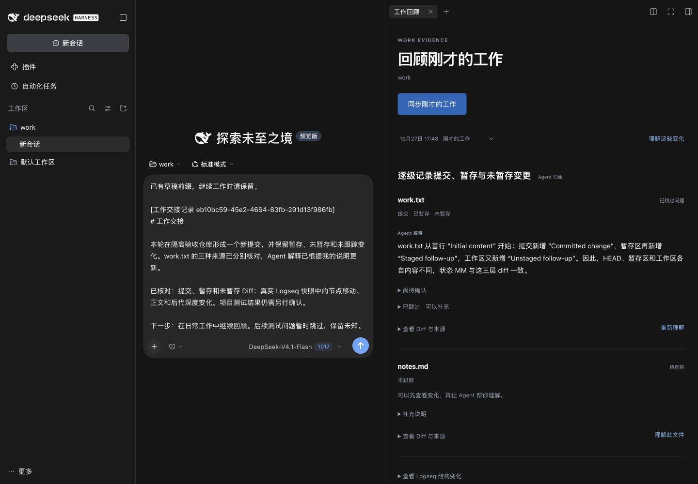
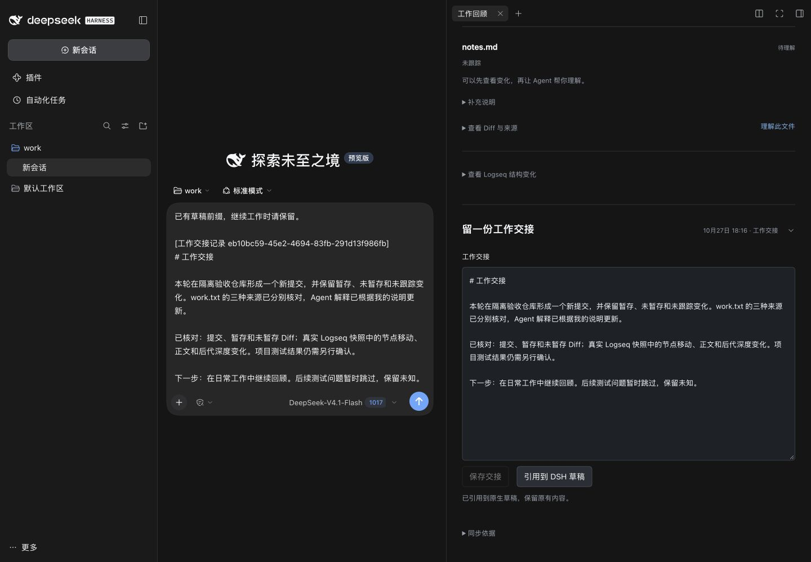
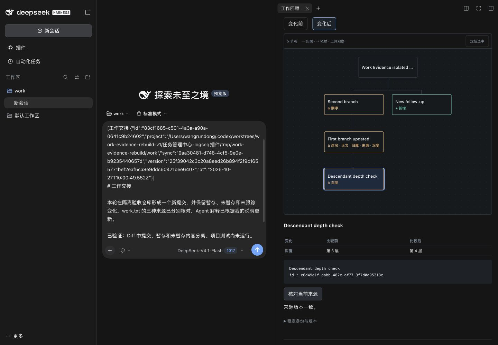

# Work Evidence 核心重建与本轮验收

日期：2026-10-27（Asia/Shanghai）。独立分支 `codex/work-evidence-rebuild-v1`，从实际刷新后的 `origin/main` `f35fa5efeb403e30a86b2c71b110ccef65b82047` 建立，未合入 main。全程单 Agent，没有 DSH Worker 或开发子代理。原 main 工作区的 Capture 修改、旧 Work Evidence 分支与其他 worktree 均未作为开发起点或被覆盖。

## 使用路径

安装当前分支的 DSH 插件后，从会话头部「回顾工作」或原生右侧栏的「工作回顾」进入。

1. 首次点击「建立同步起点」。已有提交和未提交内容作为基线，页面不把它们列为刚完成的新工作。
2. 自然工作后点击「同步刚才的工作」。每个文件只有一条，提交、暂存、未暂存及未跟踪来源合在条目内；Diff 保留同步时的内容，按需打开。
3. 点击「理解这些变化」或「理解此文件」。使用当前 DSH 模型逐条解释，再按目的归组。观察事实、Agent 解释、用户说明分别保留。只在条目旁提出关键问题；可以回答、编辑问题或跳过，已有说明不会因跳过而丢失。
4. 随时「形成交接初稿」，包括分析未完成时。初稿由实际观察、已有解释和用户说明整理，不冒充新模型调用；直接编辑、保存即可。历史选择器可以重开原版、保存修订版和继续编辑。
5. 「引用到 DSH 草稿」通过原生 `captureInsertion/insertText` 插入带不可变记录 ID 的正文引用，保留已有草稿。发送仍由用户操作。

默认以文件和解释为主。没有统计仪表盘；Diff、来源、未知事项和结构图均按需展开。浅色/深色沿用宿主主题，窄栏与桌面侧栏分别核验。

## 代码与复用

- 权威依据：`docs/integration/README.md` 及需求地图、2026-10-01 工作区协作需求和架构分析，并核查当前 main 的 DSH、工作区、材料、Stage 与结构历史实现。架构分析中的提案不当作已实现事实。
- 检查旧 `codex/work-evidence-v1` / `codex/work-evidence-ux-v1` 的代码及交付记录。保留其正确边界作为参考：宿主 LLM 流、精确来源验证、原生草稿插入。没有 cherry-pick 旧 UX、旧 EvidenceStore、主题合成树或体验 harness。
- `apps/dsh-plugin/src/work-evidence/` 重新实现 Git 采集、工作回顾服务、宿主模型适配和客户端。没有新增 CLI、数据库、通用作业框架、Task/Journal 写入或原生对话提交入口。
- 从 main 的结构历史实现最小抽取 `structure-view/model.mjs`、`layout.mjs`、`view.jsx`、共享样式与 `source.mjs`；原历史模块继续使用同一实现。保留 sourceId/UUID、父级、局部顺序、正文处理、树布局、节点选择、字段对照和确定性 compare，包括祖先移动引起的后代深度差异。原文字面标记解析单独抽到 `annotations.ts`，不加载历史业务服务。
- 原 `HistoryStore` 抽为 `ProjectRecords`，原入口保留兼容导出。Work Evidence 与原历史服务使用同一个实例和追加队列，在既有私有 `history/` 内使用独立记录种类，沿用内容哈希、不可变记录、请求幂等及原子 JSON 写入。用户说明和交接显式属于 user，解释/归组属于 agent，Git/来源采集属于 observed。
- 浏览器仅暂存用户未保存的输入；服务端记录是已保存内容的权威。修订检查基础版本，旧编辑器不能覆盖新版本；保存回执重试不会另造一份同内容交接。保存过程中新增的输入迁移到新修订的编辑草稿。

## Git 与真实结构的语义

同步范围为上次成功同步后的提交和当前未提交变化。逐提交保存证据，因此中间改动后再改回仍可追溯；沿重命名链合并路径，staged/unstaged/untracked 分开保存。同步前已存在且未改变的当前改动明确标识。子目录读取不越过工作目录；内部 `.task-workspace` / `.longdoc` 不作为工作文件，敏感路径、疑似密钥、二进制和过大正文只保留状态或明确标为不可读，不发送其正文。

采集前后核对 HEAD、索引与当前变化，失败或超限不推进成功基线。Git 历史分叉或被改写时拒绝猜测范围；用户可明确保留旧记录并重建起点。保存的 Diff 是当时版本，后来编辑文件不会改写历史 Diff。

结构采集只调用已有块范围 `content.read`，经过 `validateSnapshot` 检查身份、拓扑、正文哈希、structureVersion 和 sourceSetVersion。每次同步关联当时的真实快照；首份只作起点。Graph、范围或工作身份不一致，或任一快照未通过校验，不进行结构比较。没有可信快照时，文件与交接继续可用并说明原因。没有扩展页面快照、Stage 枚举或用 Agent 文件归组充当来源历史。

来源核对复用当前工作授权范围的 `source.read`，不通过刷新镜像或扩展授权取得更多原文。删除、移出范围或变化的来源不改变保存的历史正文。

## 本轮证据

工具链：仓库 Node 20.20.2；实际 DSH 0.2.1-rc.2 使用 Node 24.19.0；Logseq 0.10.15。依赖在新 worktree 独立安装。首次完整检查发现本机 SQLite 绑定缺失，重建该依赖后重跑通过；隔离脚本的旧主题偏好不兼容本机 Logseq，在本轮私有测试配置内修正。

| 检查 | 实际范围与结果 |
| --- | --- |
| `npm run check` | 全仓类型、lint、回归、构建及二进制、需求地图、边界、Taste 均通过。841 个 workspace 回归；另 5 个 sandbox 与 12 个边界测试，共 858 个通过项，0 failed/skip。 |
| 新增测试 | 仅 5 项组合行为测试，覆盖真实临时 Git、增量/重命名/删除/子目录、历史改写、持久化、局部分析/问题编辑/跳过、旧版保护、缺模型、真实形状快照和伪引用拒绝；模型替身部分明确为单元验证。 |
| 现有真实宿主检查 | `node --import tsx apps/dsh-plugin/tests/host-proof.mjs` 通过；真实 Cordis/Tools/SystemPrompt/companion，原有合成 SDK/模型范围未冒充真实 Graph 或模型。 |
| 真实 DSH + Git | 在本轮独立 DSH_HOME/profile、目录、绑定和存储中，经实际 UI 建立基线，再同步 1 个新提交及 staged/unstaged/untracked；真实 Diff 分别打开。同文件合成一个条目。 |
| 真实模型 | 宿主 `deepseek-official/deepseek-flash` 实际产生 2 份文件解释和 2 份目的归组。回答后只重新分析 work.txt，notes.md 未被重新分析。最初遇到模型多包一层 file 的真实输出，修正协议提示与受限解析后通过。没有使用预设解释、替换 LLM 或提交原生聊天消息。 |
| 问题与交接 | 实际 UI 回答、编辑后续问题并跳过；保留原说明。分析中即可生成初稿；保存后重开、另存修订、旧版正文不变。重载后旧版、修订版和已有原生草稿均恢复。 |
| 真实 Logseq | 本轮新建应用副本/home/profile/Graph/companion。原生界面建立工作目录关联和只读连接。两次 content.read 得到 4/5 个真实块；通过文件 Graph 的自然变更与 watcher 更新测试移动、顺序、正文、新增和后代深度。实际 UI 显示后代第 3→4 层，source.read 版本一致；读取前后 Graph 文件哈希相等。没有伪造 snapshot provider。 |

简要数据：[宿主与检查](assets/work-evidence-rebuild-v1/verification.json)、[结构版本与实际变化](assets/work-evidence-rebuild-v1/structure-verification.json)、[重开与草稿恢复](assets/work-evidence-rebuild-v1/ui-verification.json)。测试凭据、完整 profile、原始模型流与会话日志均未提交。

## 仍有的边界

这是隔离 Git/Graph 中的真实宿主与模型验收，没有用日常用户 Graph 做写入试用，也没有证明长期稳定、物理 IME、跨设备恢复或模型判断必然准确。真实 Graph 的层级调整由本轮隔离 Markdown 文件变更和 Logseq watcher 载入，不是物理拖放手势验收。真实模型解释发生在接入 Logseq 快照之前，未宣称本轮已验收模型对真实 Graph 上下文的理解质量。

结构仅覆盖明确授权的块范围，相邻成功同步都持有可信快照才可比较。受限/二进制/过大文件不提供文本解释所需的完整正文；限额在同步记录中保留。浏览器草稿按本机浏览器保存，不能替代跨设备备份。既有存储仍按单个 DSH 宿主写入设计，没有新增跨进程写锁。

模型不可用时可以浏览 Diff、历史、生成事实型交接并编辑保存；解释/归组失败显示实际失败状态。插件不执行项目测试，交接中的验证结果必须来自实际运行证据或明确标为用户自述。敏感内容过滤是启发式检查，不能替代完整秘密扫描；只应分析允许提供给当前 DSH 模型的工作内容。
