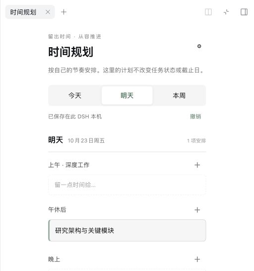

# Goal 4：个人语义时间规划

## 基线与范围

- 基线：`origin/main` = `2cb0ced7688b7af19ac5814b1f556ecae255f3c9`（2026-10-22 fetch 后核对）。创建前目标分支本地、远端均不存在。
- 独立 worktree：`/Users/mac/Downloads/work/logseq-task-manager-semantic-planner`；分支 `codex/semantic-planner-v1`。
- 未修改用户 Graph、其他 worktree、Profile、服务或 main；无子代理。

## 使用与设计

DSH 会话标题栏「◷ 规划」，或右侧栏「个人时间规划」打开。自由活动无需关联 Logseq、无需配置模型。今天/明天展示语义时段，本周从周一到周日，空白日期只显示一个轻量入口。宽侧栏时周视图自动分两列。

点时段空白处或加号输入活动，只需填写内容。点卡片修改内容、日期、时段或删除，也可直接拖动到其他时段。快捷日期支持今天/明天，日期输入支持其他日期。周视图拖动时展开全部投放时段。引用入口按需展示，可搜索当前会话已关联工作范围内的 Project、MiniProject、Task。引用保留 Graph/块身份、正式对象 ID（存在时）、类型与标题快照，可跳回 Logseq；自然工作标记明确标注，不冒充正式身份。

齿轮中修改时段名称、增加、上移或删除。删除时段会把其中安排移到首个时段，界面提前说明，可撤销。最近 20 次新增、修改、移动、删除和模板操作均可撤销，撤销记录也持久保存。编辑过程中禁用会替换当前输入的操作，保存失败保留输入。

计划仅表示“打算投入”，无任务完成按钮、Deadline、实际工时或任务所有权写入。引用列表复用当前 Graph 的身份索引与授权来源快照，不通过标题推断正式身份，不新增正式对象。

## 实现文件与保存

- `apps/dsh-plugin/src/planner.jsx`、`planner-styles.mjs`：宿主侧栏里的 React 交互与局部样式，保留原生会话输入。
- `planner-model.mjs`：本地日期、跨日和周范围计算，不用 UTC 截断个人日历日期。
- `planner-store.mjs`：单一 JSON 模型，复用 `atomicJson` 临时文件替换；串行写入，成功后才更新内存和 UI；revision 防止同一宿主多个窗口静默覆盖。
- `client.jsx`、`index.mjs`：现有 slot、标签页与认证 Connection RPC 集成，未增加模型工具。
- `packages/contracts/src/workspace-agent.ts`、Logseq `agent-workspace/router.ts`：新增只读 `planner.references`，限定当前已授权工作来源，不修改公共任务模型。
- `tests/planner.test.mjs`、`tests/host-proof.mjs`：持久化、撤销、日期和生产插件 RPC 验证。

默认文件为 `~/.dsh/logseq-workbench/semantic-planner.json`，与现有绑定目录一致。可设置 `plannerStateDirectory`，不设置时跟随 `bindingStateDirectory`。每个配置目录一份个人规划，跨会话共享。多个独立 DSH 宿主应配置不同目录，不支持多个进程同时写同一个文件。不要把目录指向 Graph。损坏文件读取报错，不自动用空数据覆盖。

## 验收（2026-10-22）

- DSH 插件测试：26/26，包含新增日期、CRUD、模板删除迁移、持久撤销、revision 冲突及写入失败保持旧状态。
- `npm run typecheck`：全工作区通过。
- `npm run build`：全仓构建及产物检查通过。
- `npm run lint`：全仓通过。
- `npm run check:boundaries`：12/12 与依赖边界检查通过。
- `npm run test:host --workspace @task-copilot/dsh-logseq-workbench`：生产 Cordis 插件、认证 RPC、真实 HTTP companion 通过。合成 Graph 三个来源分别登记 Project/MiniProject/Task 身份；引用后跨会话读回、磁盘重载一致，Graph 写入计数不变。
- Logseq 完整回归：使用项目要求的 Node 20.20.2，`node --import tsx --test --test-concurrency=1 apps/logseq-plugin/tests/*.test.ts apps/logseq-plugin/tests/integration/*.test.mjs`，556/556 通过。
- 共享 contracts 测试：10/10 通过。
- 环境说明：首次系统 Node 22 并发运行 547/556，包含一个 CLI 入口超时和 8 个 SQLite ABI 不匹配失败；串行复核入口通过，8 个失败均为现有 SQLite 模块由 Node 20 编译。换项目要求的 Node 20 后完整 556 项通过，无需改代码或重编译其他工作区依赖。DSH 宿主与其 host-proof 仍使用所需的 Node 22。
- 最终 `git diff --check` 通过；测试宿主和临时浏览器标签已关闭，仅保留隔离验收数据。

### 真实 DSH 界面

已安装 DSH `0.2.1-rc.2`；独立 `DSH_HOME=/private/tmp/semantic-planner-dsh-20261022`，专用 planner/bindings/workspace 目录，系统分配端口。仅操作合成规划数据，无账号或模型调用。

在实际 DSH 浏览器界面完成：侧栏入口、新建活动、编辑标题、改时段、快捷移动至明天、删除并撤销、拖动换时段、自定义时段名称、今天/明天/本周切换。刷新恢复活动和模板；停止并重新启动本次专用宿主后，活动、模板和撤销能力均恢复。验收发现并修复周日标题截断，精简周视图空时段，补上快捷日期与保存期间输入保护。

DSH UI 与 Logseq 验收分开：正式引用链路使用生产 Logseq 插件加合成 SDK/Graph 测试，并非真实 Logseq 桌面端到端验收。未在用户 Graph 测试，未修改正式任务状态。

## 限制

- 事项选择限定当前已关联工作的授权来源，不做全 Graph 浏览；切换工作会话可选择其他工作，已有引用保留。
- 正式身份来自已有 Graph 身份索引；索引未加载时，不将普通块猜测为正式任务。标题是保存时快照，来源改名或删除后不会自动改写安排。
- 单机、单宿主写入；不含日历、AI 排程、工时、同步、精确分钟或重复计划。
- 未保存输入在主动取消、关闭标签或刷新后不恢复；已保存数据及撤销历史保留。
