# Personal Semantic Time Planning — Visual Refinement v1

> 在已经可用的 Planner 上做一次体验精简：去掉卡片和冗余字段，把日常浏览压回“今天想做什么”，把截止、引用、日期/时段等次要信息收进按需展开。
>
> 分支：`codex/semantic-planner-ux-refinement-v1`\
> 基线：`origin/codex/semantic-planner-ux-v1` @ `39225770`\
> `origin/main` 已前进到 Goal 3（`4acc2699`），但 Planner v1 尚未合并 main，因此本轮从 Planner v1 创建独立 worktree，不从缺少 Planner 的 main 重做。\
> 本轮只修改 `planner.jsx` 与 `planner-styles.mjs`，不改 PlannerStore、宿主 RPC、共享 contracts / router。

---

## 一、发现的主要问题

改造前（v1）截图见 `before-today.png`、`before-week.png`、`before-editor.png`、`before-slots.png`。

1. **头部层级太厚**：eyebrow「个人时间规划」、大标题、日期、全宽分段控件、独立统计行、常驻状态行、页脚说明叠在一起。首条安排之前要经过 5–6 行，信息密度低。
2. **每项安排都是一张完整卡片**：边框、背景、左侧强调条、常驻「＋15 / ↗ 对话」动作；即使只有标题，也占一整块视觉容器。
3. **字段常驻**：没有计划/实际时显示「未设计划 实际 0」；所有卡片都显示截止、引用、动作；大量重复的辅助信息盖过安排标题。
4. **空时段占位重复**：每个空时段都有名字、时间、加号和整行虚线「留一点时间给…」，一天五个时段就有五块空占位，纵向被拉长。
5. **编辑状态信息过载**：日期、时段、计划、截止、实际、快速记录、说明、引用、排序、删除/取消/保存同时出现；日期和时段对一个日常调整来说过于抢眼。
6. **时间段管理技术感过强**：每行始终显示两个时间输入框和三个图标；可选的时间范围反而成了默认噪音。
7. **本周视图卡片化**：每天一个带边框的块，今天还会展开所有空时段；扫视一周需要滚动。
8. **辅助文字重复**：页脚长期说明“拖动、点击标题编辑、计划不改工作状态”，编辑里重复“计划与实际分开记录…”，日常使用时没有增量价值。

---

## 二、删除、隐藏、合并、弱化

| 元素 | 处理 | 原因 |
| --- | --- | --- |
| eyebrow「个人时间规划」 | 删除 | 右侧栏 tab 已经叫「时间规划」，重复品牌字不承担导航 |
| 独立统计行 | 合并进日期行 | 日期 +「5 项 · 计划 4h · 实际 1h05m」一行足够 |
| 常驻状态行 | 改为按需出现 | 只有保存中/通知/撤销时才占高度 |
| 页脚说明 | 删除 | 拖动手柄、标题按钮、空时段 CTA 已经提供发现线索 |
| 安排卡片边框/背景/左强调条 | 移除，改为细线分隔的列表行 | 减少重复容器，让标题成为第一视觉层级 |
| 未设计划 / 实际 0 | 只在有意义时显示 | 空活动不再带两段无信息文本 |
| 每行常驻「＋15 / 对话」 | 悬停/聚焦时出现；触屏媒体下常显 | 日常浏览干净，动作仍可发现；保留键盘可访问 |
| 引用徽标盒子 | 合并为「↗ MiniProject · 标题」一行 | 仍然用蓝色区分正式工作引用，不额外加框 |
| 空时段虚线占位 | 合并为单行「时段 · 时间 · ＋ 留出时间」 | 每个空时段从约 70px 降到约 24px |
| 编辑里的日期/时段 | 收进「今天 · 午休后 ⌄」按需展开 | 日常编辑优先标题、计划、实际；移动优先拖动 |
| 编辑里的截止时间 | 有值时显示琥珀色 chip，点击才展开输入 | 保留截止语义，不默认占用一整格 |
| 编辑说明文字 | 删除 | 标签本身已经表达计划/实际/截止，重复解释无价值 |
| 「删除安排 / 保存安排」 | 缩短为「删除 / 保存」 | 减少按钮文字噪音 |
| 时间段的两个时间输入 | 收进「＋ 时间 / 07:30–10:30」按钮，按需展开 | 可选时间范围不再默认占据每行 |
| 本周每日卡片 | 改为细线列表；只显示有安排的时段 | 一周扫视更紧凑；空日期只保留一行入口 |
| 全宽三格视图切换 | 改为标题右侧的下划线 tabs | 减少一整行容器和灰色背景 |
| 本周今天的空时段 | 不默认展开 | 周视图用于扫视；需要细化时切回「今天」 |

> 数据层没有删除任何字段：`plannedMinutes`、`actualMinutes`、`dueAt`、`reference` 都原样保留。只是默认不把所有字段都画出来。

---

## 三、关键改动

### 1. 今天

- 头部压缩为两行：
  - 第一行：`今天` + 右侧 `今天 / 明天 / 本周` 下划线 tabs + 撤销/时间段设置。
  - 第二行：`10月31日 周六 · 5 项 · 计划 4h · 实际 1h05m`。
- 安排改为行列表：标题、引用、计划/实际/截止按信息量出现。
- 只有计划或实际或截止存在时才显示 meta 行；只有引用时才显示引用行。
- 有计划和实际时，显示 30px 的迷你进度条。
- 空时段收成一行，右侧 `＋ 留出时间`。
- 拖动仍从左侧 `⠿` 开始；悬停时出现 `＋15` 与 `↗ 对话`。

| Before | After |
| --- | --- |
| 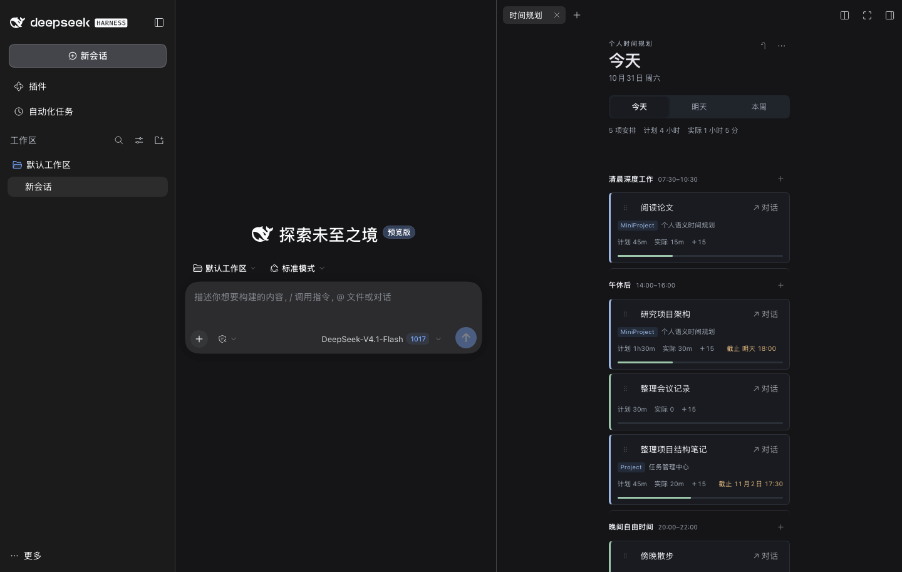 | 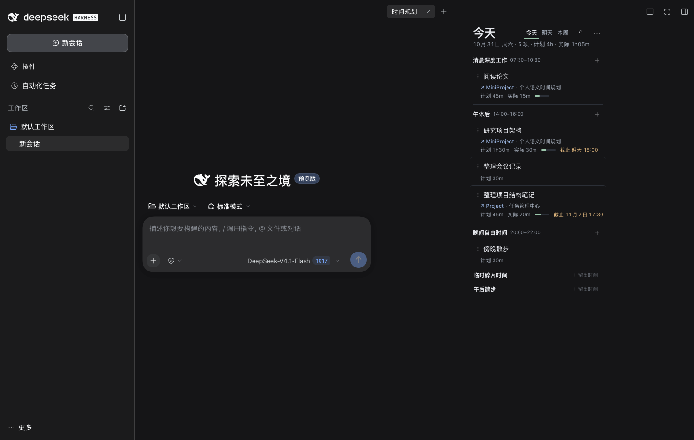 |

### 2. 编辑状态

- 默认只显示：标题、计划分钟、实际分钟、快速 `＋15/＋30/＋45`。
- 日期/时段通过「今天 · 午休后 ⌄」展开；截止时间通过琥珀色 chip 或「＋ 截止」展开。
- 工作引用通过「↗ 关联工作」或已有 chip 编辑。
- 去掉了说明段落，减少了一层视觉噪音。
- 删除、取消、保存在一行，保存仍是明确的主按钮。

| Before | After |
| --- | --- |
| 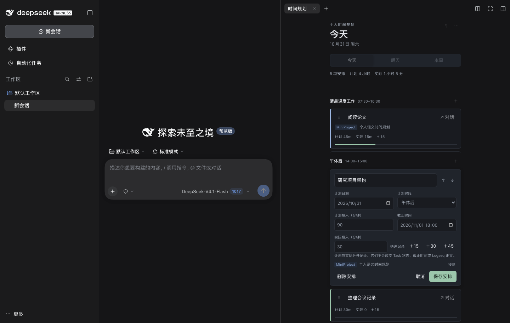 | 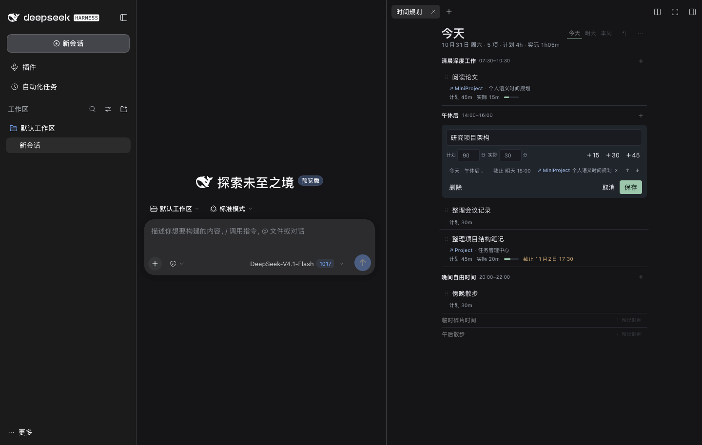 |

### 3. 时间段

- 每行只保留名称、可选时间范围、上下移动、删除。
- 时间范围默认显示为「07:30–10:30」或「＋ 时间」；只有点击时才展开开始/结束输入。
- 删除提示缩成一行；不再有长篇说明。

| Before | After |
| --- | --- |
| 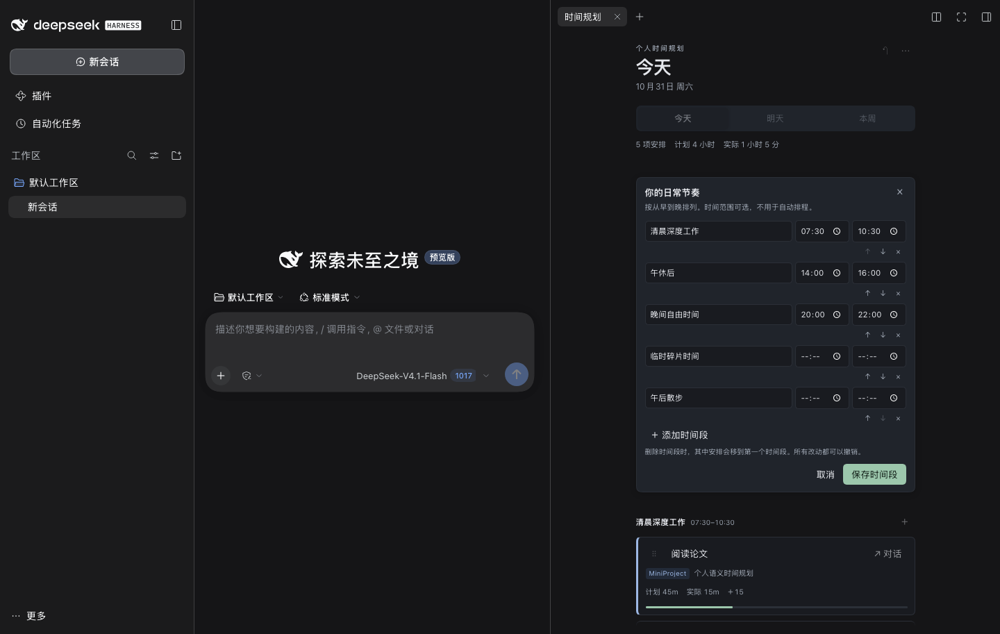 | 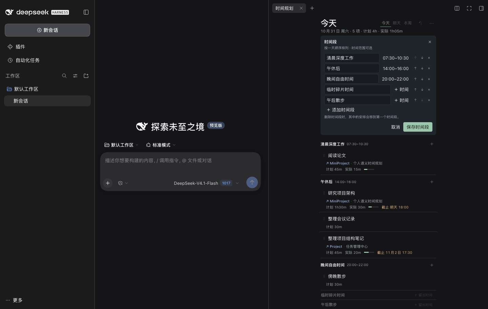 |

可选时间范围展开状态：

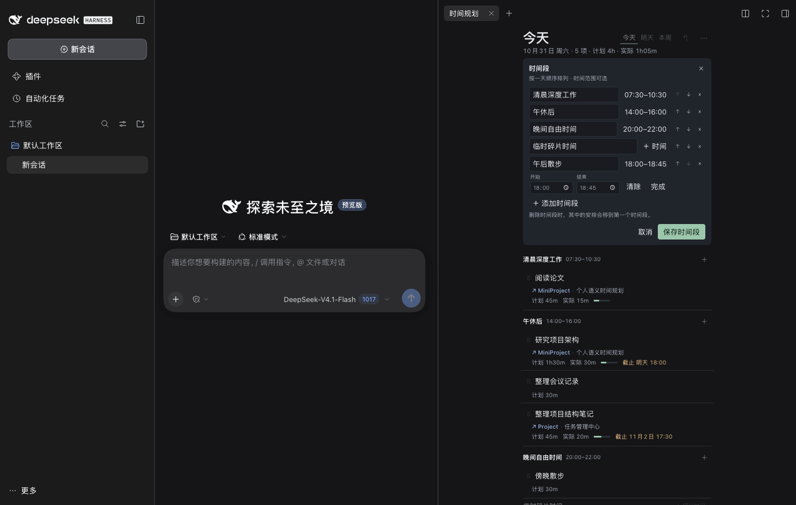

### 4. 本周

- 移除每日外框，改为细线分隔的日期块。
- 空日期只保留「周一 10月26日  空闲  ＋」一行。
- 每天只显示有安排的语义时段；今天的日期标题用绿色强调。
- 拖动时才会展开所有时段作为投放目标，避免日常视图变长。

| Before | After |
| --- | --- |
| 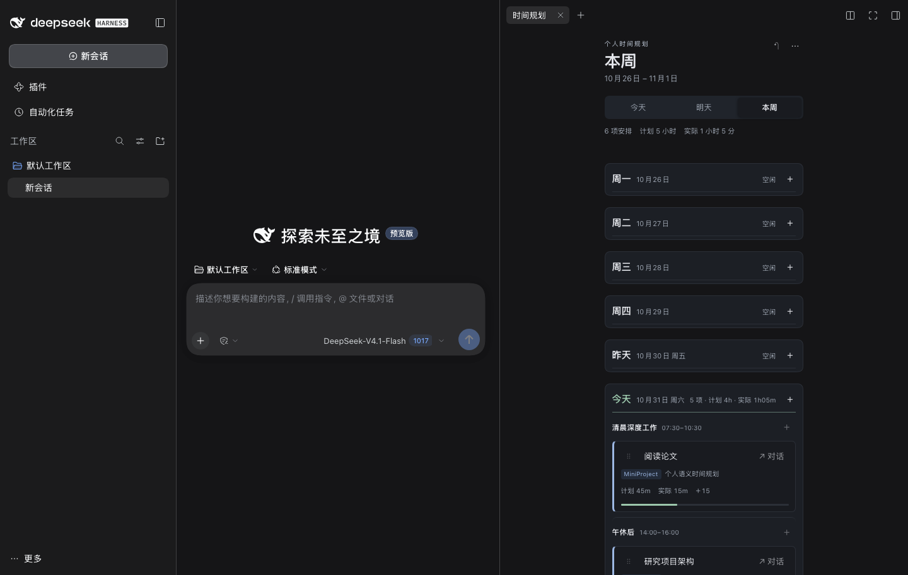 | 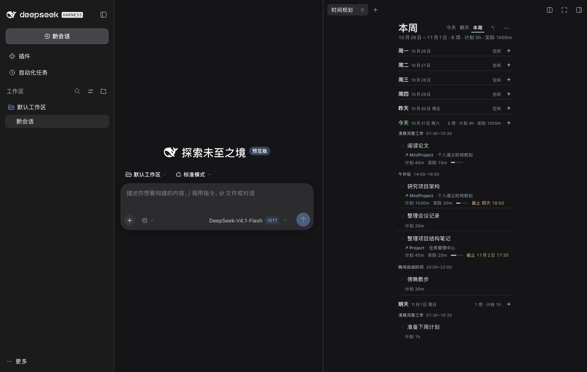 |

### 5. 工作引用与草稿衔接

- 卡片引用从带框徽标变为一行 `↗ Project / MiniProject · 标题`，蓝色仍然表示正式工作引用，自由活动没有这一行。
- 引用选择器同步压缩：搜索框、三行引用，不再是一张高卡片。
- `↗ 对话` 仍在悬停动作中；带入后只在原生输入框追加文本，不发送、不调用模型。

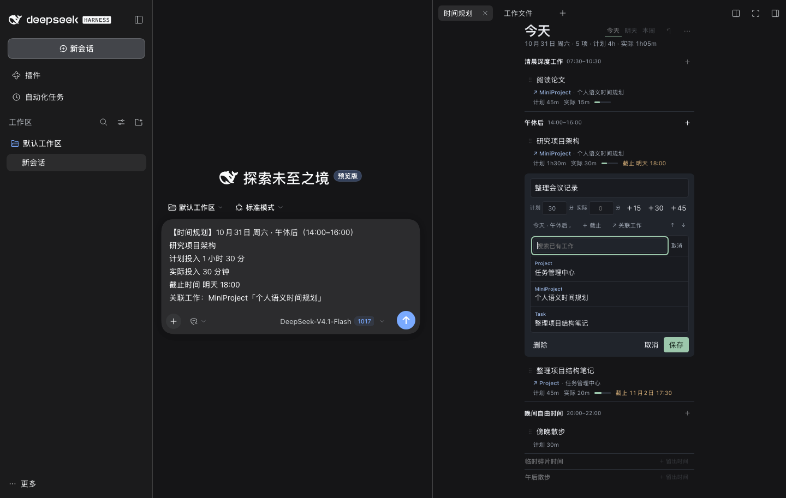

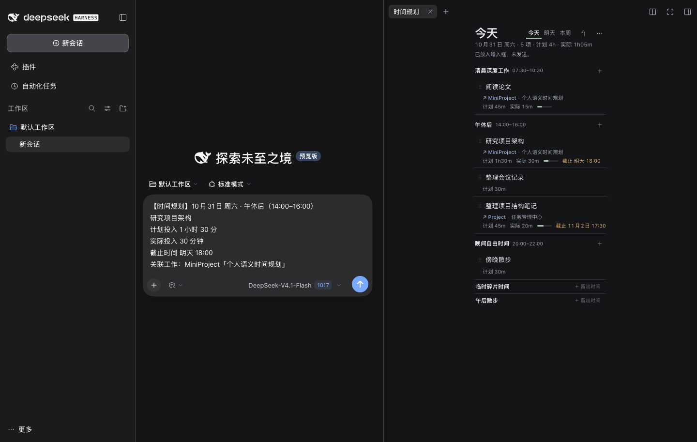

悬停时出现的 `＋15` 与 `↗ 对话`：

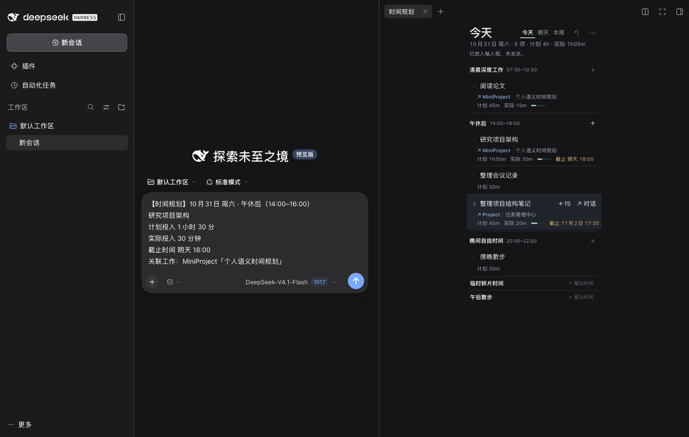

### 6. 窄侧栏

在 302px 左右的右侧栏中：

- 头部仍是两行，视图 tabs 与标题同行；
- 编辑器的日期/时段、截止、引用会自然换行；
- 无横向溢出；
- 列表行仍保持可读。

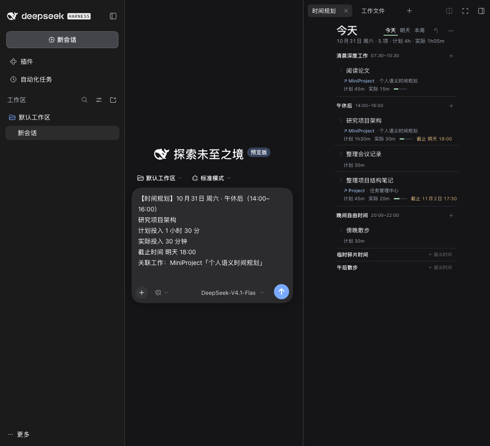

---

## 四、保留的核心能力

- 自定义语义时段，名称/顺序/可选时间范围。
- 今天、明天、本周。
- 自由活动与 Project / MiniProject / Task 只读引用。
- 计划投入、实际投入、截止时间分离；本轮没有改数据模型。
- 拖动跨时段、卡片间插入、编辑器内 ↑↓ 排序。
- 实际投入快速记录（悬停 `＋15` 或编辑器精确输入）。
- 删除、撤销、revision 冲突保护、原子保存、重载恢复。
- 把安排带入 DSH 原生草稿，不自动发送、不自动调用模型。
- 引用只读，不创建 Task、不写 Graph、不改 Formal Kernel。

---

## 五、主要修改文件

仅两个：

- `apps/dsh-plugin/src/planner.jsx`
- `apps/dsh-plugin/src/planner-styles.mjs`

未修改：

- `planner-store.mjs` / `planner-model.mjs` / `planner-host.mjs`
- `client.jsx` / `index.mjs`
- `packages/contracts/src/workspace-agent.ts`
- `apps/logseq-plugin/src/features/agent-workspace/router.ts`
- 任何 Capture / Structure History / Work Evidence 代码

---

## 六、测试与真实 DSH 验收

自动化：

- Planner 核心测试：**7/7**
- DSH workbench 全量单测：**49/49**
- Host proof：**9/9**（含 Planner 免绑定保存、跨会话共享、只读引用、磁盘重载、Graph 零写入）
- 全仓 `typecheck` / `lint` / `build`：通过
- `check:boundaries`：**12/12**
- `git diff --check`：通过

真实 DSH（独立 `DSH_HOME` / Profile `semantic-planner-refinement` / 端口 3098 / Chrome 9338，合成数据）：

- 今天、明天、本周、302px 窄侧栏均正常渲染；无横向溢出。
- 编辑器：日期/时段与截止时间按需展开；计划/实际/快速记录正常；取消/保存正常。
- 空时段：单行「＋ 留出时间」可直接新建；创建后可撤销。
- 删除 + 撤销：列表、状态提示、底层 JSON 均恢复。
- 时间范围：点「＋ 时间」展开开始/结束，保存后 slot 显示范围，撤销后恢复；可选范围仍生效。
- 拖动：从 `⠿` 拖到空时段时显示「放到这里」、目标高亮和插入线；移动后撤销恢复。
- 排序：编辑器 ↑↓ 改变顺序，撤销恢复。
- 快速实际投入：悬停 `＋15` 记录，撤销恢复。
- 工作引用：真实通过合成 Logseq companion 的 picker 展示 Project / MiniProject / Task 三类；卡片引用显示为一行。
- 草稿衔接：`↗ 对话` 将标题、时段、计划、实际、截止、引用写入 DSH 原生输入框；输入框中原有内容保留；未发送，状态提示“已放入输入框，未发送”。
- 页面重载后数据仍在；测试结束把安排与时段恢复到改造前数据（仅 revision / 撤销历史变化）。

> 引用选择仍使用隔离的合成 Logseq companion（Graph `A:/A`、happy-dom + 本地 workspace server），没有接触真实 Graph。正式插件与只读引用路径由 host-proof 覆盖。

---

## 七、限制

- `＋15` / `↗ 对话` 在桌面默认隐藏，依赖悬停或键盘聚焦发现；触屏媒体下常显。这个取舍是为了日常视图更干净。
- 本周空日期的 `＋` 仍先落在第一个时段；需要指定时段时进入「今天/明天」或保存后再改。
- 拖动时本周会展开所有时段，列表会临时变长；这是为了让跨日/空时段投放有明确目标。
- 没有新增自动排程、外部日历、重复安排、Planner 后台服务或新的数据模型。
- 仍是单机、单宿主写入；截止时间本地 naive datetime；触屏拖动未验证。

---

## 八、与其他并行开发线的共享文件交集

本轮**没有修改任何共享文件**，只改了 Planner 自身 UI 文件。因此：

- 与 Codex Goal 3（`work-context-read-routing-v1`）没有新的文件交集。
- 与 Structure History UX 没有新的文件交集。
- `client.jsx`、`index.mjs`、contracts、agent-workspace router 均保持 v1 原样；如果后续合并，需要以 v1 的共享改动为基础，而不是本轮 UI 文件。

---

## 九、截图位置

- 仓库：`docs/implementation/planner-refinement/`
- 本地完整：`/Users/wangrundong/work/dsh-homes/semantic-planner-refinement/screenshots/before/` 与 `.../after/`
- 数据：合成 Planner JSON + 合成 Logseq 工作，未使用真实 Graph 或个人数据。
