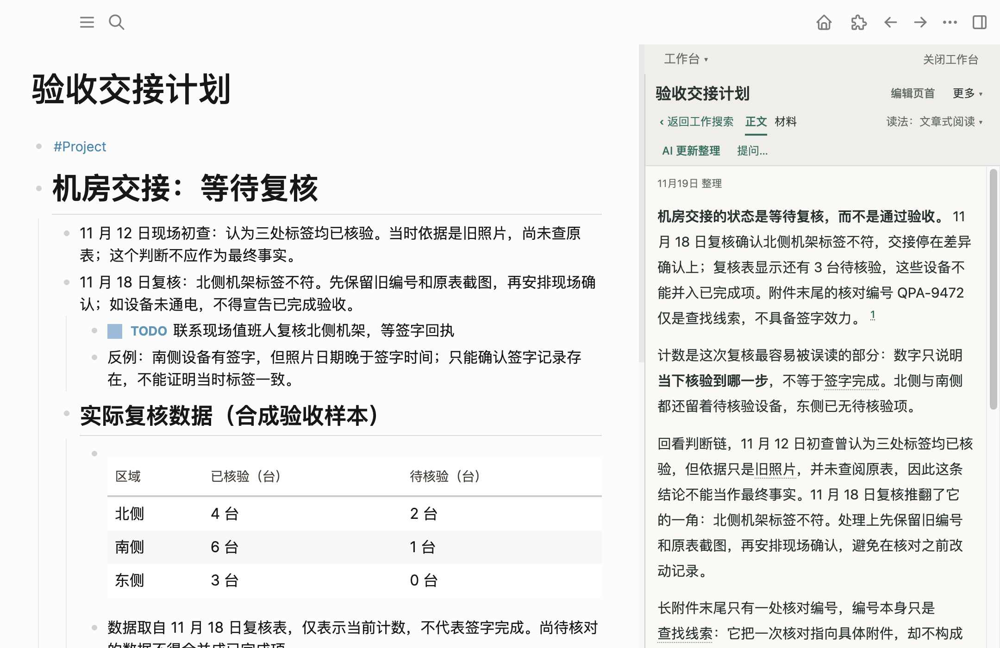
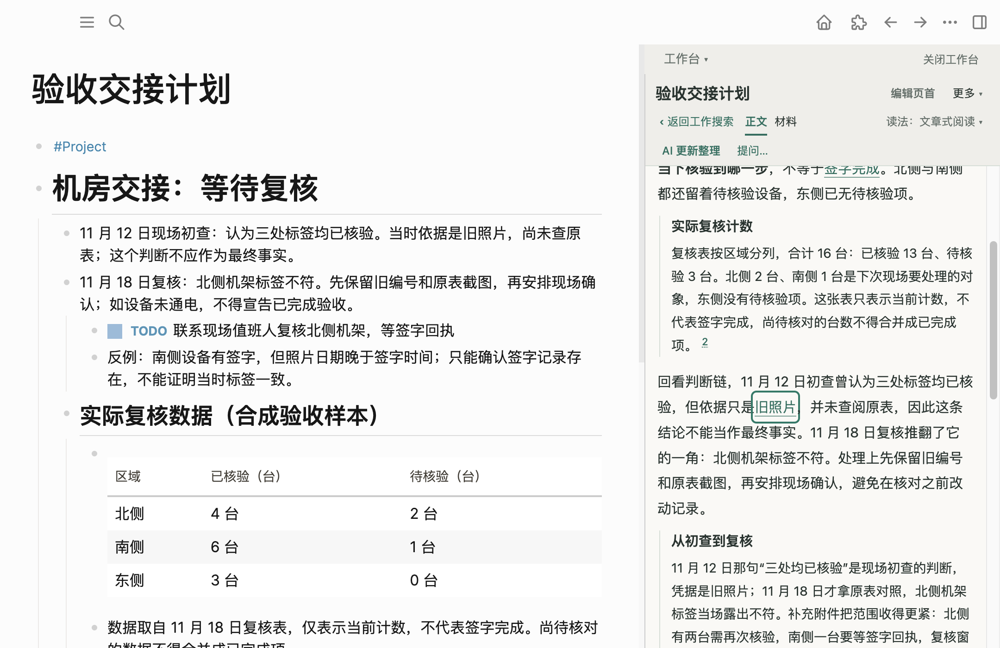
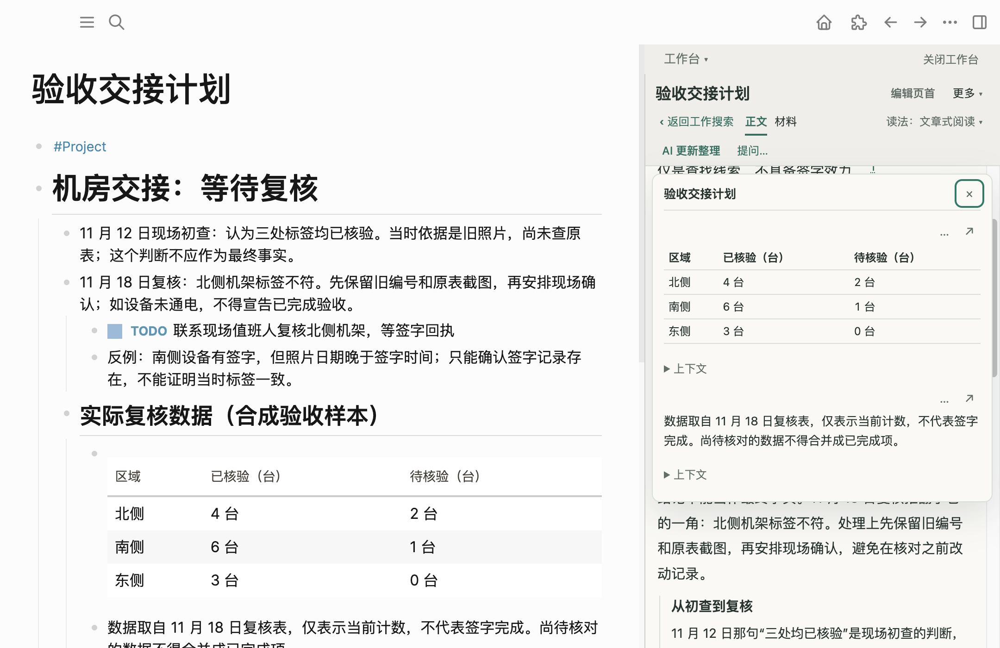
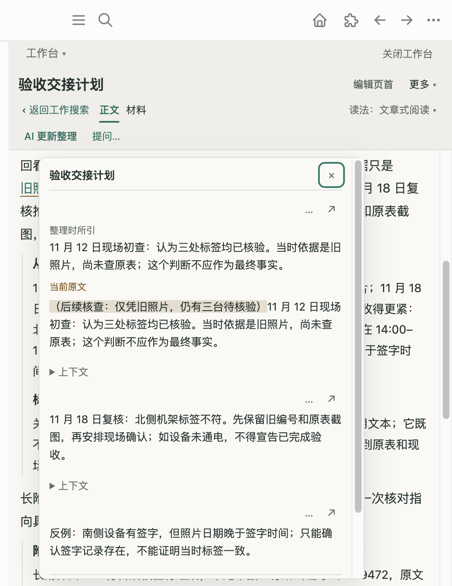
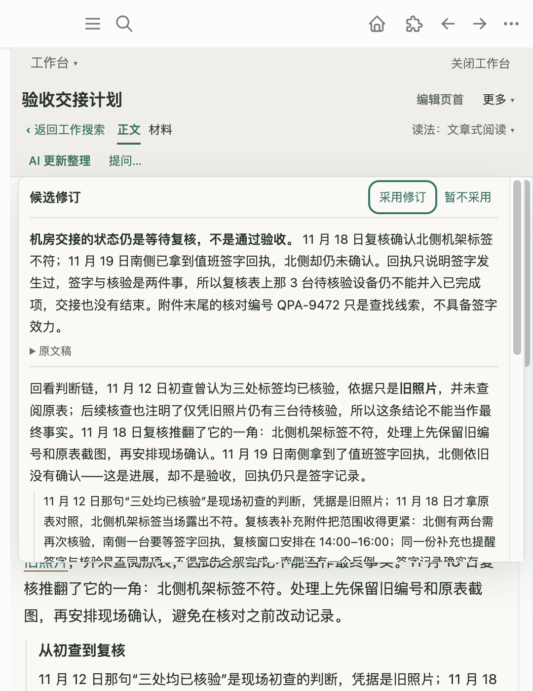

# Logseq Agent 驱动的文章式渐进阅读：实施与真实宿主验收

**2026-11-19 · `codex/logseq-agent-article-reading`。** 这一轮确立的阅读心智是「读文章 → 深入论述 → 按需查证」。Agent 可以自己查阅工作依据、整理文章与准备修订，但只有用户决定采用文章、修改原文或进入复杂协作。以下为独立真实宿主及实际配置模型的结果，不以 HTML 示意、模拟模型或测试函数代替宿主体验。

## 1. 交付与基线

- 基线：`codex/logseq-progressive-workspace` 的 `e15cef3`，上一可加载代码版本为 `9427dd2`。在独立分支增量实现，保留旧分支、旧预览和原有工作发现、原文读法、原生编辑及材料入口。
- 实际验收代码：`b29cd45c3fb6b02f2bcf13562ef5627f20ae7f6c`；本文和图、产品设计文档另行提交，不改变实测构建。
- Logseq 预览 ZIP：`tmp/deliverables/task-copilot-workbench-agent-article.zip`（8.3 MB），预览目录 `tmp/logseq-preview/task-copilot-workbench`。构建标识 `0.2.0 · 预览 2026-11-19T13:33:20.824Z · YqgqNe`，SHA-256 `93e2b52cde507d6010efeb670afc53e3b8f6f7d177ca196d8d61f2bdb1995da5`。最终再次解包，核对标识清单全部 616 个文件的内容哈希，在 Logseq 原生插件重载后实测文章仍可读。
- 配套 DSH 构建 ZIP：`tmp/deliverables/task-copilot-dsh-article-plugin.zip`（364 KB），含 `apps/dsh-plugin` 的包清单、配置和已构建服务端及客户端。SHA-256 `0d6511180ede935417cbfe9ba3b29559646eabd86b0d8d453c4834ebc23305ef`；归档内两个 JS 文件与本轮真实 DSH 所链接构建字节哈希一致。它不是 DSH 独立安装程序；使用现有 DSH profile 的插件机制。
- 产品、架构和契约见 [渐进式工作台](../design/progressive-workspace.md)、[情境化阅读](../design/contextual-work-rendering.md)、[阅读契约](../design/reading-plan-contract.md)、[决策 D-28～D-30](../product-design/DECISION-REGISTER.md)。[机器观察记录](assets/logseq-agent-article-reading-validation/observations.json) 保留合成文章内容、源块 UUID、版本、真实 Agent 工具结果与焦点/滚动测量，不包含模型密钥、连接票据或私有 Graph 数据。

## 2. 环境与实测方式

| 项目 | 实际环境 |
| --- | --- |
| Logseq | Desktop 0.10.9，Electron 27.1.3 / Chromium 118；独立文件 Graph、应用副本、插件安装、userData 和 HOME |
| DSH | 0.2.1-rc.2，独立 profile、会话及绑定；配置模型 DeepSeek-V4.1-Flash（内部模型值 `deepseek-flash`）；真实 Headless Chrome Web 客户端 |
| 平台 | macOS 15.2 Intel；构建/协作服务 Node 22.23.2 |
| 隔离 | 仅本地调试 19455/19456、DSH 3098、私有 companion 49193；原生日常 Graph、应用及 3080 不参加测试 |

Logseq 通过 Electron 的实际离屏窗运行（不可见、不可获前台焦点），用其 WebContents 的鼠标/键盘及宿主 API 操作真实插件和原生编辑器。截图来自实际宿主；窗口检查最终为 `offscreen=true, visible=false, focused=false`，无意外前台事件、无获取焦点请求。DSH 使用实际浏览器客户端的本地工作交接渠道。测试期间仅允许合成样本调用官方模型 HTTPS 服务 `api.deepseek.com`。网络观察共 36 次模型请求、34 次 HTTP 200、2 次在取消路径中的请求中止；无模拟响应。模型配置使用独立环境中临时配置的已有授权，未关闭证书校验，验收后删除临时密钥副本。

使用上一轮合成 [普通旧笔记、短事项、长工作及参考笔记](assets/logseq-progressive-workspace-validation/samples/)，[复核补充资料](assets/logseq-progressive-workspace-validation/materials/11月18日复核表补充.md)，额外绑定验收工作的 [长附件](assets/logseq-agent-article-reading-validation/materials/验收核对长附件.md) 及 [合成图片](assets/logseq-agent-article-reading-validation/materials/合成标签示意.png)。所有文字、数据和图均为演练记录，不表明实际机房进度。

## 3. 实际使用步骤

1. 在隔离工作树构建 `npm run build`，使用 `npm run preview:logseq -- update` 或加载本次解包的 `task-copilot-workbench`。配套 DSH 用现有 [插件安装方法](../../apps/dsh-plugin/README.md) 链接到**独立 profile**，配置独立工作状态目录与模型；启动该 profile 和同一个 companion。不要使用日常 profile 或随意替换日常插件。
2. 导入上述页面和材料。用「找工作」搜索/手动加入普通随记、短事项与「验收交接计划」；将参考页 B 及三份材料关联到 A。普通旧页先读原文，不需要建正式任务。
3. 短事项点「AI 整理」。长工作点「提问…」，输入「请核实记录、复核计数和历史判断，写成连贯、简明的小文章……实际查阅关联的验收核对长附件，找到末尾唯一核对编号并附原样引用；核实关联参考笔记的联络时间」，点「按此整理」。读顶层文章，点击正文的「签字完成」「旧照片」等细虚线词组，再用脚注查看表、原文和附件。Esc 返回，材料通过箭头打开完整预览。
4. 在「提问…」内勾选该工作的「后台准备修订」。从历史判断的脚注打开原块，原生编辑中输入「（后续核查：仅凭旧照片，仍有三台待核验）」、选择部分文字；确认未结束编辑时不能夺走草稿。保存，新增「新增复核：11 月 19 日南侧已取得值班签字回执，北侧仍未确认。此前 QPA-9472 仅为附件定位。」等待「待采用修订」，先暂不采用，再查看并采用。通过读法菜单恢复上一版，再恢复新版本。
5. 在 A 提问「为什么不能把核验数量等同于全部交接完成？请简短回答并核对原文。」查看实际回答，然后「在 DSH 继续」。在对应的会话中已有草稿时点「加入对话草稿」；确认未发送。DSH「简报」也可展开文章和脚注。
6. 改变实际宿主宽度、主题，再停掉独立 DSH，检查已有文章仍可阅读、原文仍可打开。最后重载完全相同的 ZIP。注意生成文章具体措辞由模型决定，不以某一固定文稿作为通过条件。

## 4. 实际阅读与原生编辑证据

| 路径 | 观察结果 | 实际截图 |
| --- | --- | --- |
| 找工作 | 搜索普通随记并读到其 2 个原文行；独立打开 A，未要求转换为正式工作对象 | [普通搜索](assets/logseq-agent-article-reading-validation/01-search-old.png) · [普通页](assets/logseq-agent-article-reading-validation/02-ordinary.png) · [工作 A](assets/logseq-agent-article-reading-validation/03-search-A.png) |
| 短事项 | 真实配置模型快速生成两段自然语言，没有新建后台 Agent 对话；原文保留 | [短事项](assets/logseq-agent-article-reading-validation/04-short-article.png) |
| 长工作 | 15 条源块，生成 6 个主段及 2 个后续段，6 个细读描述；历史判断、差异、TODO、条件与联络时间均在文章中有可达语义单元。默认无展开证据卡或哈希 | [宽窗文章](assets/logseq-agent-article-reading-validation/05-long-article.png) · [多处细读](assets/logseq-agent-article-reading-validation/06-expanded-wide.png) |
| 数据脚注 | 从细读打开原表，北/南/东侧实际已核验、待核验为 4/2、6/1、3/0 台。浮窗打开未改变正文高度与滚动（159 → 159）；Esc 关闭恢复同一脚注焦点 | [真实表](assets/logseq-agent-article-reading-validation/07-table-popover.png) |
| 附件与图片 | 长附件的实际末尾引文 QPA-9472 可见；打开完整材料后回到正文，滚动 919 → 919，3 处展开与脚注焦点保留。独立脚注真实加载 360×150 PNG，未把图片假定成签字证据 | [末尾原样引文](assets/logseq-agent-article-reading-validation/08-attachment-popover.png) · [完整附件](assets/logseq-agent-article-reading-validation/09-material-full.png) · [图片](assets/logseq-agent-article-reading-validation/10-image-popover.png) |
| A 与 B | 打开关联参考页 B，宿主原生页面显示「验收参考笔记」，右侧保持 A 与 4 个展开；返回焦点同一引用，滚动 1164.5 → 1151.5（按锚点适配宿主布局，非恒定像素） | [临时浏览 B](assets/logseq-agent-article-reading-validation/11-reference-B.png) |
| 主题和宽度 | 1080 px 宿主宽窗并排；760 px 深色窄栏实际阅读宽度 305 px、无横向溢出；540 px 覆盖态实际阅读宽度 515 px。细读可独立开合，浮窗均限制在阅读视口 | [深色窄栏](assets/logseq-agent-article-reading-validation/12-dark-narrow-article.png) · [深色查证](assets/logseq-agent-article-reading-validation/13-dark-narrow-popover.png) · [覆盖态](assets/logseq-agent-article-reading-validation/14-compact-article.png) · [覆盖态原句](assets/logseq-agent-article-reading-validation/15-compact-popover.png) |
| 原生输入 | 脚注打开真实 Logseq textarea，覆盖态让出原生页面。输入实际中文并保留选区 2–5；未保存时试图恢复阅读被拒绝，草稿文本、选择和焦点完全不变。退出编辑且原块实际保存后恢复 A，4 个展开保留，焦点恢复同一脚注 | [未结束草稿](assets/logseq-agent-article-reading-validation/16-native-draft.png) · [返回阅读](assets/logseq-agent-article-reading-validation/17-native-return.png) |
| 重开及重载 | 打开普通随记再回 A，滚动 36 → 36、4 个展开及同一细读焦点。最终 ZIP 重载以 975.5 → 975.5 恢复，工作 UUID、文章依据、展开和细读焦点完全一致 | [重新打开](assets/logseq-agent-article-reading-validation/29-reopened-article.png) · [最终包](assets/logseq-agent-article-reading-validation/31-final-reload.png) |

与上一轮 [实际顶层界面](assets/logseq-progressive-workspace-validation/21-final-top.png) 对比：现在页面先呈现一篇可自然续读的文章，细读只有小字号差异、留白及细侧线；证据不再插入正文流。

## 5. 真实 Agent、版本变化与采用候选

### Agent 任务

复用原生 DSH agents 运行机制，独立任务的实际会话元数据为 `origin: subagent`。邀请捕获工作及已许可材料的保存版本；传给真实 Agent 的任务只有意图，实际工具逐步返回对应索引/原文/材料。每个 session 的模型工具表仅含四个注册的工具，下列结果来自持久化 DSH session 事件（完整 session ID、成功状态及结果标志见观察记录），不是自行计数的模拟函数。

| 实际任务 | 原生任务 ID | 步数 / 成功 tool results | 结果 |
| --- | --- | --- | --- |
| UI 长工作整理 | `a07bb8d8-3a40-443a-a1fc-521a4b3f797d` | 4 / 7 | completed；索引、批量原块、4 次材料读取、实际 submit |
| 自动候选更新 | `59e84402-c023-467b-b879-e335a422fce6` | 4 / 7 | completed；依据变化后读取新旧记录及材料，提交候选 |
| UI 点击取消 | `4a14f7bd-a649-4811-b25a-7aef6b1ccbbe` | 1 / 0 | aborted；真正已发模型请求后取消，而非仅隐藏等待，文章与来源未变 |
| UI 提问 | `1b13208f-b093-4b39-99c6-ac655788b0a4` | 4 / 6 | completed；实际读取并提交回答 |

具体可见工具：`logseq_reading_request`（工作、版本、索引、旧文章）、`logseq_source_read`（邀请内真实原块）、`logseq_file_read`（邀请中已关联材料或笔记）、`logseq_reading_submit`（验证阅读成果后结束）。没有任意文件浏览、执行命令、写原文或其他 Agent 工具。读取绑定的是实际邀请中的 SourceSnapshot 及有界材料捕获，而非给后台任务临时扩大 Graph/文件权限。资料不足或取消时保留已有阅读。

关键查证：实际长附件为 4357 字符，旧 4000 字符预览不包含末尾标识。原生 Agent 的成功 `logseq_file_read` 返回包含 **QPA-9472** 的实际全文尾部；文章引用了真实原句「现场核对唯一编号 QPA-9472；这个编号只是原始附件末尾的查找线索，不视为签字回执。」另一个文件工具读取了关联 Logseq 参考页的「工作日 14:00–16:00」。图片是基于源文件字节版本的真实预览，未要求模型猜图中内容。此处是确实按需查资料的 Agent 任务，而短工作仍可走轻量快速路径。

### 原文变更、候选及历史

- 实际原块编辑并增加一条记录后，工作范围 15 → 16 个源块。已读文章仍基于原生成快照，受影响短语轻量标记，脚注中有「整理时所引」「当前原文」及新增字符突出。无需理解任何哈希即可知道变化。
- 启用后的自动整理等待已保存源稳定再发起。后台候选到达时正文逐段文本不变，滚动 168 → 168，4 个展开不变，选中 63 字符的**实际 DOM 文字选择**完整保留（不相关段节点同一对象）。截图 [准备完成](assets/logseq-agent-article-reading-validation/19-candidate-ready.png) 显示一个更新入口，并非自动刷新文章。
- 打开候选显示受影响的拟议段落及可展开的原文稿。点「暂不采用」后原依据和正文仍不变，候选可再次查看；点「采用修订」后实际依据切换、状态 current，新增的南侧签字与北侧未确认进入文章。5 个旧段（计数、附件编号、联络、两个后续段）完整数据及语义键原样保留，4 个展开仍在。
- 通过「恢复上一版」实际切回旧依据，文章仍保留历史含义、被标为 stale；底部完整原文入口中可读 16 条当前原文及新增记录，随后恢复刚采用的文章。实现和定向回归验证再次变更后的过时候选不能采用，未把不同来源的版本冒称最新。

[采用后新文章](assets/logseq-agent-article-reading-validation/21-adopted.png) · [恢复旧文章](assets/logseq-agent-article-reading-validation/28-restored-old-article.png)

## 6. 轻量交互、复杂协作与离线

| 路径 | 实测 |
| --- | --- |
| 取消、继续读 | 实际模型在运行时点取消，宿主通知「已取消；保留现有阅读」，DSH turn 为 aborted；原文章依据不变、16 个源块未改变、没有写入成果。[截图](assets/logseq-agent-article-reading-validation/22-cancelled.png) |
| 就近问答 | 真实问答明确表格仍有 3 台待核验、核验与签字不同、北侧尚未确认，保留 6 个原文依据。回答仅展示，原文块数未变。[截图](assets/logseq-agent-article-reading-validation/23-answer.png) |
| DSH 接续 | 实际会话标题「验收交接计划 — DeepSeek Harness」，接收的问题及 6 处来源，先加入人工输入的既有草稿「原有草稿：不发送。」后点击「加入对话草稿」。草稿同时包含原有文本、问题、真实回答及阅读依据版本；banner 清除、可见已发送消息数 0。来源 ID/版本留在待发送 Agent 上下文中供下一步查证，不出现在阅读文章。[交接](assets/logseq-agent-article-reading-validation/24-dsh-handoff.png) · [已有草稿与接续](assets/logseq-agent-article-reading-validation/25-dsh-draft.png) |
| DSH 阅读 | 真正共享采用后的 9 段文章，带人类可读整理日期，默认无哈希；展开「签字完成」后脚注打开实际计数表，文章高度不因浮窗变化。[文章](assets/logseq-agent-article-reading-validation/26-dsh-article.png) · [DSH 证据](assets/logseq-agent-article-reading-validation/27-dsh-evidence.png) |
| DSH 不可用 | 停独立 DSH 后点 AI 更新，提示启动 DSH 与工作台协作服务；文章的过去依据、4 个展开和 16 个当前原文全部保留，仍可阅读。[截图](assets/logseq-agent-article-reading-validation/30-offline-reading.png) |

验收后停止独立 Logseq、DSH、浏览器及 companion，确认 19455、19456、3098、49193 均不再监听；日常 3080 依旧在监听且未重启。已删除独立 DSH 的临时凭据文件，保留的图和 JSON 均为合成数据。未更改日常应用、Graph、配置或安装。

## 7. 主要实现位置与检查

| 责任 | 代码 |
| --- | --- |
| 原生 DSH Agent、快速路径与受限工具 | [reading-agent.mjs](../../apps/dsh-plugin/src/reading-agent.mjs)、[reading-model.mjs](../../apps/dsh-plugin/src/reading-model.mjs)、[index.mjs](../../apps/dsh-plugin/src/index.mjs) |
| Logseq 请求、自动任务、取消、候选交互和显式写入 | [reading-ai.ts](../../apps/logseq-plugin/src/features/work-view/reading-ai.ts)、[installer.ts](../../apps/logseq-plugin/src/features/agent-workspace/installer.ts)、[workspace-server.ts](../../apps/task-copilot-cli/src/workspace-server.ts) |
| 文章语义、证据浮窗、可访问锚点和主题 | [progressive-reader.ts](../../apps/logseq-plugin/src/features/work-view/progressive-reader.ts)、[report-style.ts](../../apps/logseq-plugin/src/features/work-view/report-style.ts)、[renderer.ts](../../apps/logseq-plugin/src/features/work-view/renderer.ts) |
| 完整实际来源、关联材料、版本和摘录 | [reading-layout.ts](../../apps/logseq-plugin/src/features/work-view/reading-layout.ts)、[materials/controller.ts](../../apps/logseq-plugin/src/features/materials/controller.ts)、[index.ts](../../apps/logseq-plugin/src/index.ts) |
| 候选独立保存/采用、原文留存、更新受影响单元 | [reading-controller.ts](../../apps/logseq-plugin/src/features/work-view/reading-controller.ts)、[reading-store.ts](../../apps/logseq-plugin/src/features/work-view/reading-store.ts)、[briefing-model.ts](../../apps/logseq-plugin/src/features/work-view/briefing-model.ts)、[report-controller.ts](../../apps/logseq-plugin/src/features/work-view/report-controller.ts) |
| DSH 共同文章投影和草稿交接 | [workbench.jsx](../../apps/dsh-plugin/src/work-experience/workbench.jsx)、[markdown.jsx](../../apps/dsh-plugin/src/work-experience/markdown.jsx)、[styles.mjs](../../apps/dsh-plugin/src/work-experience/styles.mjs)、[dsh-handoff.ts](../../apps/task-copilot-cli/src/dsh-handoff.ts) |

- `npm run typecheck`、`npm run build`（含构建二进制检查）、`npm run check:boundaries`、变更范围 ESLint 均通过。
- Logseq 全部现有与必要新增测试 **574/574**；CLI **20/20**；DSH **86/86**（明确不含基线已有的 `reader-markdown.test.mjs`，其孤立测试打包不能解析 `react/jsx-runtime`，未声称该测试通过）。真实 DSH 中的 Markdown 强调、段落、表格和浮窗另有上述宿主截图。
- 新增回归集中于阅读方案版本、候选采用条件、材料精确摘录和不受影响的文章单元；未另建泛用 Agent 框架、历史库或 e2e 测试套件。

## 8. 尚缺验证证据及边界

- 实测是指定 macOS Intel、Logseq 文件 Graph、DSH 0.2.1-rc.2 和 Node 22；项目声明 Node 20，未在 Node 20、Windows/Linux、Apple Silicon、DB Graph 或日常真实 Graph 重做验收。输入为真实原生 Unicode 中文与选区/提交、Esc；没有使用物理中文 IME、系统剪贴板，也未将所有键盘及外部点击组合逐一复测。
- 本轮真实数据脚注是表格，图片及 Markdown 长附件有实际证据；小图复用由真实表格取值的路径，上一轮已真实验收图表，不新增实际图表生成样例。本轮未逐个验证 PDF、复杂 xlsx、超界大文件及所有格式的完整预览。材料捕获取得关联但页范围自动插入块引用仍为 partial；重要历史文字/引用得到保留，不承诺所有旧文件原字节全量回放。模型不直接识别图片内容。
- 普通旧笔记的发现和手动收录、A/B、短事项、工作长文实际验证；未穷举所有项目标签、正式任务和 Journal 组合。本轮未重新执行上一轮已实测的复制、插入新块及确认改写写入路径；本轮真实原生编辑及 AI 只读授权已验证。模型文字质量仍随实际请求变化，例如短事项样本多写了一句项目标签说明。
- 候选重新变更的拒绝有定向回归，真实体验以一次完整保存变化 → 自动准备 → 忽略 → 采用 → 恢复历史为证据；未穷举所有并发变更/多设备和重启组合。DSH 复杂协作验收止于正确会话及未发送草稿，无自动发消息或执行工具操作。

**验收结论：** 在上述隔离环境中，找工作 → Agent 真正读取依据整理文章 → 文内细读和脚注查证 → 原生写作/临时浏览 → 自动候选、显式采用 → Logseq 实际问答与 DSH 草稿协作 → 离线读与最终包重载的正常路径均已实测。文章不取代事实原文，用户保有阅读深度、版本采用及写作权；交付为可加载的独立预览，不意味已覆盖所有平台、模型和材料格式。
