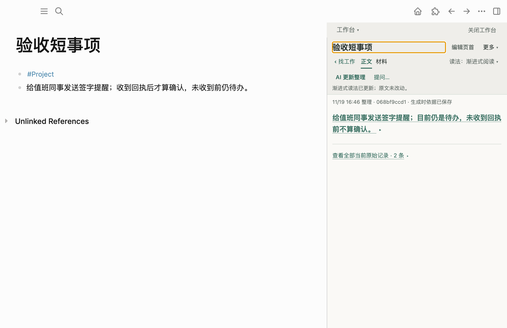
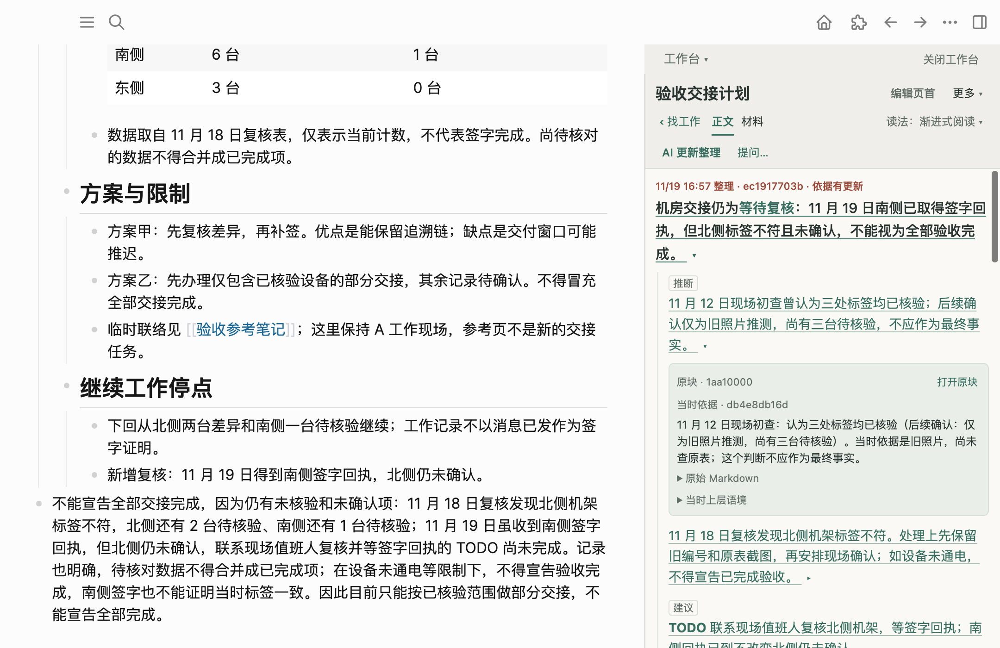
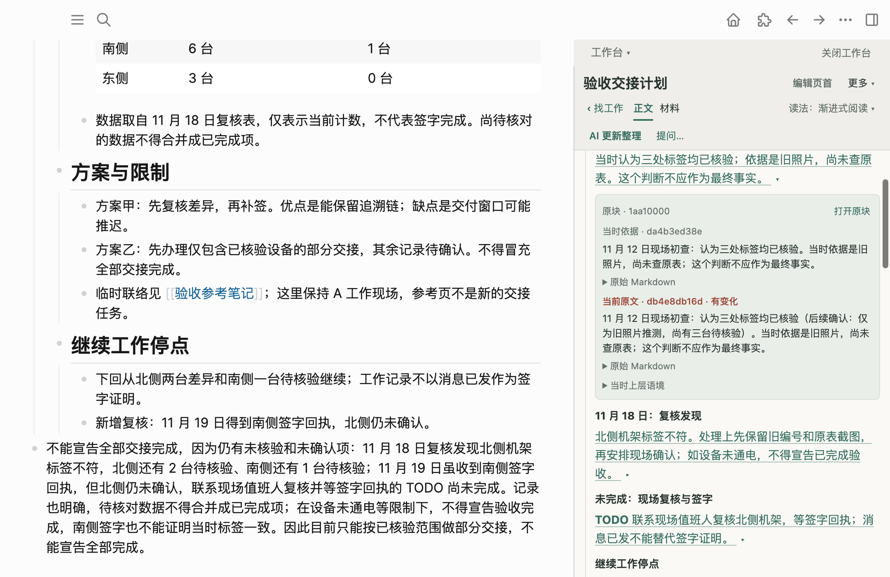
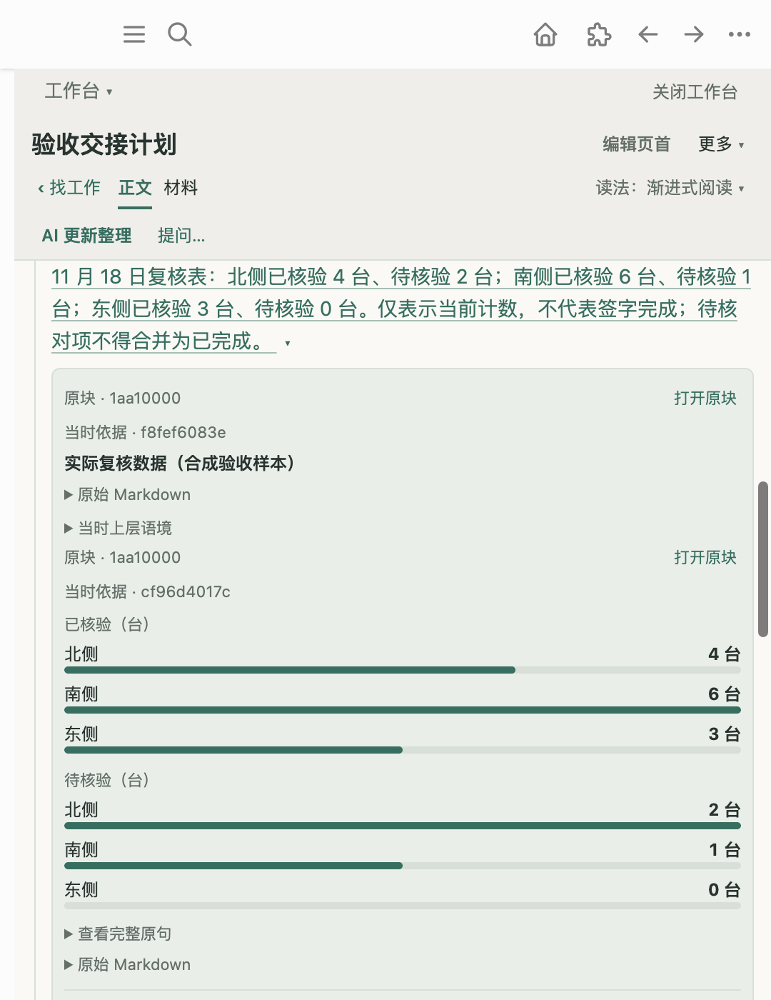

# Logseq 渐进式工作台实施与离屏验收

**2026-11-19，分支 `codex/logseq-progressive-workspace`。** 本次验收使用真实 Logseq Desktop、真实 DSH 和独立的文件 Graph；模型请求也由 DSH 的已配置模型实际完成，业务内容与材料均为隔离合成样本。下文区分已观察的结果与测试边界，不将截图替身或函数测试当作真实宿主证据。

## 1. 版本与交付物

- 基线：`codex/logseq-sidebar-reading` 的 `904b562a2ad20b340e4adaa1c02acce319a0b2a4`；核对 `codex/contextual-work-briefing` 的 `bb44afe`，选择性继承简报结构、阅读邀请/提交、真实来源关联与版本处理，而非整分支合并。
- 代码：`3cf7640` 渐进式工作台，`5eae2dc` 实际体验优化，`4e06e62` 覆盖态原生输入与焦点修复，`9427dd2` 直接交接补齐工作来源。本文及验收图片另行提交，不改变构建代码。
- 交付 ZIP：工作树中的 `tmp/deliverables/task-copilot-workbench-progressive.zip`（8.3 MB）；同包解出的开发预览安装目录为 `tmp/logseq-preview/task-copilot-workbench`。打包依据 `9427dd23264ef9bf301d231f7eeab43fc264ad6b`；插件显示 `0.2.0 · 预览 2026-11-19T10:22:27.074Z · 86Kz0E`。
- SHA-256：`044ac73ae3c09be5ed3dc8a3737d5bc4e884f10703c5ef784886d8faaf8f9aed`。核验 ZIP 内构建身份文件中每个文件摘要后，在真实隔离宿主重载此包；当前工作、6 个展开键与滚动位置 `1479.5 → 1479.5` 均保持。
- 产品方向：[产品总览](../product-design/01-产品总览.md)、[DSH 工作现场](../product-design/modules/02-DSH工作现场.md)、[决策登记](../product-design/DECISION-REGISTER.md)、[跨模块设计](../product-design/architecture/01-跨模块设计.md)、[完整设计](../design/progressive-workspace.md)、[阅读契约](../design/reading-plan-contract.md)、[情境化渲染](../design/contextual-work-rendering.md)。

## 2. 验收环境与操作方式

| 项目 | 真实环境 |
| --- | --- |
| 宿主 | macOS 15.2 Intel x86_64，Logseq Desktop 0.10.9（Electron 27.1.3），Node 22.23.2 |
| Agent 宿主 | DSH 0.2.1-rc.2；轻量请求使用其配置的 DeepSeek-V4.1-Flash；DSH 界面为独立 headless Chrome 中的真实应用 |
| 隔离 | 独立应用副本、HOME、userData、文件 Graph、插件安装、工作服务状态和 DSH profile；仅本次宿主的 Loopback 端口 19453/19454、59002、3097 |
| 方式 | Logseq Electron 实际窗口 `offscreen=true, visible=false, focused=false`，通过只连接该实例的驱动点击实际界面、读取宿主 API、发键盘事件及捕获窗口；未发送系统级前台键鼠事件 |
| 来源 | [随记、短事项、交接计划及参考页](assets/logseq-progressive-workspace-validation/samples/)；有关联的隔离 Markdown 材料、嵌套来源、TODO、真实 Logseq 页引用及原文表格 |

验收中仅合成样本经实际模型通路发送；请求目标限制为模型的 HTTPS 服务。初次请求的 TLS 证书链错误通过本次独立 Node 进程使用系统信任证书解决，未关闭 TLS 校验。在一次 HTTP 200 模型输出包含额外字段后，收窄适配层输出到阅读契约字段，再实际生成。网络观察共 6 次 HTTP 200，涵盖短事项、长工作、重新整理、问答及选块改写；不是模拟模型。已移除临时隔离凭据并停止全部本次宿主、浏览器、DSH 和 companion，确认上述隔离端口不再监听；日常 DSH 的 3080 仍在监听，仅作只读检查。没有更改日常 Graph、配置、应用安装或前台工作。

### 可重复体验步骤

1. 在独立工作树运行 `npm run build`、`npm run preview:logseq -- update`。在**隔离** Logseq 实例中通过插件页加载解压后的 `task-copilot-workbench`，不指向日常插件目录。预览切换脚本和版本标识沿用基线，可通过 `npm run preview:logseq -- rollback` 回退预览指针；不要对日常宿主执行重载。
2. 将 `samples/` 内四个 Markdown 样本导入独立文件 Graph，打开相关页面并手动收录普通随记及长工作。使用工作台的「找工作」查询、进入和返回最近工作。长工作可再通过材料入口关联 [11 月 18 日复核表补充](assets/logseq-progressive-workspace-validation/materials/11月18日复核表补充.md)，内容与此次实际登记样本一致。
3. 在有配置模型的独立 DSH 与工作服务可用时，先让短事项「AI 整理」，再整理长工作。通过句子旁的展开控制进入描述、原句、表格/小图和材料；进入读法菜单可切回完整原文及上一修订。模型生成的具体措辞和分组可能不同，不要求固定快照文字。
4. 从长工作打开材料或引用「验收参考笔记」，确认右侧仍属于「验收交接计划」。在原生页面修订 11 月 12 日的旧判断、新增 11 月 19 日回执记录，检查旧版依据、当前原文和「新增记录」，然后更新整理。
5. 提问“为什么不能宣告全部交接完成？请简短说明依据。”在结果中核对源版本；可插入新块。另在普通随记选中原句，点提问并改写选中原块；确认替换之前不修改原文。点「在 DSH 继续」，在对应会话中选择「加入对话草稿」；是否发送仍由用户决定。
6. 将窗口切至 1080、760、540 CSS px，分别核对宽窗、窄栏、覆盖态和浅/深色。由证据打开原块，在原生编辑器输入但未保存时尝试返回阅读；覆盖态应提示先结束输入，随后按 Esc 提交、返回阅读，确认原有展开和焦点。最后停止隔离 DSH，确认无模型时旧简报和原文仍可读。

## 3. 正常使用路径结果

数值、版本、滚动、键盘及模型观察的结构化摘录见 [observations.json](assets/logseq-progressive-workspace-validation/observations.json)。截图是实际宿主窗口画面；其中 01–16 为早期路径，19–23 为视觉迭代复验，24–28 为 `4e06e62` 包复验，29–31 为最终 `9427dd2` 包。后两个包只在原生返回/写入焦点、直接交接来源方面改动，没有另换一套演示 UI。

| 场景 | 实际结果 | 截图 |
| --- | --- | --- |
| 找工作及普通笔记 | 手动收录并打开旧随记，2 个原始块，无需创建正式对象；在目录搜索进入 A，显式切换到其他工作后重新进入 A，6 个展开键及焦点相同 | [旧笔记](assets/logseq-progressive-workspace-validation/01-ordinary.png) · [搜索](assets/logseq-progressive-workspace-validation/04-search.png) · [重开 A](assets/logseq-progressive-workspace-validation/26-final-reopen.png) |
| 短、长顶层 | 2 块的短事项由实际模型组织成 1 个顶层信息单元；初次长工作（15 块）形成 3 个顶层语句、10 个描述，无固定栏目，不改原文 | [短事项](assets/logseq-progressive-workspace-validation/02-short.png) · [长工作折叠态](assets/logseq-progressive-workspace-validation/03-long-collapsed.png) |
| 第二层证据 | 真实原块、父级上下文、原始 Markdown、来源版本及表格可达；表格 3 行，北侧 4/2、南侧 6/1、东侧 3/0，单位均为台；更新后模型选择图表，渲染器从同一来源表解析两组等值序列 | [表](assets/logseq-progressive-workspace-validation/06-table.png) · [图](assets/logseq-progressive-workspace-validation/20-final-chart.png) |
| 材料往返 | 关联真实隔离材料，显示版本和摘录、打开完整材料。首次返回滚动 `1404 → 1404`，5 个展开键不变；复验 `1775.5 → 1775.5`，6 个展开键及材料按钮焦点不变 | [附近证据](assets/logseq-progressive-workspace-validation/07-material-evidence.png) · [完整材料](assets/logseq-progressive-workspace-validation/08-material-preview.png) |
| 浏览与工作分离 | 临时打开 B，提示「浏览：验收参考笔记 · 当前工作不变」；回到 A 仍为相同页 UUID 的工作范围，滚动 `1404 → 1404`、5 个展开键不变 | [参考页 B](assets/logseq-progressive-workspace-validation/09-reference-B.png) |
| 来源修改及历史 | 实际修改旧块、新增记录后显示旧依据 `da4b3ed38e`、当前原文 `db4e8db16d` 与「新增记录 · 1 条（尚未整理）」。当时判断仍保留当时语义；可切换上一方案并显示历史依据 | [历史与当前](assets/logseq-progressive-workspace-validation/19-final-history.png) |
| 更新方案 | 从 `614414f135` 更新为 `ec1917703b`，状态为 current；从 15 块到 16 块，6/6 展开键保留，重新布局使锚点处滚动 `154 → 141`（不是固定像素契约）。随后实际插入和原生编辑再次使已保存简报变旧，提示重新出现 | [更新后](assets/logseq-progressive-workspace-validation/11-updated.png) · [再变更后](assets/logseq-progressive-workspace-validation/21-final-top.png) |
| 轻量 AI | 真实问答指出回执不等于全量核验，7 个真实原文依据，点击插入为新块并查实际 Logseq 页树；选中普通随记生成改写，二次确认前内容完全未变、确认后仅替换选择的普通原块；再插入得到 2→3 块，原块未再变，未唤起原生编辑器 | [问答](assets/logseq-progressive-workspace-validation/15-answer.png) · [待确认改写](assets/logseq-progressive-workspace-validation/27-final-rewrite-confirm.png) · [实际改写](assets/logseq-progressive-workspace-validation/28-final-rewrite-applied.png) |
| DSH 接续 | 首次从问答交接 7 处来源和依据版本，实际进入对应「验收交接计划」会话。最终包验证未先提问也能交接当前 17 个块的来源及请求；复用同会话，加入草稿后保留原有草稿和先前问题，含新请求及依据版本，无自动发送。DSH 简报使用实际共享投影，Markdown 强调正确渲染，变更时显示陈旧提示 | [首次交接](assets/logseq-progressive-workspace-validation/16-dsh-handoff.png) · [最终接续与简报](assets/logseq-progressive-workspace-validation/29-dsh-final-briefing.png) · [草稿](assets/logseq-progressive-workspace-validation/30-dsh-final-draft.png) |
| 模型不可用 | 停止独立 DSH 后点击 AI 更新，提示先启动 DSH/工作服务；保持 A、同一旧依据、6 个展开键和 17 个当前原文块，内容继续可读 | [离线保持阅读](assets/logseq-progressive-workspace-validation/31-offline-readable.png) |

### 主要界面证据

短事项按实际需要组织为一个信息单元：

宽窗的原生写作与渐进描述同时可见，右侧逐语句展开，证据和原文入口就近显示：

旧版保留实际依据，而不是拿新记录覆写旧判断：

覆盖态中的图来自表格原值，仍可打开完整原句：

## 4. 宽窄、主题、键盘与原生输入专项

- 宽窗 `1080×700`；`760×700` 深色窄栏正文 client/scroll 宽度均 296 px；`540×700` 覆盖态均 506 px（没有横向溢出）。见 [深色窄栏](assets/logseq-progressive-workspace-validation/22-final-dark.png) 和 [覆盖态](assets/logseq-progressive-workspace-validation/23-final-compact.png)。
- 使用实际 CDP `Enter` 将描述从 `aria-expanded=true` 切到 `false`，再次展开、仍聚焦同一描述按钮。多个已展开单元独立存在。
- 实际缺陷修正：初次覆盖态返回阅读时 Logseq 的 iframe 获得焦点，原生文字虽在，编辑焦点丢失。修复后再次实际打开原块，输入中文 Unicode 文本 `（最终包焦点复验）` 并选择 `[2,5]`；返回尝试得到 `editing-in-progress`，原生 textarea 的文本、选区 `[2,5]`、聚焦状态完全保持，覆盖层没有挡住输入。按 Esc 实际提交原块后返回，6/6 展开键及此前的「打开原块」按钮焦点恢复。见 [原生草稿](assets/logseq-progressive-workspace-validation/24-final-native-draft.png) 和 [编辑返回](assets/logseq-progressive-workspace-validation/25-final-native-return.png)。
- 原生编辑过程实际写入的是独立 Graph。AI 插入使用 `focus:false`，另经 2→3 块回归，`Editor.checkEditing()` 仍为 false。现有集成回归包含组合输入期间切换窄窗、已有输入节点及光标保护。

## 5. 代码位置与复用边界

| 职责 | 实现入口 |
| --- | --- |
| 目录、手动收录、浏览与当前工作身份、按 scope 保存停点 | [`controller.ts`](../../apps/logseq-plugin/src/features/work-view/controller.ts)、[`shell.ts`](../../apps/logseq-plugin/src/features/work-view/shell.ts)、既有工作目录/搜索 |
| 阅读契约与依据 | [`briefing-model.ts`](../../apps/logseq-plugin/src/features/work-view/briefing-model.ts)、[`reading-plan.ts`](../../apps/logseq-plugin/src/features/work-view/reading-plan.ts)、[`reading-controller.ts`](../../apps/logseq-plugin/src/features/work-view/reading-controller.ts)、[`reading-store.ts`](../../apps/logseq-plugin/src/features/work-view/reading-store.ts)；沿用 `SourceSnapshot`、UUID、三个版本字段及申请/提交控制器 |
| 就近展示及返回 | [`progressive-reader.ts`](../../apps/logseq-plugin/src/features/work-view/progressive-reader.ts)、[`source-table.ts`](../../apps/logseq-plugin/src/features/work-view/source-table.ts)、[`renderer.ts`](../../apps/logseq-plugin/src/features/work-view/renderer.ts)、[`report-controller.ts`](../../apps/logseq-plugin/src/features/work-view/report-controller.ts)、[`report-style.ts`](../../apps/logseq-plugin/src/features/work-view/report-style.ts)；保留原文模式与现有材料 owner |
| 轻量模型交互 | [`reading-ai.ts`](../../apps/logseq-plugin/src/features/work-view/reading-ai.ts)、[`installer.ts`](../../apps/logseq-plugin/src/features/agent-workspace/installer.ts)、[`workspace-server.ts`](../../apps/task-copilot-cli/src/workspace-server.ts)、[`reading-model.mjs`](../../apps/dsh-plugin/src/reading-model.mjs)；复用本机协作、阅读 invitation 和 DSH 模型配置，不为问答另建 Agent 会话 |
| DSH 会话与展示 | [`dsh-handoff.ts`](../../apps/task-copilot-cli/src/dsh-handoff.ts)、[`handoff.mjs`](../../apps/dsh-plugin/src/handoff.mjs)、[`client.jsx`](../../apps/dsh-plugin/src/client.jsx)、[`workbench.jsx`](../../apps/dsh-plugin/src/work-experience/workbench.jsx)；既有会话绑定和原生草稿通道，读法投影相同但 DSH 布局独立 |

原文仍是事实来源。AI 只决定阅读组织、语义样式和证据引用，不产生图表数值、不绕过权限或建立正式工作状态，不因生成简报修改原文。真实记录以完整原文和生成时的完整来源快照作为兜底路径。版本关联采用已有工作视图内的有限方案和上一修订，不额外建设独立历史数据库。

## 6. 构建与定向检查

- `npm run typecheck`、`npm run build`、`npm run check:boundaries` 通过（`4e06e62`，全工作区）。最终 `9427dd2` 的增量仅为交接来源选择，Logseq 类型检查、变更文件 ESLint、预览构建和真实最终包重载/交接通过。全部本轮变更源码的定向 ESLint 在前一代码提交亦通过。
- Logseq 现有测试 **573/573** 通过；原生报告 UI 专项 **26/26** 通过。增加的回归限于简报版本和模型输出投影等关键路径；调整既有覆盖态断言与当前产品交互一致。
- DSH 除现有 `reader-markdown.test.mjs` 外 **86/86** 通过；该单独测试打包时报 `Could not resolve react/jsx-runtime`，没有计为通过，也未扩大本轮范围修改其测试环境。真实 DSH 最新构建中的共享简报与 Markdown emphasis 另有宿主证据。CLI 协作相关定向测试 **8/8** 通过。

## 7. 尚缺证据与使用边界

- 只验收了 macOS Intel 的指定 Logseq 文件 Graph、Node 和 DSH 版本。未验收 Windows/Linux/Apple Silicon、DB Graph、Node 20 环境、实际设备不同 DPI、完整跨版本兼容或日常真实 Graph。中文使用实际 Unicode 输入及选区/提交 + 既有组合事件回归，**没有物理中文 IME 输入法**场景。为了不扰动日常剪贴板，未单独进行系统剪贴板复制专项验收。
- 真实材料登记状态为 `partial`：关联材料、版本、摘录、完整预览及返回已观察，页范围自动插入具体原块引用未完成。未用真实 PDF、图片、复杂电子表格或大文件逐一做第二层证据验收；非当前材料版本的原字节全量回放不在本阶段承诺内。
- 本轮发现入口实测的是手动收录、目录搜索、旧笔记与页面工作的连续性；未用多种真实用户项目标签组合重做目录的全部基线验收。完整 Journal、普通 TODO 修改、正式变更、复杂 Agent 实际执行不是此次工作台交接路径；DSH 验收止于进入正确会话、请求及来源加入草稿，没有发送该协作消息。
- 旧连接在隔离插件重载并重启 DSH 后一度显示等待 Logseq；明确再次「在 DSH 继续」恢复同一会话、简报及原有草稿。本轮不声明任意 Graph/DSH 重启组合都无需重新连接。
- 已实际验证同一方案的稳定语义键及保存过的上一修订。模型输出具有随机性，删除或拆分语义单元无法保证原焦点像素位置完全一致；更长期或跨设备历史、超大来源、深层图表解析、更多语言与物理交互需后续验证。模型故障不意味着已读内容丢失；离线仍可查看原文、已有方案及其依据。

**验收结论：** 上述指定环境中，工作发现 → 渐进式阅读 → 参考/材料返回 → 来源变化与重新整理 → 轻量 AI → DSH 草稿交接的正常使用路径已实际走通；宽窄/主题及原生草稿回环亦有真实宿主证据。交付为可加载的独立预览，不是对所有宿主、数据类型及 Agent 工具链的生产兼容保证。
