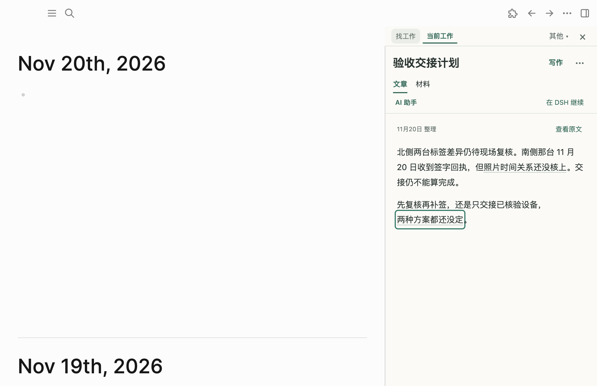
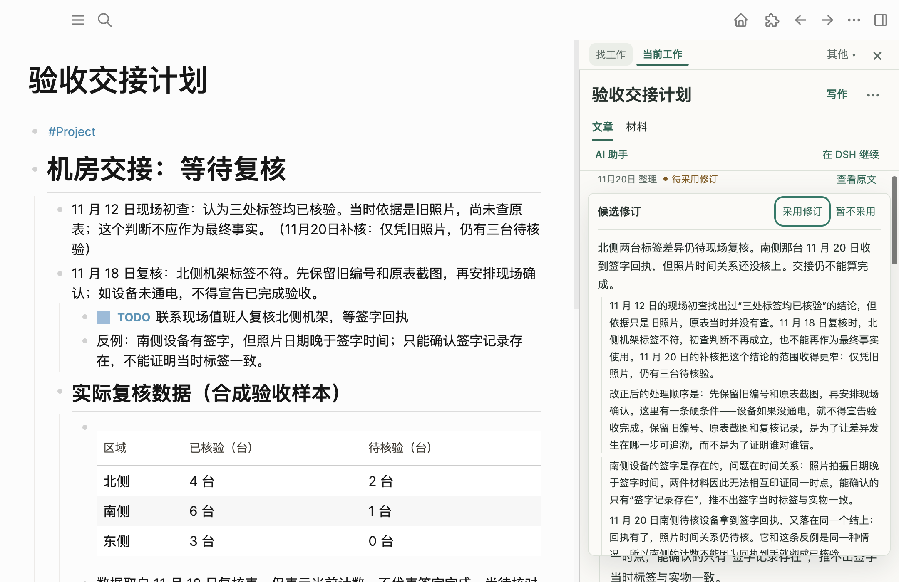
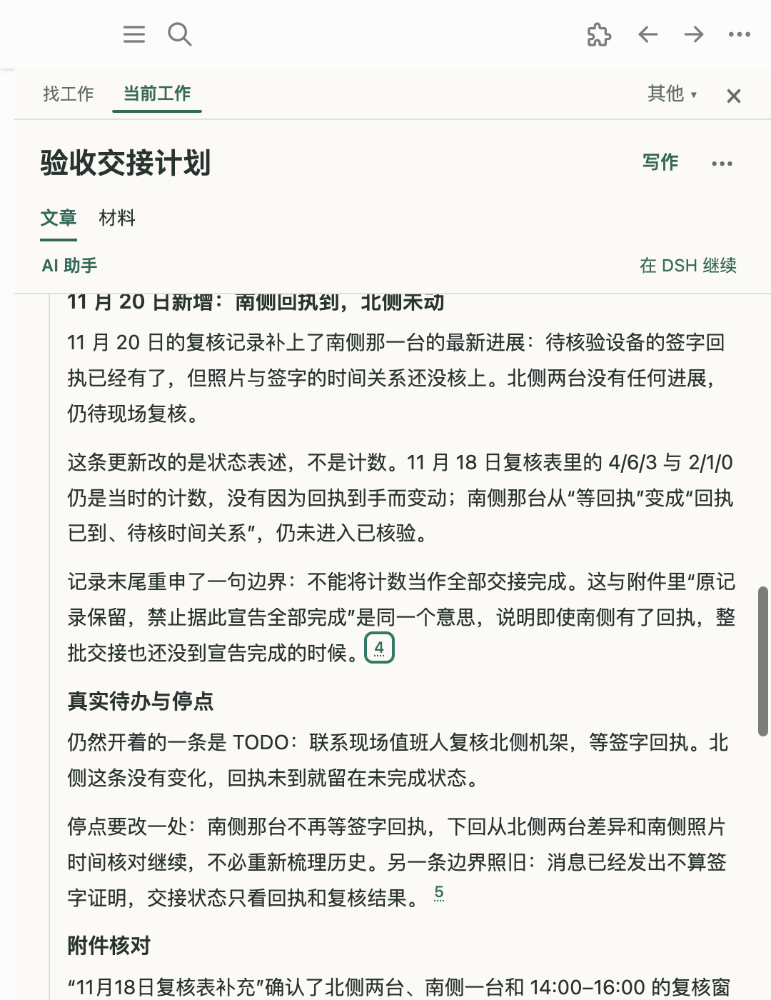

# Logseq 工作台产品化 · 真实体验验收

2026-11-19～20 · 结论：本轮产品收敛与八条指定操作路径通过独立现场验收。交付为可加载的预览，不是对日常 Graph 的自动升级，也不是所有宿主、文件格式、模型和正式任务业务的全面认证。

## 1. 基线、交付和验收环境

| 项目 | 实际状态 |
| --- | --- |
| 开发基线 | `codex/logseq-agent-article-reading`，`395315f`（简报阅读代码 `33cb360`） |
| 独立开发分支 | `codex/logseq-workbench-productization`；Downloads 原工作副本不参与本轮开发 |
| 交付构建的代码提交 | `3f950ada2bbeb72fbb25f4e141065f59cfa6de14`（后续验收文档提交不改变运行代码） |
| ZIP | `tmp/deliverables/task-copilot-workbench-productization.zip`，8,667,099 bytes；SHA-256 `cf583aead47ce80d17628813f91d1289b23207c9898c362fe5cd1c938f0bd95a` |
| 构建身份 | 0.2.0 · 预览 2026-11-20T06:03:55.387Z · 1RIGZS；干净代码树打包，616 个运行资源逐项 SHA-256 核对通过，ZIP 完整性检查通过 |
| 基线 ZIP | 前分支已交付的 `task-copilot-workbench-brief.zip`，SHA-256 `3b90e9b24d5dd67e077656fd9ddecf4b90a0ae316613f6c9f9504c7c53f91198` |
| 宿主 | macOS 15.2 (24C101), x86_64, Logseq Desktop 0.10.9（Electron 27.1.3, Chromium 118）；开发 Node 22.23.2 |
| 协作 | 独立真实 DSH 0.2.1-rc.2，DeepSeek-V4.1-Flash；独立 companion、DSH 浏览器、工作目录与会话关联存储。正式任务按需另启动独立真实 Kernel，未启用其远程模型 |

**隔离方式。** 以实际 Logseq 应用的独立副本、独立 home/profile、独立文件 Graph 加载 ZIP 内插件，而非将仓库源码当作宿主结果。仅修改验收应用的窗口与本地路径入口，使窗口离屏、不可激活，真实 Logseq renderer、SDK、文件 Graph 及插件运行逻辑不作替换。主 Graph 使用验收随记、验收短事项、验收交接计划、验收参考笔记及 22 个标记工作；另从全新 profile 与只含两篇普通笔记的第二个 Graph 验证首次启动。证据通过实际 renderer 截图、DOM 测量、键盘输入、原生编辑器、文件读取及真实 DSH 浏览器产生。日常 3080 始终保持原监听 PID 1233；测试使用 19457、19458、3099、独立 companion/Kernel 端口。各宿主的 `visible=false`、`focused=false`，无实际 show/focus 越界事件。

模型验收仅使用上述合成样本。独立 DSH 的远程调用限制在配置的 DeepSeek 官方 API：日志为 19 次尝试、18 次 HTTP 200、1 次初始证书链验证失败；恢复系统可信 CA 后实际生成成功（未关闭 TLS 证书验证）。每次 Agent 工作可能有多个请求，不能把 HTTP 次数当作完成的工作次数。[网络凭据无关的记录](assets/logseq-workbench-productization-validation/receipts/model-network.jsonl) 与 [Agent 工具调用记录](assets/logseq-workbench-productization-validation/receipts/native-agent-receipts.json)。

加载方式：[工作台使用说明](../user-guide/logseq-workbench.md)。解压 ZIP 后在 Logseq 插件页加载 `task-copilot-workbench` 目录，或使用分支的 `tmp/logseq-preview/task-copilot-workbench`。不要用仓库开发路径替代实际交付包。本轮没有安装到日常 Logseq。

## 2. 收敛前后 · 从多个入口到同一个现场

以下图片均为实际应用截图；`before-*` 来自基线初次走查，`after-*` 是实现过程中真实操作，`final-*` 是迭代后的实测（候选与原生编辑的过程截图保留其当时的真实状态，不是最终静态重绘）。`fresh-*` 是最终 ZIP 的第二份独立 Graph。为避免把实测阶段的模型文字差异误当作纯界面差异，前后比较主要核对入口、信息层级、工作归属和操作方式。

| 场景 | 收敛前 | 收敛后 |
| --- | --- | --- |
| 找工作 | [未开启发现](assets/logseq-workbench-productization-validation/before-search-empty.png)、[目录式搜索](assets/logseq-workbench-productization-validation/before-search.png) | [首次使用](assets/logseq-workbench-productization-validation/fresh-first-search.png)、[最近工作与有意义的停点](assets/logseq-workbench-productization-validation/final-search-home.png) |
| 普通笔记与当前工作 | [独立功能导航与原文](assets/logseq-workbench-productization-validation/before-ordinary.png) | [直接读普通笔记](assets/logseq-workbench-productization-validation/final-ordinary.png)，标题、写作、文章与材料共用工作身份 |
| 长工作 | [原阅读入口](assets/logseq-workbench-productization-validation/before-long-source.png)、[读法切换菜单](assets/logseq-workbench-productization-validation/before-reading-menu.png) | [文章顶层](assets/logseq-workbench-productization-validation/final-article-top.png)、[细读展开](assets/logseq-workbench-productization-validation/after-expanded.png)、[完整真实原文](assets/logseq-workbench-productization-validation/final-all-original.png) |
| 材料 | [材料库入口及目录工具](assets/logseq-workbench-productization-validation/before-materials.png) | [工作关联材料](assets/logseq-workbench-productization-validation/final-material-list.png)、[完整预览](assets/logseq-workbench-productization-validation/final-material-preview.png)、[低频目录管理](assets/logseq-workbench-productization-validation/final-material-directories.png) |
| AI / 管理 | 另有设计读法、协作、任务及审阅入口 | [一个轻量问答](assets/logseq-workbench-productization-validation/final-ai-answer.png)、[全局其他](assets/logseq-workbench-productization-validation/final-global-menu.png)、[按需正式确认](assets/logseq-workbench-productization-validation/final-formal-confirm.png) |

**最终信息架构。** 工具栏只有工作台；找工作、当前工作和工作内文章／材料组成日常入口。「其他」只收纳全局功能；工作标题省略菜单是阅读版本、阶段、目录、授权与维护等工作相关选项。右侧读 A 时，左侧 Journal 或 B 参考页并不变成 A 的来源。没有文章时直接展示完整已保存原文，AI 不是创建工作或阅读的前置步骤。

## 3. 指定实际操作路径

### 1）普通旧笔记：不使用模型，查找、原文、写作、恢复 — 通过

- 主 Graph 关闭首页自动发现偏好，在「找工作」输入“验收随记”，回车进入未正式收录的两年前普通笔记；没有生成文章、没有建立正式任务，也没有模型请求。真实原文显示借阅／归还条件。
- 点「写作」进入真实 Logseq textarea，使用原生中文输入插入“（合成复读核验）”，Escape 完成写作，返回工作台，原文中实际读到新增文字。再从最近工作恢复该页，并通过真正的工具栏关闭／重开，身份保持。普通阅读路径模型调用增量为 0。
- 最终包另在首次启动、无工作标记、无最近记录、无正式任务、无协作配置的独立 Graph 中，通过真正的工具栏打开「找工作」；导航不显示尚不存在的当前工作。首页直接列普通近期笔记；不匹配的搜索有简短空状态；输入普通旧笔记名、回车后真实 report 为 current、两条原文、没有文章也可以阅读。

证据：[普通笔记搜索](assets/logseq-workbench-productization-validation/final-search-old.png) · [原生写作](assets/logseq-workbench-productization-validation/after-ordinary-native.png) · [首次无匹配](assets/logseq-workbench-productization-validation/fresh-no-results.png) · [首次直接阅读](assets/logseq-workbench-productization-validation/fresh-direct-note.png)。[主 Graph 收据](assets/logseq-workbench-productization-validation/receipts/ordinary-flow.json) · [全新 Graph 收据](assets/logseq-workbench-productization-validation/receipts/fresh-flow.json)。

### 2）长短事项：简短顶层、自然细读、原文、原生编辑 — 通过

在真实 DSH 模型中整理短事项与含历史、嵌套、普通 TODO、复核表、两种方案、关联笔记及材料的长事项。实际输出长度（直接统计 Markdown 字符，不把标题或空白虚算为信息）：

| 样本 | 顶层段落 / 字符 | 细读段数 / 字符 |
| --- | ---: | ---: |
| 验收短事项 | 1 / 24 | 1 / 94 |
| 验收交接计划（初稿） | 2 / 66 | 8 / 1353 |
| 长工作采用最新修订后 | 2 / 84 | 9 / 1857 |

短事项仅呈现仍待发的提醒和签字边界。长工作顶层保留两句结论和两种未决方案；历史推翻、验收边界、表格、待办、附件、联络窗全部下沉。Enter 实际展开词句；点击就近脚注弹出表格，北侧 4/2、南侧 6/1、东侧 3/0 与真实表格逐格一致，打开前后正文高度、滚动 691 px 不变，Escape 返回脚注。点击「查看原文」直接读到 15/15 条原文；新增真实记录后最终包重新检查为 16/16 条，历史原文仍在。

宽窗和覆盖态分别返回原生页面；在覆盖态打开实际原块（固定块 UUID 结尾 0002），写入一段合成补核文字并选中位置 2–5。未完成时点击返回，输入值、选择和焦点完全不变；Escape 保存后返回同一文章、展开状态与历史脚注，确认原文新增文字。另一次新增真实末尾块后，旧文章仍保留，不自行采用新稿。

证据：[短事项](assets/logseq-workbench-productization-validation/final-short.png) · [宽栏脚注](assets/logseq-workbench-productization-validation/final-wide-evidence.png) · [覆盖态原生草稿](assets/logseq-workbench-productization-validation/after-native-draft.png) · [原生返回](assets/logseq-workbench-productization-validation/after-native-return.png)。[阅读与来源记录](assets/logseq-workbench-productization-validation/receipts/reader-flow.json) · [初次模型结果](assets/logseq-workbench-productization-validation/receipts/article-flow.json)。

### 3）当前工作、临时参考和材料往返 — 通过

- A=验收交接计划绑定独立 `work-A`，B=验收参考笔记（工作日 14:00–16:00）。在 A 的细读脚注中读 B 或打开原生 B，A 的工作身份不变；回来还是 A，展开与阅读停点保留。最终 ZIP 冷启动后再次从 A 的材料列表点 B，实际打开重建后的 B 页面，仍返回 A。
- A 关联真实 4357 字符 Markdown、360×150 PNG、关联笔记，同时加入真实补充文件，共 4 项。长文本由现有收纳入口保存；模型读取的全文包括预览前缀之外的唯一尾部编号 QPA-9472（仅合成附件定位线索）。脚注展示真实 PNG、原文与材料，完整文件预览含附件末尾；原样返回滚动 1217 px 和附件脚注焦点。工作内搜索曾从多项缩小为单一长附件。
- 在原实现验收中用实际文件选择输入加入文件；另在最终 ZIP、DSH 已关闭时，使用真实 CDP dragEnter/dragOver/drop 事件把文件拖入普通随记，得到实际副本，输入文件哈希不变。通过「其他 → 全部材料 → 关联到当前工作」把 A 的 PNG 关联到随记，随记列表变成 2 项、PNG 沿用同一材料 ID，当前工作仍为随记。未移动原文件或重新建工作。
- 查看当前工作的材料时没有重复的全局搜索、标题写作按钮；全局查找、目录管理和每个文件的完整预览与修复选项均在实际需要位置。

证据：[参考页与工作 A](assets/logseq-workbench-productization-validation/final-associated-note.png) · [长附件证据](assets/logseq-workbench-productization-validation/after-evidence-attachment.png) · [PNG 完整预览](assets/logseq-workbench-productization-validation/final-material-image.png) · [真实拖入](assets/logseq-workbench-productization-validation/final-real-drop.png) · [全局关联菜单](assets/logseq-workbench-productization-validation/final-global-associate-option.png) · [关联后的随记材料](assets/logseq-workbench-productization-validation/final-global-associated.png)。[材料原文收据](assets/logseq-workbench-productization-validation/receipts/prepared-sources.json) · [拖入收据](assets/logseq-workbench-productization-validation/receipts/drop-flow.json) · [低频界面走查](assets/logseq-workbench-productization-validation/receipts/final-surfaces.json)。

### 4）真实来源变化、候选、采用与历史 — 通过

合成历史原文实际修改，并追加新原块“11 月 20 日南侧待核验设备已有签字回执，但照片时间关系仍待核；北侧两台仍待现场复核”。初稿中“南侧一台仍在等签字回执”未被静默修改。脚注明确同时呈现整理时所引、当前原文；旧依据仍保留。

在 AI 助手开启「后台准备修订」，真实 Agent 对当前原文、关联笔记和材料读取后准备候选。核对期间旧文章 Markdown、基准版本及工作身份与改动前相同；点「暂不采用」后候选仍可打开，文章不变。分别在宽窗、覆盖态检视候选，再明确点「采用修订」：新顶层反映“回执到、照片时间待核”，仍不宣称全部交接完成；新文章通过当前依据核验。通过「阅读成果与版本 → 恢复上一版文章」来回恢复旧稿（有变化）与新稿（依据当前），不改变真实笔记、不重新执行阶段确认。后台准备随后关闭。

证据：[原文变化对照](assets/logseq-workbench-productization-validation/after-source-change.png) · [覆盖态候选](assets/logseq-workbench-productization-validation/final-candidate-compact.png) · [已采用文章](assets/logseq-workbench-productization-validation/final-adopted.png) · [恢复旧稿](assets/logseq-workbench-productization-validation/final-restored-older-article.png) · [修订收据](assets/logseq-workbench-productization-validation/receipts/revision-flow.json)。

### 5）轻量 AI 与同一 DSH 对话 — 通过

真实提问“为什么不能把核验数量等同于全部交接完成？请依据最新回执、核对原文，简短回答。”得到基于原文的回答，含 8 处原文依据、对复核表和回执的解释，明确计数不是签字或验收完成。真实 Agent 工具收据中可见长附件尾部与关联笔记的读取（不是模型凭标题猜测）。用「在 DSH 继续」打开确实属于 A 的独立会话，携带这次问题与阅读成果。DSH 明示“只加入草稿，不发送”；先输入合成未发送草稿，再点「加入对话草稿」，既有文字保持，问题和依据追加到草稿。没有自动发送复杂协作请求。

冷启动后再点同一个入口，DSH 持久化绑定最终更新为新实时页面 UUID，仍是原目录、原 workspaceId 与原 sessionId；浏览 DSH 原文看到新末尾块，先前未发送草稿仍存在，新的 16 处来源请求等待用户加入；该会话没有发送助手消息。交接提示在短时反馈后消失。

实际关闭独立 DSH 后，在同一 A 请求 AI，显示“请启动 DSH 与工作台协作服务。”；已保存文章字句与依据未变化，16 条原文、完整长附件、另一个普通笔记仍然可读，新增模型网络请求数 0。

证据：[实际回答及依据](assets/logseq-workbench-productization-validation/final-ai-answer.png) · [DSH 加入草稿](assets/logseq-workbench-productization-validation/final-dsh-prefill.png) · [冷启动后 DSH 原文](assets/logseq-workbench-productization-validation/final-dsh-cold-session.png) · [服务关闭后的提示](assets/logseq-workbench-productization-validation/final-model-offline.png) · [离线长附件](assets/logseq-workbench-productization-validation/final-offline-material.png) · [离线收据](assets/logseq-workbench-productization-validation/receipts/offline-flow.json)。

### 6）低频能力可达，不要求普通笔记升级 — 通过

在真实块工作“机房交接：等待复核”通过更多工作选项进入「阶段记录与确认」；选择合成阶段目标，开始阶段，记录当前版本，认可所见版本。实际显示“记录版本已认可”，退出审阅再回 A 的文章；没有把普通 TODO 改成完成或正式事项。阶段版本详情用序号、时间和认可状态，不把 UUID / 集合哈希当作人类界面。原结构分析留给 DSH 和原生 Logseq。

在没有配置 Kernel 时「其他 → 正式任务」打开插件设置；配置真实独立 Kernel 后再次点它，按需启用并打开正式任务中心，实际切换「待我确认」，显示“暂无待确认事项”，然后回到 A。默认导航没有新增正式任务按钮，启用后也只有一个工作台关闭入口。深色正式确认页面与普通工作采用同一纸面和强调色。

实际打开「DSH 协作 → 共同指导与项目差异」；来源是既有共同指导和当前工作的独立差异，没有新指导数据库，不为日常阅读显示技术版本。实际工作菜单的授权与恢复项依据当前连接出现；没有在授权菜单额外授予 Agent 正文、文件或普通 TODO 写权限。已有独立 CLI 回归验证源授权、写边界与原生草稿、不继承其他能力、共同源版本与项目差异、内容写回冲突和恢复；保留低频命令和接口。目录管理、名称修复、补关联、重新定位及恢复收纳原文的实际界面可达，文件不因项目化迁移。

证据：[真实阶段认可](assets/logseq-workbench-productization-validation/final-stage-recognized.png) · [共同/项目指导](assets/logseq-workbench-productization-validation/final-guidance.png) · [正式确认](assets/logseq-workbench-productization-validation/final-formal-confirm.png)。

### 7）真实宽窄、覆盖态与主题 — 通过

同一实际 Logseq 宿主调整为 1080×700、760×700、540×700 CSS px，而非缩放一张图。宽栏、窄栏与覆盖态使用统一字体、背景、边界、文字强调、菜单及可操作标签；截图以宿主 2 倍像素比出图。最终 ZIP 在深色窄栏读脚注，工作栏 clientWidth/scrollWidth 均为 320 CSS px，弹窗 304×478.06 px，未越出视口；浅色覆盖态正文 clientWidth/scrollWidth 均为 530 px，脚注保持视口内。打开、关闭证据不改变正文滚动；Enter 展开、Escape 关闭及焦点返回实际通过。覆盖态候选单独检视通过。文件、原文、AI、低频指导与正式确认均有实际走查。

证据：[深色窄栏证据](assets/logseq-workbench-productization-validation/final-dark-narrow-evidence.png) · [最终真实尺寸与 UI 收据](assets/logseq-workbench-productization-validation/receipts/visual-final.json) · [全新 Graph 空结果](assets/logseq-workbench-productization-validation/fresh-no-results.png)。

### 8）关闭／重开、重载 ZIP、实际冷启动与身份接续 — 通过

初次完整冷启动确实复现过去观察的问题：缓存的页面 UUID `6aff160f…` 在新宿主索引后变为 `6affdfea…`，旧文章仍在、实时来源却失联（16 条原文实际内容、顺序、层级相同）。此外关闭工作台时曾保存滚动却丢失脚注焦点；二者均在实际验收中发现并修正：自动跟随**已打开工作本身的同名真实页**、仅当当前 Graph 与页面吻合且没有进行本工作的原生写作/组合时，接续停点；不采纳临时浏览页，不以别名作为写入授权。

最终 ZIP 在原 app 进程内逐项核验 616 文件、重新加载插件；再次进入当前 A，定位“11 月 20 日新增：南侧回执到，北侧未动”。关闭、通过实际唯一工具栏入口重开，均记录同一篇文章与证据位置。随后退出宿主进程，确认原 PID 消失，使用原隔离 profile 与文件 Graph 启动真实新进程。没有手工搜索、重新生成文章或重新绑定目录；实际最终页 UUID 再次变化。来源模型对完全相同的树重接实时 ID；不同的树只保留历史依据并显示变化，不能自动认作相同。

| 对比 | 关闭重开后、冷启动前 | 冷启动自动恢复后 |
| --- | --- | --- |
| Logseq PID | 75160 | 77440 |
| 实时页面 UUID | `6affdfea-437e-45b8-8598-c615e418ff1a` | `6affe41f-4885-447c-9cc4-a19a1700bd51` |
| 真实原文 | 16 条、原序/深度/父级/内容相同 | 16 条，其中 1 个未持久化 ID 的块 UUID 确实变了 |
| 文章语义 | 两段、9 处细读；当前依据 | 完全相同的语义内容哈希；脚注重接到实际 ID，当前依据 |
| 展开、停点 | 两处展开，1219 px | 两处展开，1219 px |
| 焦点 | 南侧新增记录的脚注 | 保存的同一脚注焦点；宿主启动时自动保持独立 Journal 空白输入在焦点，未夺取。完成该输入再从工具栏重开，实际脚注焦点仍回到原位置 |
| 四项材料 | 3 文件 + 1 关联笔记 | 四个材料 ID 和版本均相同；B 自身原生页面 UUID 也重建并被重新解析 |
| 工作目录 | `work-A` / workspaceId `256e980f…` | 同目录、同 workspaceId；实际 managed manifest 中 primarySource 更新成新 UUID，旧读取记录保留 |
| DSH 接续 | `session-829d9790…` / 最初逻辑 WorkRef `6aff160f…` | 仍是同一 session 与逻辑 WorkRef，实际绑定新 scope；看到最新原文与保留的旧未发草稿 |

没有把哈希作为 Logseq 的日常阅读状态展示；本表及收据中的 ID 用于证实此次宿主重建确实发生。DSH 的协作草稿仍按原有接口保留供 Agent 核对的机器可读来源。[冷启动完整收据（含前后正文树、文章语义、材料版本、真实宿主与 DSH 绑定）](assets/logseq-workbench-productization-validation/receipts/cold-flow.json)。

[关闭前](assets/logseq-workbench-productization-validation/final-pre-cold.png) · [工具栏重开](assets/logseq-workbench-productization-validation/final-toolbar-reopen.png) · [新进程自动恢复](assets/logseq-workbench-productization-validation/final-cold-restored.png) · [完成原生输入后重开、焦点恢复](assets/logseq-workbench-productization-validation/final-cold-focus-reopened.png)。

## 4. 保留与隐藏的决策

| 能力 | 日常入口 | 保留及边界 |
| --- | --- | --- |
| 收录、自动发现、旧笔记 | 找工作 | 用户不必收录；收录/排除/发现偏好仍在搜索菜单；DSH 原 catalog 发布边界不扩大 |
| 连续阅读、原结构、旧读法 | 不再提供主读法切换 | 文章为主，未整理直接读完整原文；历史阅读成果、兼容 report/reading 接口仍在；原结构由 Logseq/DSH 展示 |
| 原文、证据、原生编辑 | 文章脚注、查看原文、写作 | 已保存原文和历史依据完整，原生块可定位；原生草稿与组合输入不被提交或替换 |
| AI 提问／整理／选段建议 | AI 助手 | 统一表单，明确写入动作；后台修订需用户启用，候选需采用；无模型仍可阅读 |
| 全局材料、关联、文件目录 | 当前工作材料、其他 | 文件选择/拖入/长文收纳/材料预览保留。全局查找与关联是独立操作，不切换工作 |
| 目录、重命名、迁移和修复 | 材料及工作省略菜单 | 原有目录管理、文件名、补关联、同步、重新定位、收纳恢复仍可达；不迁移实际文件 |
| 手动协作与背景 | 在 DSH 继续 | 自动复用已有目录/session；新 DSH 对话/共同指导/手动关联仅在更多中；原协作现场 API 与明确指定额外背景的高级命令保留 |
| 正式任务、阶段、阅读历史 | 其他、工作更多选项 | 正式任务按需连接；阶段事实/成果认可独立于阅读文章版本，历史与结构演变主要由 DSH；无等效替代的阶段记录和正式确认仍可达 |
| 许可与恢复 | 授权与恢复，冲突时就近 | 页只读不能代替真实块授权，文件许可、正文、普通 TODO 保持各自边界；保留写回冲突/恢复；不默认显示技术状态 |

产品设计与架构的权威说明：[D-32～D-35](../product-design/DECISION-REGISTER.md) · [产品总览](../product-design/01-产品总览.md) · [产品化架构](../architecture/logseq-workbench-productization.md) · [渐进式工作台设计](../design/progressive-workspace.md) · [视觉主题](../product-design/modules/09-视觉与主题.md)。没有重建 DSH 的 Planner、Inbox、任务或历史系统。

## 5. 真实走查引起的迭代与回归

- 基线检查发现功能导航重复、旧笔记搜索被自动发现入口阻挡、没有已生成文章时仍要选择读法；先收敛入口，再保留底层能力。
- 材料模式中工作菜单和目录菜单重复；移掉重复的全局材料、工作控制，真实文件预览仍保留名称和恢复入口。
- 共同指导的版本哈希、阶段版本的技术字段、正式任务的双关闭与独立颜色在实际视图中仍可见；统一了可读字段、停点摘要、颜色及关闭路径，未改变版本和数据结构。
- 初次模型请求 TLS 验证失败，独立宿主改用系统可信 CA 后重新生成；模型关闭后的真实错误路径独立复验，未伪造回复。
- 冷启真实页面 ID 延迟变化导致实时原文失联，已按同一 Graph + 实际页面入口恢复；原缓存保留且不授予新写权限。关闭时脚注焦点的丢失在实际 UI 重现、修复、再次关闭重开。冷启动时不抢占原生输入焦点，保留逐步恢复的语义锚点。

构建核验：全工作区 `npm run typecheck` 通过；最后两个接续焦点修改后再次运行 Logseq 插件类型检查通过。最终代码 `npm run build`（含 built-binary 核查）及 `npm run preview:logseq -- update` 通过。最终定向回归 171 个现有用例通过（reading controller/plan、work catalog、材料与实际文件、workspace/source identity、stage、guidance、原生编辑 UI、workbench UI/shell、session 等）；独立 CLI/真实 workspace 协作回归另通过（包含来源、授权、写回、冲突与共同指导场景)。更新受影响的已有 UI 断言，只为页面 ID 重建、真实阅读焦点加入必要断言，不追求全套测试数。

## 6. 未验证边界与验收结论

- 未在日常 Graph、日常 DSH、用户真实文件和正式任务上执行迁移或写回；也未宣称 Windows/Linux、其它 Logseq 版本、DB Graph、任意自定义主题或显示 DPI 均完成实机验收。
- 中文编辑采用真实 renderer 的 Unicode 文本输入、键盘及实际原生控件，不代表人工实体键盘、系统中文拼音输入法和所有键盘布局已逐项验证。组合中保留输入依靠既有定向 UI 回归；实体拖拽/系统选择器未以人工前台重新操作，实测使用浏览器真实文件选择／拖放及文件内容。
- 真实查看 Markdown 和 PNG、关联笔记、表格、长文本；未逐一复验所有其他文件格式、大型目录迁移、外部应用及任意损坏文件。正式任务中心的实际服务、确认入口和本地阶段认可已验证；本轮不重做所有正式事务/外部确认流程，不自动发送新 DSH 复杂请求。
- 冷启动结论限于同一文件 Graph 与可核对页面入口。页面改名、跨 Graph、删除后同名重建、含真实不同内容的树不能普遍视为同一来源；相关旧依据保留，无法证明等价时要求用户核对。历史文章的人工恢复实测通过，不将历史阶段和正式任务状态混同。
- 模型输出非固定，初稿确有需按新原文更新的表述；采用后与这次合成证据核对。其他模型、账号与任意网络状态未全面验证。

验收后关闭独立 Logseq、第二份 Logseq、DSH、浏览器、companion、Kernel，只保留隔离实验文件和证据；主宿主及全新宿主未记录 offscreen violation，日常 3080 PID 未变化，独立 DSH 临时复制的模型凭据已删除。正式交付文件保持可手动加载，日常环境未自动安装或切换。

**本轮结论：** 八条实际体验路径及首次无收录／离线入口均有真实证据，主界面收敛、历史与原文保留、材料与轻量 DSH 接续、真实文件 Graph 冷启动身份恢复完成，可在独立 Graph 继续进行个人日常试用。
