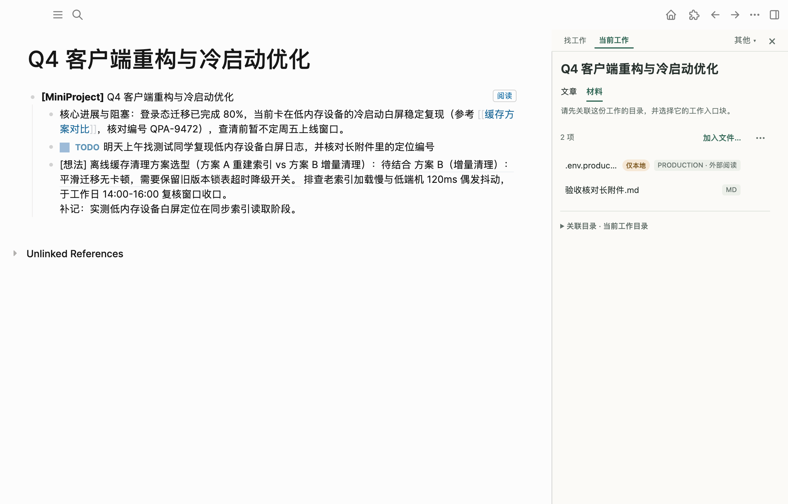
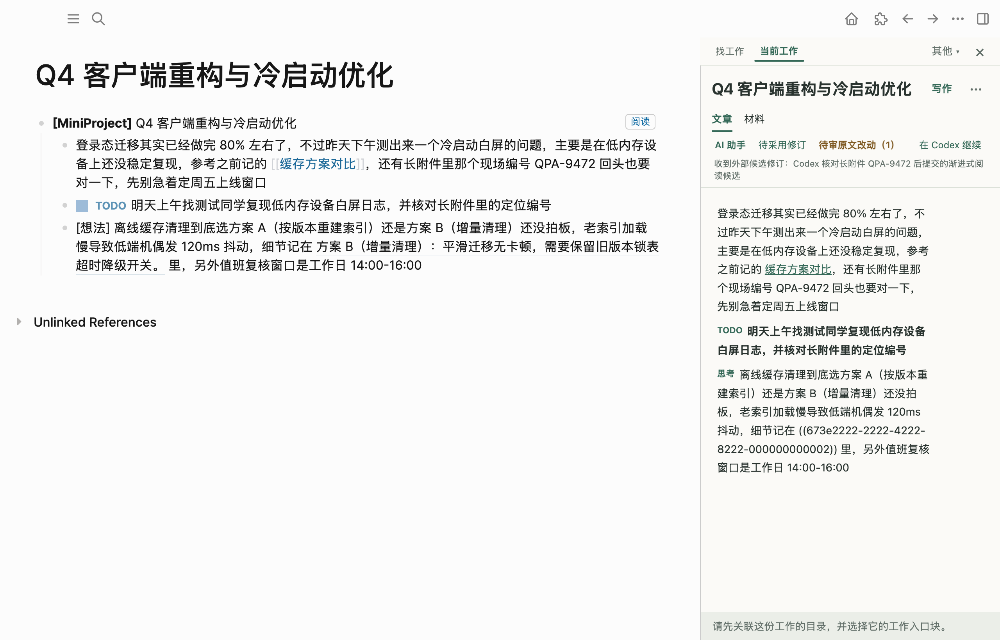
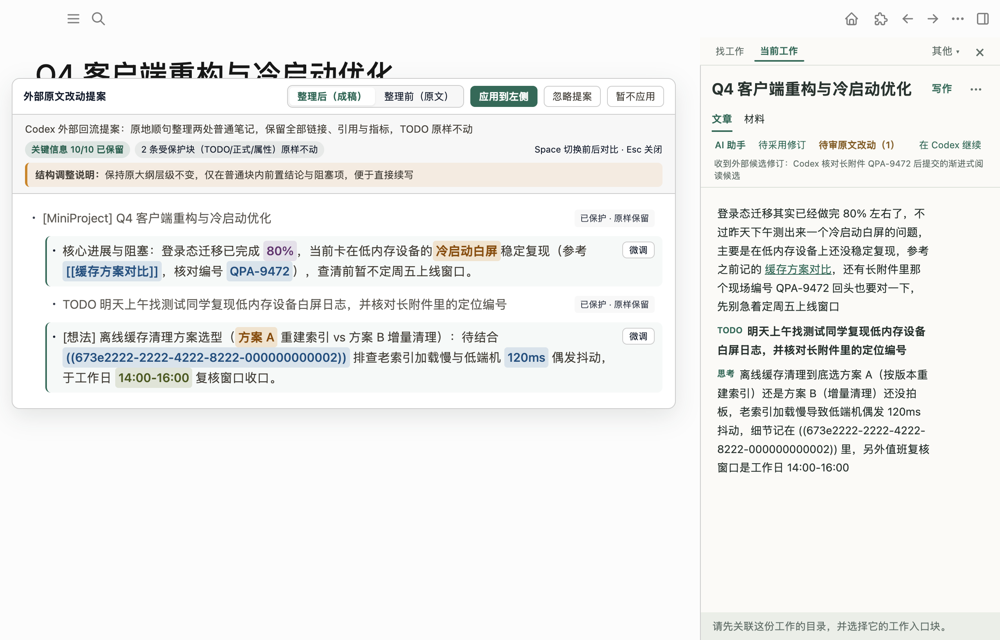
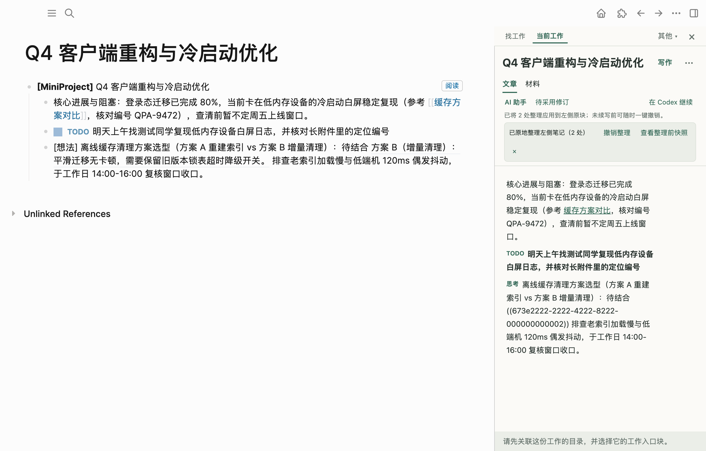
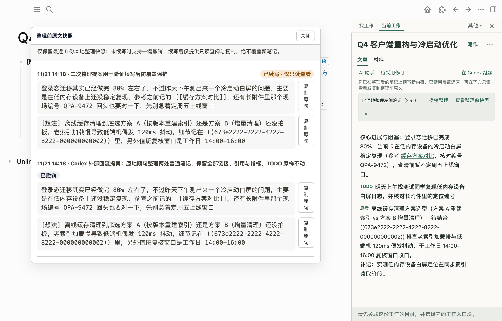

# 中立 Companion 阅读运行时与 Phase 1–3 实机验收

2026-11-21 · 结论：Phase 1（阅读 AI 与 DSH 解耦）、Phase 2（标准 stdio MCP 与多目标协作交接）、Phase 3（左侧原地笔记整理、关键锚点 FLIP 预览、安全撤回与 MCP 原文回流闭环）的打包产物通过独立离屏 Logseq Desktop 0.10.15 实机验收，并已修复验收期间暴露的真实宿主编辑态误拦截与材料目录摘要 UUID 展示问题。

## 1. 基线、交付产物与隔离环境

| 项目 | 实际状态 |
| --- | --- |
| 开发基线 | `codex/logseq-workbench-productization`（`a4b36c1a`，已合入 `main` 于 `d5ff8d60`） |
| 架构依据 | [决策登记 D-36 ～ D-46](../product-design/DECISION-REGISTER.md) |
| 交付构建代码提交 | `7615f8b60e1886326498f9e84fa7cd74d83099b9`（后续本验收文档提交不改变运行代码） |
| 交付 ZIP | `tmp/deliverables/task-copilot-workbench-neutral-companion.zip`（干净代码树 `builtFromDirtyTree: false`，共 620 个打包成员，其中 616 个 `dist/` 资产逐项 SHA-256 核验通过） |
| ZIP SHA-256 | `2e1db3b1fbefb71a9877c06be9495305cdd13586d854116656af8f7f3fe759b1` |
| 构建标识 | `0.2.0 · 预览 2026-11-21T06:14:35Z · 7615f8b6` |
| 宿主与运行时 | macOS ARM64 · Logseq Desktop 0.10.15（Electron 38.4.0）· Node v20.20.2 |
| 协作服务 | 仅启动解压 ZIP 内的 `dist/workspace.mjs workspace serve` 与 `dist/workspace.mjs workspace mcp`；**全程未启动 DSH 与 Kernel** |

**隔离方式。** 从 `/Applications/Logseq.app` 通过 APFS 写时复制克隆独立验收副本至仓库外 `~/Library/Caches/task-copilot-package-acceptance/`，设置独立 `home`、`profile`、合成文件 Graph、Companion 状态目录及 CDP 端口 `19461`。Electron 主进程强制 `offscreen: true`、`show: false`、`focusable: false` 并拦截 `show()`/`focus()`/`openExternal()`。窗口审计收据记录 `offscreen: true, visible: false, focused: false, blockedShow: 1, blockedFocus: 0, offscreenViolations: 0`。原有运行中的 `tmp/phase3-logseq-lab` 与日常环境零交互，验收结束后已清理全部验收进程与临时目录。

## 2. 实机验收期间发现并修复的真实宿主问题（`7615f8b6`）

1. **真实宿主 `checkEditing()` 误拦「应用到左侧 / 撤销整理」**：Logseq Desktop 冷启会默认将光标停在当日 Journal 空白块；切到目标工作页后 `logseq.Editor.checkEditing()` 仍返回该后台无关块的 UUID，导致原先无差别判定 `if (await logseq.Editor.checkEditing())` 阻断落盘。已修改 [executor.ts](../../apps/logseq-plugin/src/features/note-tidy/executor.ts) 与 [reading-ai.ts](../../apps/logseq-plugin/src/features/work-view/reading-ai.ts)，仅在 `editing === true`（未知编辑块）或命中本次受影响目标块 UUID 时拒绝写入/撤回，并在 [note-tidy-roundtrip.test.mjs](../../apps/logseq-plugin/tests/integration/note-tidy-roundtrip.test.mjs) 补齐三态回归测试。
2. **材料区折叠目录摘要暴露原始 UUID**：首轮实机截图中材料区底部 `
` 显示原始块 UUID。已在 [controller.ts](../../apps/logseq-plugin/src/features/materials/controller.ts) 将 UUID 目录名统一映射为「当前工作目录」，并同步更新 [material-editor.test.mjs](../../apps/logseq-plugin/tests/integration/material-editor.test.mjs) 对应断言。

## 3. 分阶段实机验收记录

### Phase 1：中立 Companion 运行时与隐私边界（无 DSH） — 通过

- 打包版 `dist/workspace.mjs` 在零 DSH 状态下独立提供 Companion 服务；插件成功连接并在 `0600` 私有目录持久化配置，前端响应与 DOM 零密钥泄露。
- 标记 `privacyMode: "local-only"` 且未配置本地端点时，`/plugin/reading-model` 与 `/plugin/note-tidy` 均以 `READING_LOCAL_MODEL_REQUIRED` Fail Closed 拒绝，云端请求数为 0。
- 材料面板呈现精简头部（数量 + `加入文件…` + 低频菜单）、敏感 `.env.production` 的暖色「仅本地」标记，以及折叠的 `▸ 关联目录 · 当前工作目录`。

### Phase 2：标准 stdio MCP（6 工具边界）与多目标协作交接 — 通过

- 在真实工作台 AI 助手中将默认协作目标由 `DSH` 切换为 `Codex`，主操作按钮即时切换为「在 Codex 继续」并持久化至 `collaborate.json`；点击后建立当前工作的真实只读连接。
- 启动解压 ZIP 内的 `dist/workspace.mjs workspace mcp --client codex`：
  - `tools/list` 返回准确 6 个工具：`workbench_list_works`、`workbench_get_active_work`、`workbench_read_sources`、`workbench_read_material`、`workbench_submit_reading_candidate`、`workbench_propose_writeback`。
  - `workbench_list_works` 自动发现当前 Graph 中全部 2 份工作（`Q4 客户端重构与冷启动优化`、`机房交接验收计划`）。
  - `workbench_read_sources` 读取当前工作 4 条实时原块；跨工作读取另一份工作时被硬拦截（`SCOPE_MISMATCH`）。
  - `workbench_read_material` 分页读回长附件末尾唯一编号 `QPA-9472`；读取 `.env.production` 被硬拦截（`SENSITIVE_MATERIAL_BLOCKED`），响应中零密钥字符泄露。
  - `workbench_submit_reading_candidate` 暂存外部渐进式阅读候选（`staged: true`），Logseq 恢复焦点后工作台安静出现「待采用修订」。

### Phase 3：左侧原地整理、FLIP 预览、安全撤回与续写防覆盖 — 通过

- 通过打包版 stdio MCP 调用 `workbench_propose_writeback`：
  - 试图改写 `TODO` 块时被硬拒绝（`PROTECTED_TARGET_FORBIDDEN`）。
  - 提交针对 2 条普通笔记块的整理提案后（`writesSource: false`，附 10 处高先验锚点），工作台安静出现独立入口 **「待审原文改动（1）」**（与只改读面的「待采用修订」明确隔离）。
- 点击「待审原文改动（1）」后，`NoteTidyPreviewOverlay` 原位挂载在左侧 `#main-content-container`（`placement: inline`），完整呈现 `关键信息 10/10 已保留`、`2 条受保护块（TODO/正式/属性）原样不动`、结构调整说明与 8 处可见锚点高亮（`80%`、`冷启动白屏`、`[[缓存方案对比]]`、`QPA-9472`、`方案 A`、`((673e2222-...))`、`120ms`、`14:00-16:00`），并支持「整理后（成稿）」⇄「整理前（原文）」对比切换。
- 点击 **「应用到左侧」** 后：浮层关闭，左侧真实 Logseq 块即时更新，`TODO` 块逐字节不变，块引用 `((673e2222-2222-4222-8222-000000000002))` 保持完整并由 Logseq 实时解析；右侧出现撤回条（`撤销整理` / `查看整理前快照`）。
- 未续写时点击 **「撤销整理」**：两条被整理原块逐字无损恢复（`b1Verbatim: true, b3Verbatim: true`）。
- 二次应用提案后模拟用户在第三块末尾续写新内容（`补记：实测低内存设备白屏定位在同步索引读取阶段。`），再次点击「撤销整理」被安全阻止，续写内容 100% 保留；点击 **「查看整理前快照」** 打开只读快照列表，清晰标注 `已续写 · 仅只读查看` 与 `已撤销` 并提供「复制原句」。

其他留证：[整理前对比视图](assets/neutral-companion-reading-runtime-validation/03-note-tidy-overlay-before.png) · [机器核验收据 JSON](assets/neutral-companion-reading-runtime-validation/receipts/desktop-acceptance-receipt.json)。

## 4. 自动化回归核验摘要（Node 20.20.2）

- `npm run docs:requirements`（44 节点）、全 12 个 workspace `npm run typecheck`、`npx eslint apps packages scripts`、`npm run test:sandbox`（5/5）、`npm run build`（含 `check-built-binaries`）、`npm run check:boundaries`（12/12）、`npm run taste:eval`（PASS）全部通过。
- `verify-companion-ui.mjs` 离线与真实 stdio MCP 专项检查 **10/10** 全部通过（`c4-local-privacy`、`m1-catalog` ～ `m5-writeback-audit`、`t1-anchors-protection` ～ `t4-local-privacy-guard`）。
- Phase 1～3 专项与材料集成回归（`note-tidy-roundtrip`、`mcp-collaborate-handoff`、`reading-ai-decoupled`、`material-editor`、`materials-reading-ux`）**33/33** 全部通过；`@task-copilot/reading-runtime`、`@task-copilot/cli`、`@task-copilot/dsh-logseq-workbench`、`@task-copilot/kernel-service` 等其余 workspace 测试全部通过。

## 5. 未验证边界

- 本轮实机验收全程在离线隔离环境以合成样本执行，未向远端 DeepSeek / Anthropic 云端模型或本地 Ollama 发起真实推理请求；在线直连模型生成质量与长延迟网络恢复依赖 `verify:companion` 互动面板或用户真实配置后的试用验证。
- 未在日常 Graph、Windows/Linux、DB Graph 或物理输入法组合键（IME）场景做实机认证；Work Evidence（Git/目录变更回执）按 D-46 留待后续阶段。
- 全仓 `npm test` 中仍有 2 项源自上一轮产品化下沉旧菜单的历史遗留断言（`view-lenses-ui.test.mjs:74` 的 `只读选中部分` 与 `stage-review.test.ts:132` 的 `原结构`），未在本分支强改旧语义。
