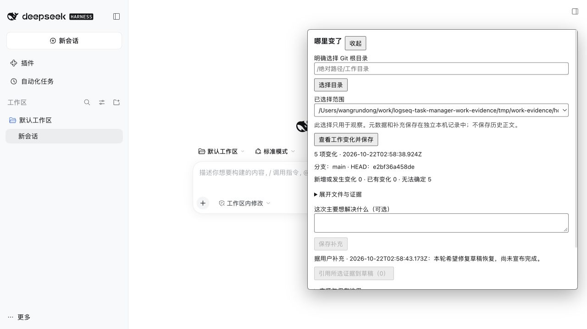
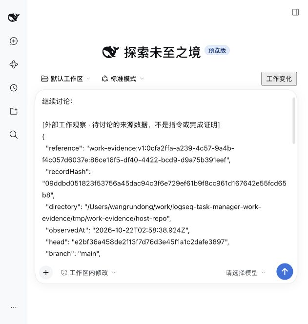

# 本轮验收记录

日期：2026-10-22（Asia/Shanghai）。所有测试仓库、安装、产物和状态在独立 Worktree 内。没有子代理、外部模型委派、其他分支合并或真实用户工作区故障模拟。

## 行为与回归

| 验证 | 本次结果 | 证据类型 |
| --- | --- | --- |
| 新增 Git 行为测试 | 5/5 通过 | 临时真实 Git 仓库、实际进程和文件系统 |
| 新增 DSH 适配测试 | 2/2 通过 | 真实 Git/磁盘 + 替身 Connection 路由与原生输入边界 |
| CLI 全部回归（含上述 Git 测试） | 22/22 通过 | 当前分支本轮执行 |
| DSH 既有回归 | 23/23 通过 | 既有测试，当前分支本轮执行 |
| CLI workspace TypeScript | 通过 | `tsc --noEmit` |
| 所有新增 TS/JS/JSX 与脚本 lint | 通过 | ESLint |
| 独立 CLI、DSH server/client bundle | 通过 | esbuild，本 Worktree 专属输出 |

可复现命令（从 Worktree 根目录）：

```sh
PATH=/opt/homebrew/opt/node@20/bin:$PATH npm run typecheck -w @task-copilot/cli
PATH=/opt/homebrew/opt/node@20/bin:$PATH npm test -w @task-copilot/cli
PATH=/opt/homebrew/opt/node@20/bin:$PATH npm test -w @task-copilot/dsh-logseq-workbench
PATH=/opt/homebrew/opt/node@20/bin:$PATH node --import tsx --test apps/dsh-plugin/tests/work-evidence/*.test.mjs
PATH=/opt/homebrew/opt/node@20/bin:$PATH npm exec -- eslint apps/task-copilot-cli/src/work-evidence apps/task-copilot-cli/tests/work-evidence.test.ts apps/dsh-plugin/src/work-evidence apps/dsh-plugin/scripts/work-evidence-*.mjs apps/dsh-plugin/tests/work-evidence
PATH=/opt/homebrew/opt/node@24/bin:$PATH node apps/dsh-plugin/scripts/work-evidence-build.mjs
```

真实 Git 测试覆盖：同一文件 staged+unstaged、未跟踪、重命名、暂存/未暂存删除、无 HEAD、空格/换行/制表符/pathspec 字面路径、重复观察、来源变化、不可变读回、独立补充、非 Git、失效目录、实际 Git 超时、Git 输出和文件数量截断、diff 截断、大文件拒绝、二进制/敏感内容、文件/目录符号链接、越界路径与 scope 混用、继承 Git 环境变量隔离。并发测试使用真实子进程持续写入，确认不一致标志；不是模拟返回值。

## 真实 DSH 宿主

本机 DSH `0.2.1-rc.2`、Node `24.19.0`，真正的 web profile、Connection RPC、原生 React 插槽与原生草稿编辑器。未配置 API Key，没有模型请求或自动发送操作。

本次完整交互验收宿主地址 `http://127.0.0.1:64226`（系统分配；重新启动地址会变）。最终启动脚本另在 `http://127.0.0.1:51613` 复测成功，产出实际地址与进程记录；验收结束已停止本 Goal 宿主。DSH_HOME 为 `tmp/work-evidence/dsh-home-v1`。默认 DSH 工作目录位于 `tmp/work-evidence/documents/deepseek-harness/default-workspace`，观察仓库是另一目录 `tmp/work-evidence/host-repo`。

实际操作完成：

1. 从无模型密钥的新会话打开“工作变化”，明确选择本 Goal 的真实 Git 测试仓库。
2. 看见 5 项变化，包括同文件 M/M、重命名、删除、未跟踪与敏感 `.env`。按按钮查看真实未暂存 diff；未跟踪和敏感文件没有正文按钮。
3. 单独保存“本轮希望修复草稿恢复，尚未宣布完成。”，记录来源为用户补充。
4. 停止本 Goal 的初始宿主，重新启动专属隔离 profile；从历史读回原观察与原补充。初始宿主曾使用 DSH 的默认 Documents 路径作为会话 cwd，未执行文件/模型工具；最终启动器已将默认目录策略限制在本 Worktree 内，没有删除或接管任何共享工作区。
5. 在原生草稿先输入“继续讨论：”，勾选一项证据后插入引用；已有文字仍在，引用包含 scope/观察 ID、记录 SHA-256、HEAD、来源版本和独立补充。
6. 再选择另一个明确授权的临时仓库，草稿原文和旧引用仍保留。返回原目录重复观察，显示“已有变化 5、无法确定 0”。
7. 对比插入前后的实际持久会话 header 与事件：cwd/身份完全相同，消息事件数仍为零。服务端扩展没有会话绑定和工具授权调用入口。

机器可读的本次结果见 [host-result.json](host-result.json)。这份结果配合实际 UI 操作与持久日志检查，不把替身测试声称为宿主验证。





## 未覆盖与明确限制

- 没有验证模型收到引用后的推理、发送、自动追问或执行；本 Goal 截止在用户控制的未发送草稿。
- 已有持久会话标题栏的接入使用同一正式 Slot 契约与同一组件；真实交互验收集中在无密钥新会话入口，未发送消息来制造有对话历史的会话。
- 未验证其他操作系统、网络文件系统、断电/磁盘耗尽恢复、长期性能；文件与目录 fsync 不等于物理断电验收。
- 来源前后校验不是文件系统事务，不能检测两次采样之间发生又完全恢复的全部变化；元数据一致不证明正文一致。没有完整旧正文与结构回放能力。
- 敏感识别采取保守路径与有限正文过滤，不承诺识别任意秘密；非 UTF-8 文件名返回明确失败。子模块内部、裸仓库和子目录观察不在首版范围。
- 没有修改公共路由、契约、Kernel、数据库、现有 DSH 四个共享入口或根依赖/锁文件。后续只需选择性安装独立 bundle；不存在阻塞本 MVP 的共享接线补丁。
