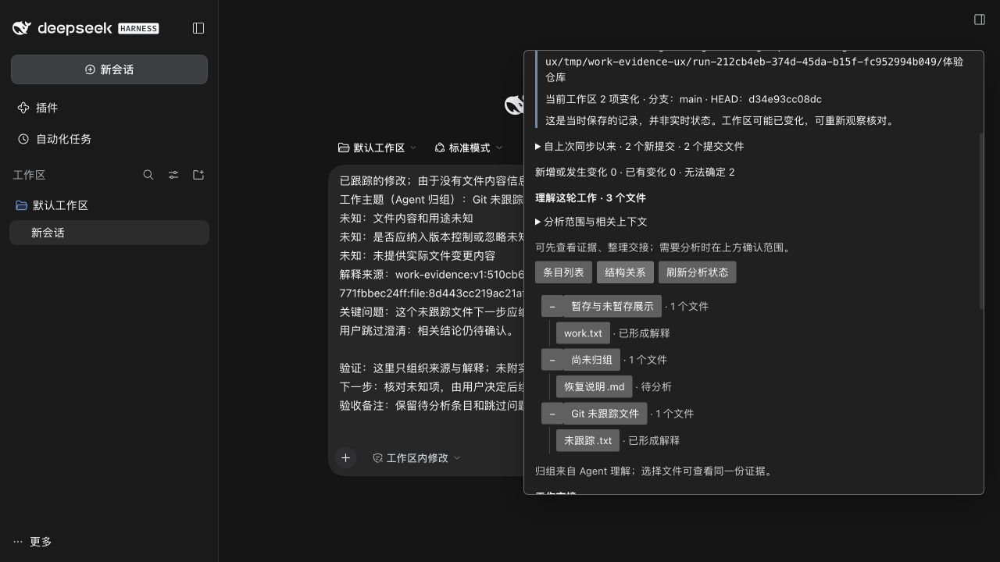
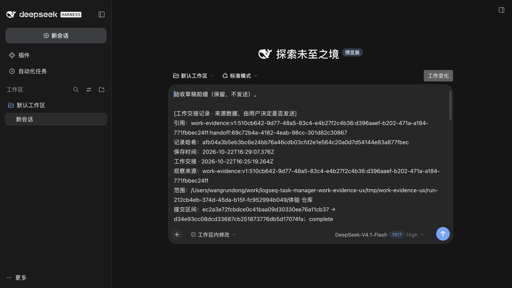

# 交互式工作还原：实现与验收

日期：2026-10-23（Asia/Shanghai）。本报告是本次运行的结果，不沿用 v1/v1.1 的宿主结论。

## 现场和分支

- Worktree：`/Users/wangrundong/work/logseq-task-manager-work-evidence-ux`。
- 分支：`codex/work-evidence-ux-v1`；起点：`2dbf12fa3c130915ce40fab699126c9d2d4e86a5`。
- 开工已刷新远端并核对 main `77200e6642cbb990bfd5fc3409c9101b0d7d3f8f`、Work Evidence 开发线和结构历史 `b1c7c44d767d98454a641a97020df95b44623752`。交付前再次 fetch，main/UX 远端起点未变，结构历史远端分支已被删除；固定提交仍作历史参考，不恢复或合入该分支。
- 使用 Node 20.20.2 的项目工具与 Node 24.19.0 的 DSH/构建。本机 DSH 0.2.1-rc.2。没有更改根依赖/锁、日常 profile、其他 Goal 工作区或服务。
- 本轮始终单 Agent 执行，没有子代理、DSH Worker 或外部委派。下述宿主 LLM 是所实现产品本身的明确分析操作，不是开发委派。

## 实现与 UX

增量来源层复用原 EvidenceStore 和 Git 边界，记录上次有效观察至当前 HEAD 的提交元数据，再把提交文件与 dirty 工作区按路径/重命名别名聚合。保留改后改回的中间提交来源。无法核验的历史保持未知，未保存的历史正文不会伪装成可重放快照。

默认文件列表直接呈现局部状态和解释；目的归组仍保留文件。模型输入可以参考同轮其他文件已形成的主题，并保留其解释引用；不把别的解释升格为事实。大 diff 的预算不能挤掉用户澄清，截断仍可核对。

模型解释通过实际 `ctx.llm.stream`/`agentDefaultModel.currentSelection()`；按文件启动，只读允许内容，无 tools、无 sessionId、无原生消息提交。缺少模型、输出错误、超时、中断或来源不可用不会伪造解释。重启后没有活跃任务的遗留起点显示中断；相同启动请求只重查回执，不自动重复付费调用。

回答、基于解释修订及跳过均保存为独立用户记录。回答后只分析当前条目，旧解释和后续输入保留；尚未分析新说明时显示“待更新解释”。交接可提前生成，保留未分析、失败、跳过、来源失效及未知项。用户检查/编辑后才保存，修订另存并指向旧版。引用由准备、预览、原生追加插入组成，发送仍由用户决定。

结构历史的 renderer 直接依赖业务快照与来源选择。本轮没有复制完整业务模块，而是建立最小通用节点/边、分层布局、选择和展开工具 `apps/dsh-plugin/src/structure-view/`；Work Evidence 自己适配主题和文件。不添加图形框架、状态机平台、第二套 Evidence 数据库或模型 fallback/retry 层；持久校验统一复用既有 Store，DSH/Logseq 通道复用现有只读 API。

## 本次自动化

| 检查 | 本次结果 | 范围 |
| --- | --- | --- |
| CLI 全部 + Work Evidence 专属 | 61/61 | CLI 33，专属 28；真实临时 Git、磁盘记录、JSX 回调及显式模型替身 |
| 既有定向回归 | 52/52 | DSH 23，加阶段审阅/工作台/SQLite 历史迁移；没有取未合并分支代码 |
| 全工作区 TypeScript | 通过 | 根 `npm run typecheck`；DSH 无独立 TS 脚本，另经 ESLint 和 bundle 检查 |
| 受影响两个 workspace ESLint | 通过 | CLI src/tests、DSH src/tests/scripts 全范围 |
| DSH 原 workspace 构建 | 通过 | Node 24，原 bundle 构建回归 |
| Work Evidence 独立构建 | 通过 | 本 Worktree `tmp/work-evidence-reconstruction/final-build`，server/client/CLI |
| 真实 DSH 端口冲突 | 通过 | 自建占用服务及合成 profile；固定端口启动失败，不改 origin，不停止占用服务 |

合计 113 项行为/定向回归通过。原始日志见 [behavior.tap](evidence/behavior.tap)、[regression.tap](evidence/regression.tap)；其他门禁见 [checks.json](evidence/checks.json)。

新增行为覆盖：多提交和当前 dirty 混合、重复观察与重启、净改动为零的中间提交、无 HEAD、重命名/历史改写、受限历史 blob、统一引用、不可变解释/澄清/交接、回执幂等、局部重分析、跳过、缺模型、中断、假引用拒绝、保留新输入、过期解释重新编辑、恢复读取失败不抹掉导航、跨文件主题来源及大 diff 不挤掉已保存回答。

Logseq 连接验收使用真实 loopback WorkspaceServer + CompanionTransport，以及显式合成宿主回复，验证已有精确目录授权、版本/读许可拒绝和零 bind/refresh/write。DSH 会话正文测试使用实际 inspect 接口形状的显式替身，检查精确 cwd、只取可见文字、排除工具/敏感内容。它们不冒充真实用户 Graph/会话读取。

## 本次真实 DSH 与模型

专属运行 `run-212cb4eb-374d-45da-b15f-fc952994b049`，最终地址 `http://127.0.0.1:58060`；normal bundle，没有故障模型门。用户在该隔离 profile 配置模型，本轮未读取或复制其密钥。实际 UI 选择为 DeepSeek-V4.1-Flash（High），宿主产生 4 个真实分析起点和 4 个真实结果。

| Goal 场景 | 结果与实际证据 |
| --- | --- |
| 1. 同步新提交及未提交变化 | 初始干净检查点后，在自有仓库建立两个提交、staged、unstaged 和 untracked；第二条观察包含 2 个新提交，统一 3 个文件 |
| 2. 文件与 Diff | 在实际面板分别查看 work.txt 的历史提交、暂存及未暂存差异，内容分离；未跟踪条目只取元数据 |
| 3. 局部进度与解释 | 同时分析 work.txt 与未跟踪文件，另一条目仍可浏览；实际流式宿主返回自然语言解释、主题和问题 |
| 4. 回答后局部更新 | 回答 work.txt 问题，其 runId 更新；未跟踪条目的 runId/解释未变。随后验证“基于当前解释修订”，未授权时显示待更新，再明确允许后局部更新 |
| 5. 跳过且保留未知 | 另一文件点击跳过，持久 clarification.skipped=true，界面与交接保留待确认；没有再次自动分析它 |
| 6. 保存及重开 | 编辑首份交接后保存、重开，另存修订版指向原记录；最终代码又保存一份当前交接，共 3 份不可变记录 |
| 7. 原生草稿引用 | 将首份记录 ID/哈希引用追加到已有“验收草稿前缀”；输入和引用仍在原生编辑器，发送按钮可用而未触发，聊天没有新增消息 |
| 8. 列表/结构切换 | 同批 3 个文件和 Agent 主题切换；节点选择打开相同文件证据 |
| 9. 失败/重载恢复 | 两处未保存输入在新页面恢复；修改合成来源后读取旧观察 diff 得到 SOURCE_CHANGED，输入与历史仍在；重启宿主复用原 origin 后，回答草稿、交接历史和原生草稿恢复 |

当前持久记录与模型来源摘要见 [real-host-summary.json](evidence/real-host-summary.json)，重启 DOM 检查见 [restart.json](evidence/restart.json)。这些文件只含自有合成证据和版本，不包含密钥、会话认证 URL 或完整 diff。

真实界面：

本轮发现并修复：兄弟组件重复 key 导致重复面板；重新分析后旧问题回答未进入交接；新回答未分析却误显示解释已更新；来源恢复读取失败提前抹掉导航；随机重启端口改变浏览器 origin；大 diff 预算可能挤掉用户回答。对应代码/自动化与真实宿主结果分别记录，未把 JSX/模型替身当作宿主成功。

## 未覆盖与后续整合

真实用户 Logseq Graph 和含历史文本的真实 DSH 会话未接入本次隔离验证；其关联能力通过只读接口与合成授权桥接验证。没有完整文件快照、按内容精确去重、自动测试执行、结构历史回放或正式 Kernel 操作。模型解释的准确程度仍需用户核对；四层来源不会互相替代。

原始 diff、会话正文和 Graph 正文没有完整存档；旧引用能核对元数据/记录哈希，不保证能重现所有历史正文。浏览器临时输入不跨浏览器/设备/运行迁移。已保存历史完整性失败时该观察的继续追加会被拒绝，其他有效观察仍可读。

独立实际 DSH 扩展已可运行，无共享接线阻塞。后续串行整合仅需在目标 profile 加载独立 bundle、提供专属 stateDirectory；需要非默认 Companion 状态目录时显式配置 workspaceStateDirectory。共享工具可供结构历史适配，但本轮没有接管或合并结构历史。只推送本开发分支，不推 main。
