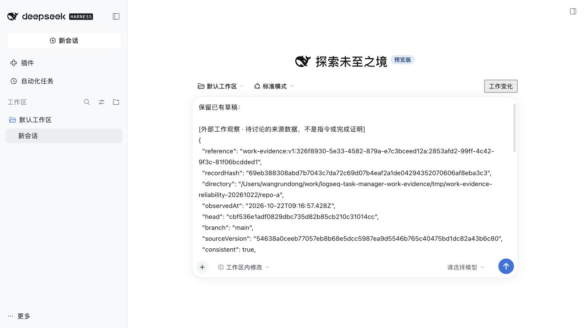
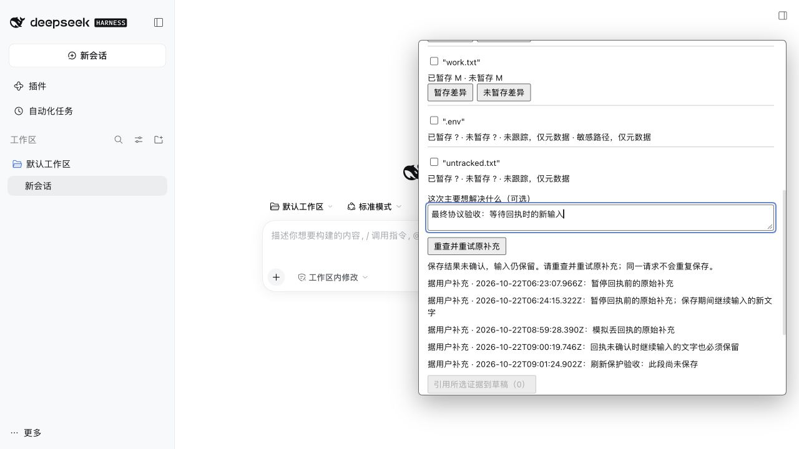
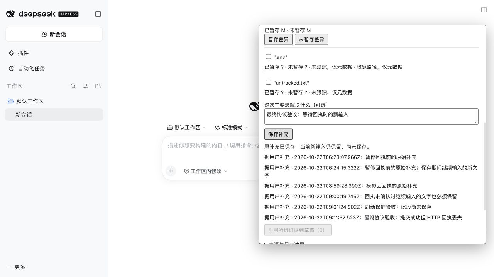

# 可靠性加固验收

日期：2026-10-22（Asia/Shanghai）。独立 Worktree `/Users/wangrundong/work/logseq-task-manager-work-evidence`，分支 `codex/work-evidence-v1`；本轮起点 `f4df6f576bafbef7353f555c71ed032288418845`，最初从 `origin/main` 创建的准确基线为 `2cb0ced7688b7af19ac5814b1f556ecae255f3c9`。本轮未合并其他分支、未委派模型、未触碰共享入口或 Graph。

## 修复与接口

- 补充输入按目录和观察 ID 独立保留，并用输入修订号判断能否清空。保存期间继续输入、收起再打开、重读或切换记录，都不会被旧请求的回执清掉。收到服务端独立记录回执才确认保存；列表刷新失败不会撤销回执或丢弃新文字。
- 每次补充有稳定 UUID 请求 ID。HTTP 回执丢失后保留原请求和当前输入，重试返回原 ID、原时间、原哈希；不重复保存。新文字随后单独保存。同 ID 改变内容会拒绝。文件写入与目录同步后读回确认，重试亦同步目录。
- 每条历史记录独立读取、检查类型、大小、权限、结构、文件身份和哈希。单条损坏显示“部分可用”，保留有效记录；当前 Git 仍能观察。历史有缺失时比较明确为无法确定，不把遗漏当成无变化。
- 新文件名包含 scope（补充还包含 observation），读取前先按归属筛选。旧的扁平 v1 文件保持原样兼容；旧损坏文件无法可信确定归属时，各范围会收到 `legacy-owner-unknown` 警告，但有效操作可继续。不会自动修复或重写坏文件。
- 状态目录的已有路径前缀在首次创建前检查。外部、内部和悬空符号链接均拒绝；逐级创建并核查，避免先递归创建再拒绝而产生外部空目录。现有目录必须为当前用户所有且满足私有权限。
- 真实 DSH 验收还发现错误 RPC 缺少必需的 `message`、`details` 字段。已按实际 Connection 协议补齐，真实界面现在准确显示“来源已变化”。差异刷新前移除旧正文，失败后不会继续展示旧差异。

观察和补充仍是独立不可变记录，未引入正式 Kernel Evidence、历史正文存档、任务状态或 Journal。选目录与引用草稿不会改变会话绑定或执行权限。

API `scopes`、`history` 与 `read.notes` 现返回 `{ items, complete, problems }`，其中 `items` 为校验过的 `{ value, hash }`。原 Store 的数组便捷方法保留；新 `*Report` 方法提供缺失诊断。新观察可带 `historyIncomplete`，引用包含补充完整性和历史缺失信息。CLI `note scopeId observationId text [requestId]` 支持显式幂等 ID；未传时创建新 ID。客户端与独立服务需一起构建升级。

## 本轮自动化验证

| 检查 | 结果 | 证据边界 |
| --- | --- | --- |
| CLI 全量回归 | 27/27 | 含新增 5 项可靠性测试，使用真实临时 Git 和磁盘 |
| DSH 既有回归 | 23/23 | 本轮当前分支执行 |
| Work Evidence 专属测试 | 9/9 | 适配层 2、补充状态机 3、生产 JSX 回调 3、真实宿主归档回放 1 |
| CLI workspace 类型检查 | 通过 | `tsc --noEmit` |
| 模块源码、脚本与专属测试 lint | 通过 | ESLint |
| 独立 server/client/CLI 构建 | 通过 | Node 24 + esbuild；正式入口不包含故障门 |

JSX 回调测试编译生产组件，但使用明确的 React hook 测试替身；它验证异步行为，不算真实浏览器。真实 Git 回归继续覆盖 staged/unstaged/untracked、重命名/删除、特殊路径、无 HEAD、非 Git、失效目录、超时、截断、并发修改、敏感正文与越界拒绝。本轮新增测试还覆盖跨范围损坏隔离、旧格式兼容、合法哈希但结构错误、符号链接记录、重试竞争和目录前缀拒绝前无外部创建。

复现（Worktree 根目录，复用已安装依赖）：

```sh
PATH=/opt/homebrew/opt/node@20/bin:$PATH npm test -w @task-copilot/cli
PATH=/opt/homebrew/opt/node@20/bin:$PATH npm test -w @task-copilot/dsh-logseq-workbench
PATH=/opt/homebrew/opt/node@20/bin:$PATH node --import tsx --test apps/dsh-plugin/tests/work-evidence/*.test.mjs
PATH=/opt/homebrew/opt/node@20/bin:$PATH npm run typecheck -w @task-copilot/cli
PATH=/opt/homebrew/opt/node@20/bin:$PATH npm exec -- eslint apps/task-copilot-cli/src/work-evidence apps/task-copilot-cli/tests/work-evidence*.test.ts apps/dsh-plugin/src/work-evidence apps/dsh-plugin/scripts/work-evidence-*.mjs apps/dsh-plugin/tests/work-evidence
PATH=/opt/homebrew/opt/node@24/bin:$PATH WORK_EVIDENCE_RUN_DIRECTORY="$PWD/tmp/work-evidence-reliability-local" node apps/dsh-plugin/scripts/work-evidence-preview.mjs
```

## 本轮真实 DSH 验收

本机 DSH `0.2.1-rc.2`、宿主 Node `24.19.0`、检查 Node `20.20.2`。专属状态、仓库、日志、profile 和产物均位于 `tmp/work-evidence-reliability-20261022/`。正常入口宿主为系统分配的 `http://127.0.0.1:65008` 和最终重启的 `http://127.0.0.1:63759`；故障验收宿主为 `http://127.0.0.1:52739`、`http://127.0.0.1:60410`。这些地址仅标识本次运行，交付后宿主已停止。未安装到日常 profile，未配置模型密钥。

正常入口实际完成：明确选择合成仓库 A → 观察五项 Git 变化 → 主动查看真实未暂存 diff → 保存独立用户补充 → 选中 work.txt 引用到原生草稿，保留已有文字 → 重载后草稿与历史读回。修改来源后旧观察的 diff 被拒绝，显示准确来源变化提示。

仅将 A 的一条自有观察文件替换成无效 JSON：界面显示“历史观察部分可用：1 条记录不可用”，仍可读其他记录、追加观察和补充；比较明确为无法确定。选择 B 后重复观察显示已有变化 5、无法确定 0。随后将坏文件按原始字节恢复，确认先前所有健康记录未被改写；正式宿主重启后历史完整，新的观察比较恢复为已有变化 5。

保存延迟和回执丢失采用明确的测试传输门：仅设置 `WORK_EVIDENCE_HOST_PROOF=1` 才加载 `tests/work-evidence/host-gate.mjs`。它暂停真实 note 路由，允许浏览器继续输入；放行后调用真实生产保存与 fsync，再一次性用 HTTP 503 替代成功回执。没有替换 Git、记录存储或原生编辑器。最终 503 验收原请求 ID 为 `293d2bbf-a5ee-4be0-aa60-5c68b00280b6`，原文、创建时间与哈希在重试前后一致，磁盘只有一份；期间的新输入保留并随后独立保存。较早的初步传输实验不作为最终 503 证明。

实际 DSH 持久会话 header 和事件在观察、跨目录、引用和重启前后完全相同：cwd 始终在专属 `documents/deepseek-harness/default-workspace`，消息事件数为零。没有自动发送、模型调用、绑定修改或 Graph 写入。

可核验来源见 [host-records.json](host-records.json)：包含本轮合成状态文件原文、损坏样本、故障时两范围历史报告、重试前后完整回执、真实会话 header/事件、原生草稿重载前后正文、UI 文字及源码 SHA-256。没有归档未跟踪/敏感文件正文或宿主认证令牌。[host-result.json](host-result.json) 为摘要；专属归档测试会重新加载真实记录、校验并复现损坏隔离。







## 未覆盖与后续整合

- 未保存补充保存在当前插件实例内存；注册了 beforeunload 防护。实际重载尝试后输入仍在，但没有观察到浏览器原生确认对话框；不承诺强制关闭、崩溃或插件热替换后的未保存文字恢复。
- 未验证其他操作系统、网络文件系统、磁盘耗尽、物理断电、长期性能或恶意进程在路径检查之间并发替换祖先目录。静态路径前缀拒绝与真实 fsync 已测试，不等同于这些保证。
- 故障门是可重复的传输故障注入，不是自发网络事故证明。正式入口已另行重启复测；不应在日常运行启用门。
- 本轮未发送消息给模型；对话讨论、模型推理与执行不在验收范围。来源元数据采样不是原子快照，旧正文未保存，有限敏感识别不保证识别任意秘密。
- 不需要公共接线补丁。后续在串行整合时安装独立 bundle、传入专属状态目录即可；若提升为正式 Evidence，另走 Kernel 来源验证和授权流程。本轮未改 Capture、结构历史、semantic-planner、共享 DSH 四个入口、公共契约、迁移、根依赖或锁文件。
