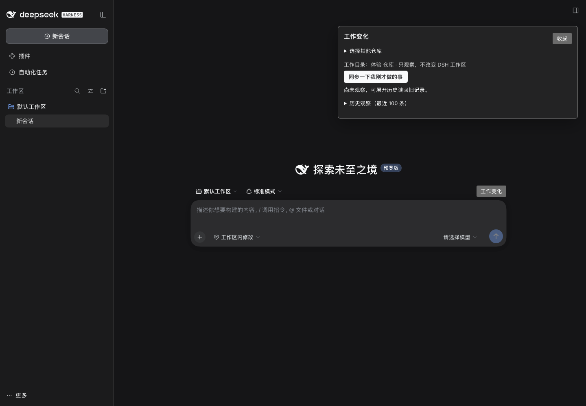
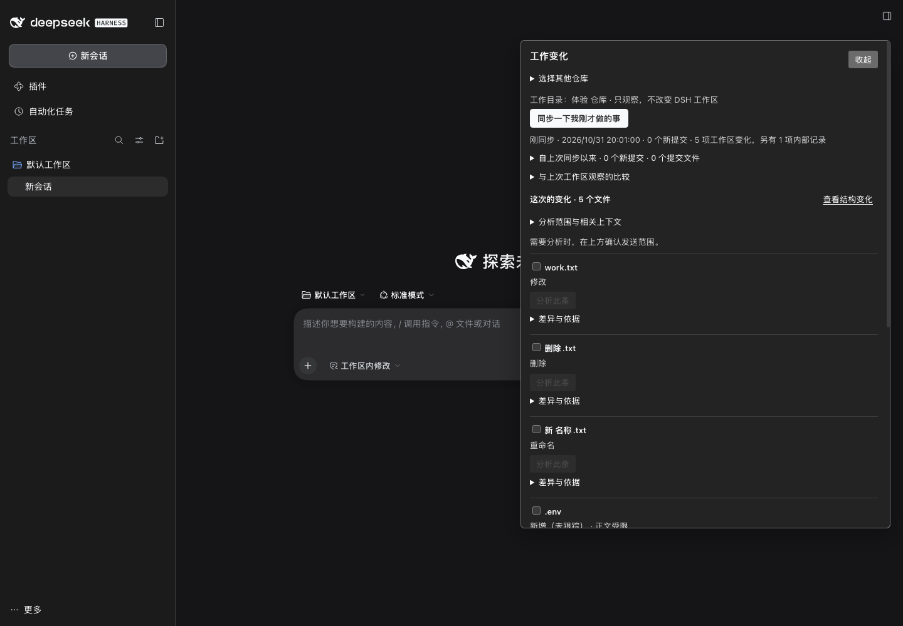
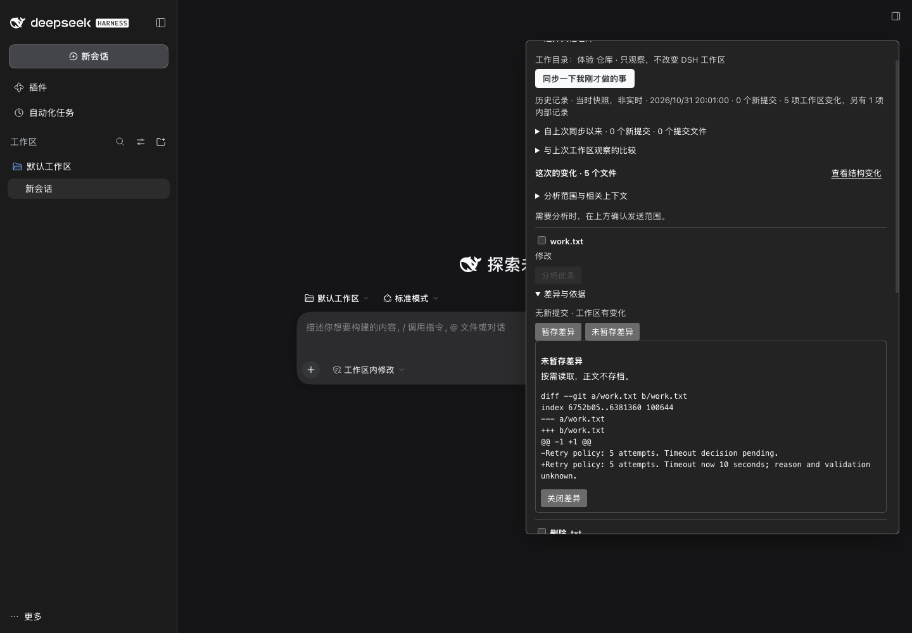
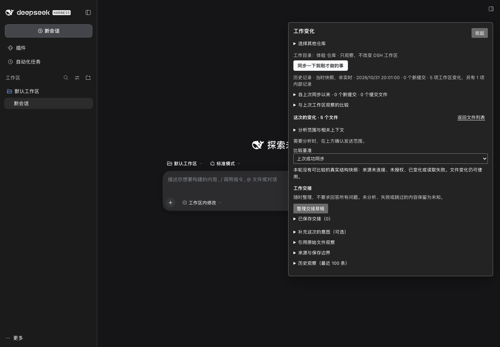

# Work Evidence UX 调整与隔离宿主验收

日期：2026-10-31（Asia/Shanghai）。本轮只推进 Work Evidence 自己的开发线，不合并 main、不改共享契约或其他 Goal 的工作区。

## 分支、Worktree 与起点

- 分支：`codex/work-evidence-ux-v1`
- Worktree：`/Users/wangrundong/work/logseq-task-manager-work-evidence-ux`
- 起点：`ce52552a8fb07e0018c6e91025ff8bcfd8081de5`（`fix(work-evidence): read scoped structure without mirror refresh`）
- 远端：`origin/codex/work-evidence-ux-v1`，开工与交付前均核对；未合并 main，未触碰其他 Worktree 的未提交文件。
- 修改范围：仅 `apps/dsh-plugin/src/work-evidence/`、`apps/task-copilot-cli/src/work-evidence/`、对应测试与本说明；没有改共享 contracts、workspace-agent 协议、Logseq installer/router、连接服务、Kernel、根依赖或 profile。

## 本轮改了什么

1. **信息层级**：目录只保留一行“工作目录 + 只观察，不改变 DSH 工作区”；完整路径放在 `title` 和“来源与保存边界”里。单目录时隐藏重复的范围选择器；“同步一下我刚才做的事”成为唯一主按钮。观察摘要区分“刚同步”和“历史记录 · 当时快照，非实时”，并显示本地时间、新提交数、工作区变化数与内部记录数。
2. **减少折叠前的噪声**：历史观察、比较、分析范围、意图、引用、来源边界默认折叠；比较统计、已保存交接和内部记录只在有内容时出现；文件行不再重复显示默认的“待分析”，只在分析中、已解释、待澄清或失败时显示状态。
3. **文件条目更可读**：每条先给出“新增 / 删除 / 重命名 / 复制 / 修改 + 提交数 + 正文受限”，提交和工作区来源仍合并在同一文件条目。差异改为在当前文件的“差异与依据”内展开，不再在面板底部重复显示第二个全局差异块。
4. **工作区内部记录**：`.task-workspace` 文件仍被观察和保留，但正文受限，默认收进“工作区内部记录”折叠区；交接草稿只写数量，不展开路径或正文。
5. **旧记录与敏感路径**：`sensitive` 增加 `.task-workspace`；文件条目在读取旧观察时也会重新判定受限路径；查看 diff 时再次检查路径，避免旧记录绕过当前限制。
6. **局部 diff 的失效边界**：查看某文件差异时，用该文件自身的 stamp 与分支/HEAD 核对当前来源，不再因其他文件的无关 churn 使整份差异失效；该文件本身或 HEAD/分支改变仍返回 `SOURCE_CHANGED`。
7. **结构视图入口**：列表/结构切换移到“这次的变化”标题行，按钮文字为“查看结构变化 / 返回文件列表”；结构比较基准的时间改为本地时间。

## 自动化检查

| 检查 | 结果 |
| --- | --- |
| `npm test -w @task-copilot/cli` | 35/35 通过 |
| `node --import tsx --test apps/dsh-plugin/tests/work-evidence/*.test.mjs` | 34/34 通过 |
| `npm run typecheck -w @task-copilot/cli` | 通过 |
| ESLint（Work Evidence 源码、脚本与测试） | 通过 |
| `npm run build -w @task-copilot/dsh-logseq-workbench` | 通过 |

新增回归覆盖：内部 `.task-workspace` 文件在旧观察中仍受限、diff 再次拒绝、交接不展开内部路径；无关工作区变化不影响所选文件 diff，而所选文件自身变化仍拒绝。

## 独立宿主验证

- 运行：`run-afd2d66e-f6da-4762-98fb-3d6c878e9c01`，位于本 Worktree 的 `tmp/work-evidence-ux/`。
- 地址：`http://127.0.0.1:59796`（系统分配的独立回环端口；没有占用、停止或重启其他 Goal 的服务）。
- 隔离：该运行拥有自己的合成 Git 仓库、状态目录、`DSH_HOME`、`work-evidence` profile、documents、bundle 与日志；没有安装到日常 profile。
- 观察对象：本运行自己的合成仓库 `体验 仓库`，不是 Goal 3 或其他 Worktree 的目录。
- 浏览器：本机 Chrome headless + CDP，使用独立临时 profile；截图只包含界面，不含认证 URL。
- 交付时已停止该运行与临时浏览器；复建用 `new` 创建新运行，或按下面的 `start RUN_ID` 重启同一运行的记录。

实际走通：

| 场景 | 结果 |
| --- | --- |
| 首次干净观察 | 显示“刚同步”、0 新提交、0 工作区变化、首次范围 |
| 增量观察 | 合成提交 + 暂存/未暂存、删除、重命名、未跟踪与 `.env`；显示 1 个新提交、5 项工作区变化、1 项内部记录 |
| 文件列表 | 新增、删除、重命名、修改、正文受限分别显示；`.task-workspace` 收进内部记录折叠区 |
| 单文件 diff | 在 `work.txt` 的“差异与依据”内展开暂存/未暂存差异，正文不存档提示和“关闭差异”可用 |
| 历史恢复 | 重载页面后显示“历史记录 · 当时快照，非实时”，记录仍可读取 |
| 交接草稿 | 生成成功；包含“工作区内部记录：1 项（…未展开）”，不包含 `.task-workspace/status.json` |
| 列表/结构切换 | 切到结构视图后显示“本轮没有可比较的真实结构快照 … 文件变化仍可使用”，可返回文件列表 |
| 未保存输入保护 | 生成交接草稿后导航会触发浏览器离开确认；自动接受后继续，证明保护仍在 |

未验证或未宣称通过：

- 真实 Logseq Graph / profile 和真实结构快照：本轮宿主没有 Logseq 连接，结构视图只验证了不可比较状态；没有使用或修改任何真实 Graph。
- 真实模型分析：宿主未配置模型，分析按钮按设计禁用；没有发起模型调用。
- 原生草稿插入与消息发送：没有初始化对话和原生输入，未验证插入；也没有发送任何消息。
- 真实人工 UI 走查：浏览器交互由 CDP 驱动，不等同于人工操作；截图见下。









## 复建与检查命令

```sh
cd /Users/wangrundong/work/logseq-task-manager-work-evidence-ux
PATH=/opt/homebrew/opt/node@20/bin:$PATH npm ci --no-audit --no-fund

PATH=/opt/homebrew/opt/node@20/bin:$PATH npm test -w @task-copilot/cli
PATH=/opt/homebrew/opt/node@20/bin:$PATH node --import tsx --test apps/dsh-plugin/tests/work-evidence/*.test.mjs
PATH=/opt/homebrew/opt/node@20/bin:$PATH npm run typecheck -w @task-copilot/cli
PATH=/opt/homebrew/opt/node@20/bin:$PATH npm exec -- eslint apps/task-copilot-cli/src/work-evidence apps/task-copilot-cli/tests/work-evidence*.test.ts apps/dsh-plugin/src/work-evidence apps/dsh-plugin/scripts/work-evidence-*.mjs apps/dsh-plugin/tests/work-evidence
PATH=/opt/homebrew/opt/node@24/bin:$PATH npm run build -w @task-copilot/dsh-logseq-workbench

PATH=/opt/homebrew/opt/node@24/bin:$PATH node --import tsx apps/dsh-plugin/scripts/work-evidence-playground.mjs new --clean
PATH=/opt/homebrew/opt/node@24/bin:$PATH node --import tsx apps/dsh-plugin/scripts/work-evidence-playground.mjs start RUN_ID
```

`new` 会给出新的运行 ID、合成仓库和启动命令；不要复用其他 Goal 的运行或端口。需要改动样例时用 `change RUN_ID [--with-commit]`，不要在自己的真实项目上模拟破坏性场景。

## 剩余限制

- 面板是滚动容器；长列表滚到下方时标题会离开视口，暂未做 sticky header。
- 结构视图仍只能比较本改造启用后成功捕获、且来源仍可信的块范围快照；没有真实 Graph 时明确显示不可比较。
- 敏感路径识别仍是有限名单与正文模式匹配，不是完整秘密扫描器；观察/交接只保存元数据，正文按需读取且不存档。
- 未验证原生草稿插入、模型解释、澄清与局部重分析；这些需要配置模型的真实 DSH 会话，不能在当前无密钥宿主中伪造为通过。
